<div align="center">

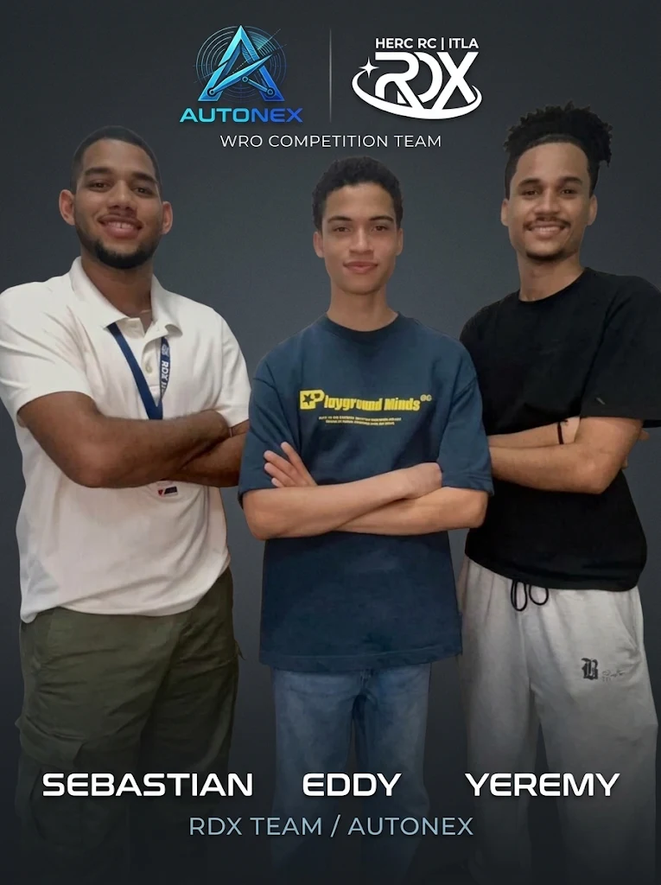

<sub>Equipo AutoNex (RDX) · Instituto Tecnológico de Las Américas · 14 de noviembre de 2026</sub>

# AutoNex

### Un coche autónomo Ackermann que mapea la pista una vez y después conduce la línea más rápida que encuentra

**WRO 2026 · Future Engineers · Self-Driving Cars** &nbsp;·&nbsp; 🇬🇧 [Read in English](README.md)



<sub>Una ronda completa simulada con el mismo firmware en C que corre en el robot. La línea roja es el cursor sobre la gráfica de velocidad.</sub>

</div>

El software está terminado y probado en simulación. La misión completa, el parqueo y el control del motor dan resultados repetibles: 24 de 24 rondas con 62 puntos y ningún contacto. El coche físico es otra historia. El chasis v2 existe en CAD y todavía no se ha impreso, así que el auto no ha rodado. En el texto, cada dato lleva su origen: medido, de CAD o supuesto.

---

## Contenido

1. [En un minuto](#1-en-un-minuto)
2. [El reto](#2-el-reto)
3. [El equipo](#3-el-equipo)
4. [El vehículo](#4-el-vehículo)
5. [Diseño mecánico](#5-diseño-mecánico)
6. [Electrónica](#6-electrónica)
7. [Software](#7-software)
8. [El simulador](#8-el-simulador)
9. [Resultados](#9-resultados)
10. [Problemas y soluciones](#10-problemas-y-soluciones)
11. [Guía del repositorio](#11-guía-del-repositorio)
12. [Compilar y ejecutar](#12-compilar-y-ejecutar)
13. [Cumplimiento del reglamento](#13-cumplimiento-del-reglamento)
14. [Lo que sigue](#14-lo-que-sigue)
15. [Créditos](#15-créditos)

---

## 1. En un minuto

La pista se sortea en cada ronda, así que no se puede programar una ruta fija. El coche trabaja en tres fases:

| Fase | Qué hace | Por qué |
|---|---|---|
| **1 · Mapear** (vuelta 1, 34 cm/s) | Recorre el campo con LiDAR y cámara y construye un mapa: paredes, cada pilar con su color y la plaza de parqueo. | Los pilares no se mueven durante la ronda. Con una vuelta alcanza para conocer toda la pista. |
| **2 · Optimizar** (vueltas 2 y 3, hasta 150 cm/s en simulación) | La Trayectoria Inteligente calcula la línea más rápida entre los pilares y una velocidad para cada centímetro. Un lazo de 50 Hz con encoders e IMU la sigue. | Es la idea de un coche de carreras: frenar solo donde un pilar o una pared no deja margen y mantener la velocidad en el resto. |
| **3 · Aparcar** (última vuelta) | La Trayectoria Inteligente le pasa el mando al planificador de parqueo, que mete el coche en la plaza con una maniobra paralela de dos cúspides. | Aparcar pide maniobras Ackermann lentas y precisas, no carrera. |

Si algo sale mal (se pierde la posición, el camino se bloquea, aparece un obstáculo), el controlador reactivo retoma el mando. La Trayectoria Inteligente nunca tiene la última palabra.

| | |
|---|---|
| Equipo | AutoNex, dentro del equipo multidisciplinario RDX |
| Institución | Instituto Tecnológico de Las Américas (ITLA), Boca Chica, Santo Domingo, República Dominicana |
| Categoría | WRO 2026 · Future Engineers · Self-Driving Cars |
| Vehículo | Ackermann con servo, tracción trasera, diferencial mecánico, dos ESP32 |
| Estado | Software validado en simulación, hardware en construcción |
| Repositorio | [github.com/Eddym06/AutoNex](https://github.com/Eddym06/AutoNex) |

---

## 2. El reto

En el Obstacle Challenge el coche da tres vueltas a una pista que se sortea en cada ronda. Tiene que pasar los letreros rojos por la derecha y los verdes por la izquierda, y terminar aparcado dentro de la plaza, completo y alineado. Sin radio durante la ronda, con dirección Ackermann (nada de girar frenando una rueda) y dentro de 300 × 200 × 300 mm y 1,5 kg.

Como la pista cambia, grabar una trayectoria no sirve de nada. Hay que leer el campo, guardarlo y después recorrerlo rápido. Eso parte el trabajo en dos problemas distintos: entender con sensores imperfectos, en movimiento y con el reloj corriendo, y optimizar sobre ese entendimiento sabiendo que el modelo del coche tiene error.

Nosotros decidimos simular antes de soldar. La pista cambiaba cada ronda y el chasis no estaba listo, así que armamos un simulador que corre el mismo firmware en C compilado a WebAssembly, con LiDAR, visión sintética, IMU, ruido y latencia. Ahí cerramos la lógica de misión y encontramos errores que en el taller nos habrían costado una tarde cada uno.

Eso tiene un límite que hay que decir: hasta que el coche ruede, todo es simulación. El agarre, el reparto de peso, el retardo del servo y la velocidad del motor son valores que pusimos a mano, no medidas.

### 2.1 La regla sorpresa

Para 2026 la WRO agregó un reto opcional al Desafío de Obstáculos. Antes de cada intento oficial el equipo dice si quiere intentarlo, y la respuesta ya no se puede cambiar una vez que el intento arranca.

Si el equipo participa, los jueces escogen un letrero, nunca el primero, y lo sustituyen por el mismo letrero en el color opuesto: el rojo pasa a verde y el verde a rojo. También lo suben o lo bajan a una altura al azar de 50 mm o 150 mm en vez de los 100 mm estándar. La base de 50 × 50 mm y la posición en el campo no se mueven. Los jueces anotan el color original y la altura modificada, y ese mismo letrero y esa altura se usan para todos los equipos de la ronda.

Ahí el coche tiene que ignorar el color que ve. Debe pasar por el lado que pedía el color original: si el letrero era rojo, pasa por la derecha aunque ahora se vea verde.

Cada paso correcto vale 5 puntos, hasta tres pasos, o sea 15 puntos. El máximo del Desafío de Obstáculos sube de 62 a 77 y el total de la competencia a 137. Los equipos que no participan conservan el campo, las reglas y la puntuación estándar.

Por eso agregamos un sensor de tiempo de vuelo VL53L0X. El LiDAR se calculó para los obstáculos estándar de 100 mm y barre en un solo plano, así que un letrero a 50 mm pasa por debajo y no aparece nunca. El ToF vigila esa franja baja y le avisa al coche de que el letrero está ahí. La altura de 150 mm no le molesta al LiDAR, pero la de 50 sí, y las dos son parte de la misma regla.

---

## 3. El equipo

Somos tres estudiantes del ITLA y cada uno lleva un subsistema:

| Rol | Nombre | Responsabilidad |
|---|---|---|
| Ingeniero de Software | [Eddy Manuel Piantini Martinez](https://github.com/Eddym06) | Percepción, localización, planificación, control, simulador y pruebas |
| Ingeniero Mecánico y de Diseño | Sebastian Josue Diaz Encarnacion | Chasis, dirección Ackermann, soportes, CAD y masas |
| Ingeniero Electrónico | Yeremy Manuel Bautista Portes | Potencia, cableado, drivers, sensores y puesta en marcha |

Cada área tiene su dueño, pero algunas decisiones no caben en una sola. El ángulo máximo de dirección lo fija la mecánica y limita la línea que puede pedir el planificador. La corriente del servo la mide la electrónica, que decide si el bus de 5,1 V aguanta o hace falta una rama aparte. Cuando una de esas conversaciones cambió algo, quedó anotado en la bitácora.

La institución es el Instituto Tecnológico de Las Américas, en Boca Chica, Santo Domingo.

El equipo salió de una competencia interna del ITLA. El equipo en el que estaban Sebastián y Yeremy quedó primero y el de Eddy quedó segundo. De los dos se escogieron los tres mejores: Sebastián y Yeremy del primero y Eddy del segundo. AutoNex es el nombre con el que competimos y RDX es el equipo multidisciplinario del que salimos.

Rafael Vargas nos acompaña como entrenador. Su apoyo es más de logística que técnico.

Es nuestra primera WRO.

---

## 4. El vehículo

### 4.1 Especificaciones

| Dato | Valor | Origen |
|---|---|---|
| Configuración | Dirección Ackermann con servo, tracción trasera, diferencial mecánico | CAD |
| Largo total | 260 mm | Medido |
| Ancho total | 130 mm | Medido con el coche armado; el chasis solo mide 120 mm |
| Alto total | ~80 mm | Medido |
| Batalla | 163 mm | Medido; el firmware todavía usa 184,5 mm |
| Vía | Pendiente | Falta medirla |
| Luz al suelo | 34 mm | Medido |
| Rueda | Ø65 × 25 mm | Comprada; el CAD la modela en 69 × 30 mm y el firmware usa 66 mm |
| Masa | Pendiente; objetivo ≤ 1,2 kg, límite 1,5 kg | Falta pesarla |
| Centro de gravedad | Pendiente; el software supone 40 mm de altura y 62 % del peso atrás | Supuesto |
| Chasis | 260 × 120 × 45,65 mm, PETG impreso en 3D, base de 4 mm | CAD |
| Cerebros | ESP32-P4 para planificación y control, ESP32-S3-CAM para visión | Ficha |
| Sensores | LiDAR 360° D500/D6, IMU MPU-6050, encoder de eje, cámara OV3660 u OV2640, ToF VL53L0X | Ficha |
| Actuadores | Servo de bus SCS0009, motor JGB37-520 de 800 rpm con encoder, puente H DRV8871 | Ficha |
| Energía | LiPo 3S 11,1 V 2200 mAh 50C, reductor XL4015 a 5,1 V | Ficha |

Faltan tres datos que solo se pueden tomar con el coche armado: masa, centro de gravedad y vía. Los iremos completando cuando el chasis esté impreso. Mientras no existan, cualquier número de pista sería una suposición.

### 4.2 Las seis vistas

<div align="center">
<table>
<tr>
<td align="center">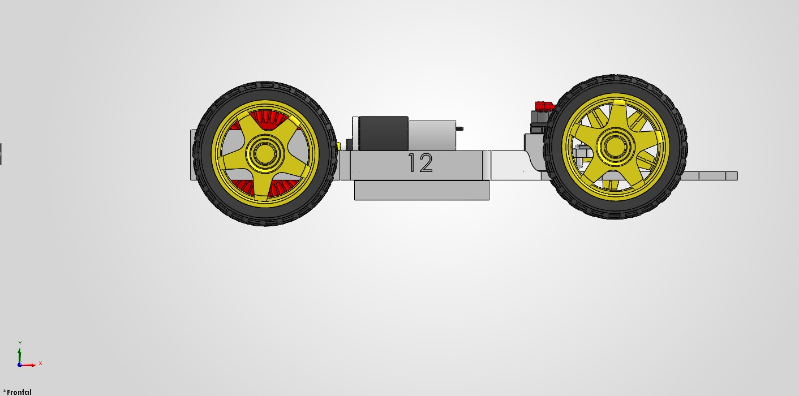<br><sub><b>Frente</b></sub></td>
<td align="center">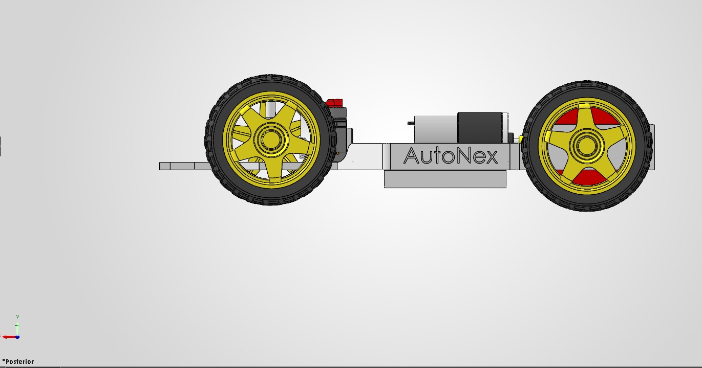<br><sub><b>Parte trasera</b></sub></td>
</tr>
<tr>
<td align="center">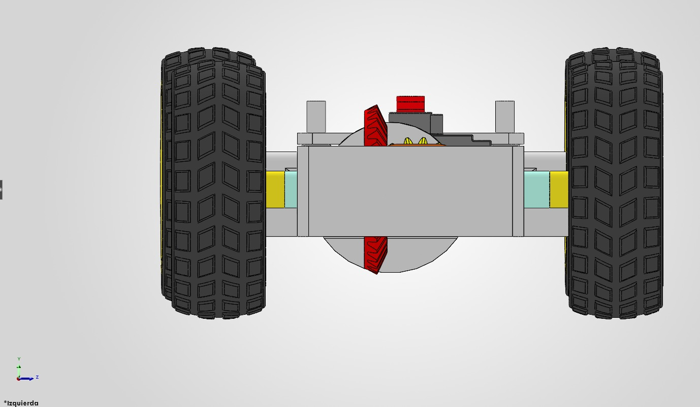<br><sub><b>Lado izquierdo</b></sub></td>
<td align="center">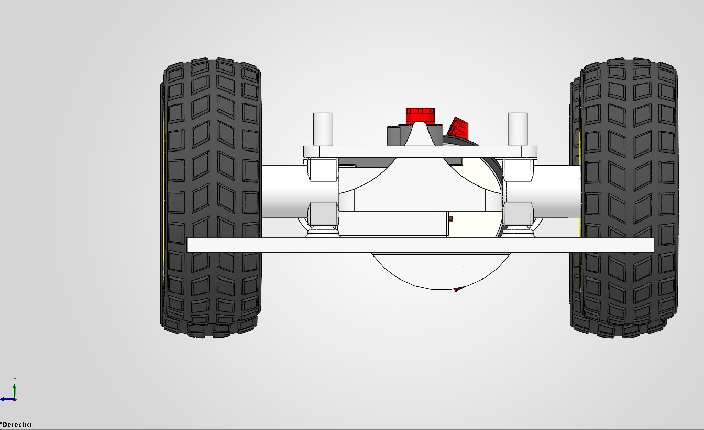<br><sub><b>Lado derecho</b></sub></td>
</tr>
<tr>
<td align="center">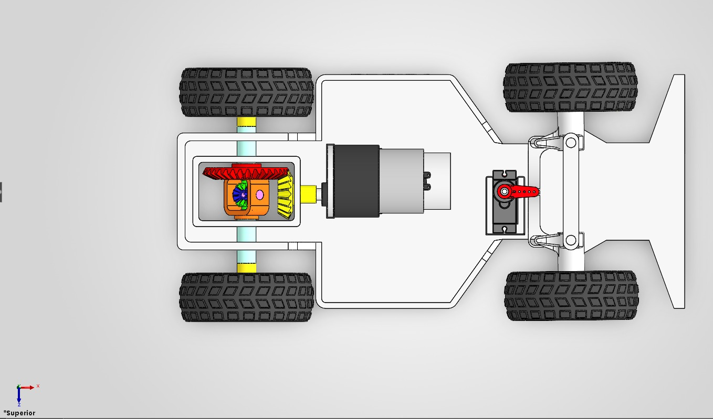<br><sub><b>Vista superior</b></sub></td>
<td align="center">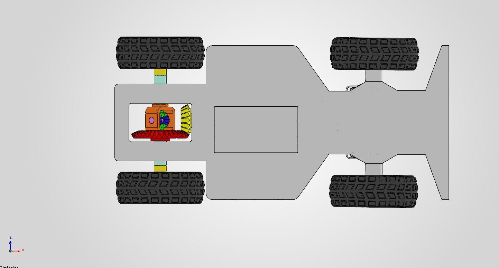<br><sub><b>Vista inferior</b></sub></td>
</tr>
</table>
</div>

Estas imágenes son renders del ensamblaje CAD completo, no fotografías del coche armado. Están aquí para mostrar la geometría y el empaquetado. En cuanto el chasis esté montado las cambiamos por fotos reales, con los mismos nombres de archivo.

<div align="center">
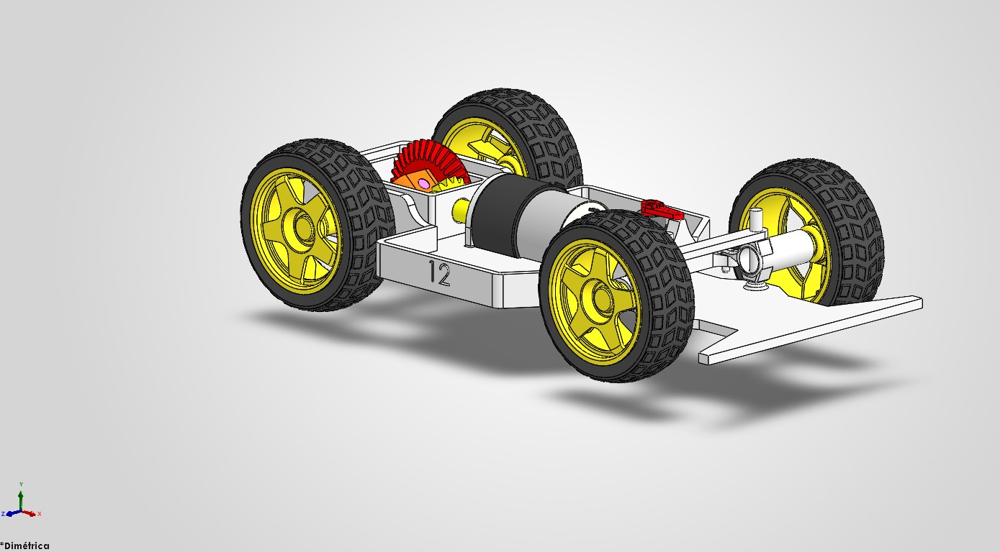
<br><sub>Vista isométrica del ensamblaje v2. No es una de las seis vistas exigidas, por eso vive en <code>docs/assets/vehicle/</code>.</sub>
</div>

### 4.3 Qué compramos y qué fabricamos

| Comprado | Fabricado en casa |
|---|---|
| LiDAR, ESP32-P4, ESP32-S3-CAM, IMU, cámara, adaptador y cinta FPC, y ToF VL53L0X | Chasis completo y sus tapas |
| Motor con encoder, servo, adaptador de servo, puente H | Engranajes, corona y carcasa del diferencial |
| Batería, reductor, portafusibles y fusible | Soportes de servo, motor, LiDAR, IMU y batería |
| Ruedas de Ø65 × 25 mm | Brazos de dirección, bieleta y portarruedas |
| Insertos roscados, tornillería M3, filamento PETG | Placa del LiDAR y retenedores de rueda |

### 4.4 Presupuesto

Los componentes principales que compramos, con el precio que pagamos. En dólares, precio de compra, sin envío ni impuestos. Cada fila es una compra, no una pieza: los packs se indican en la especificación.

| N.º | Componente | Cant. | Para qué | Modelo y especificación | Precio |
|---|---|---:|---|---|---:|
| 1 | 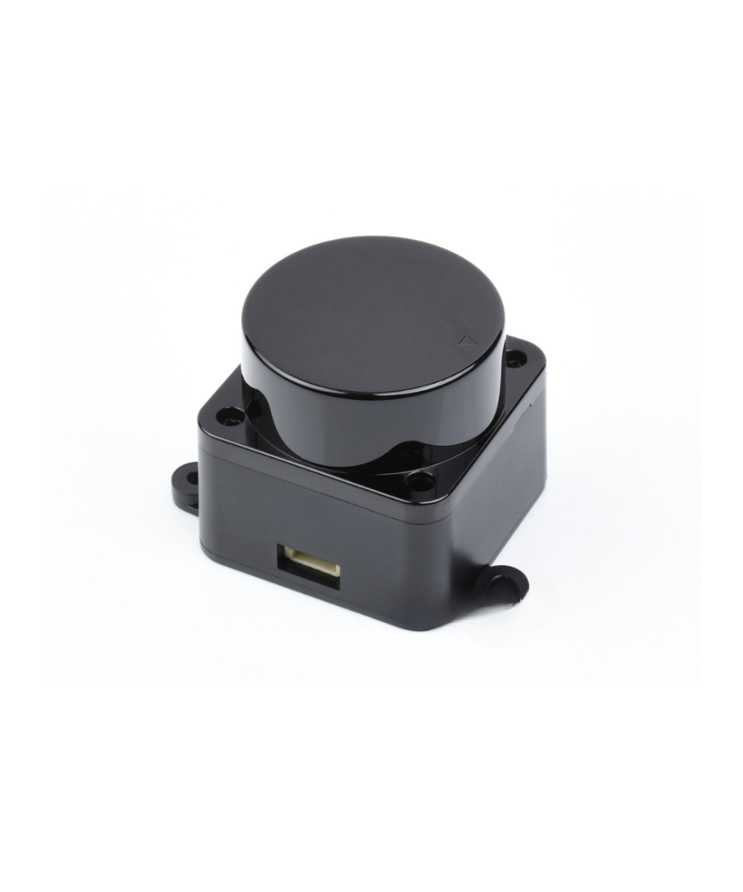<br>LiDAR 360° | 1 | Mapea paredes, pilares y la plaza | D500/D6, tiempo de vuelo, 12 m, 10 Hz, UART a 230400 baudios | $75.00 |
| 2 | 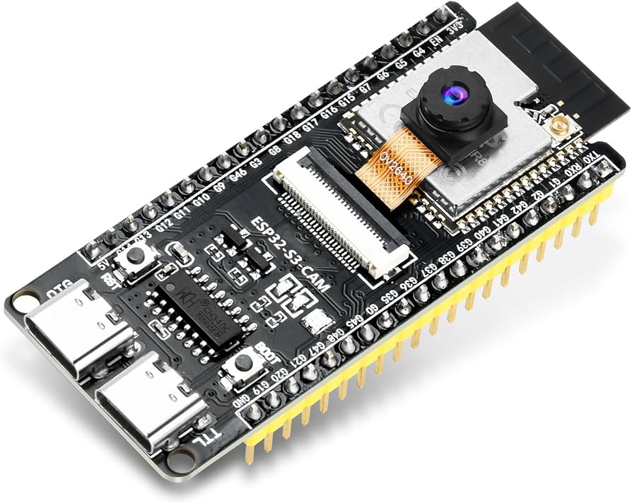<br>Placa de visión | 1 | Detecta los pilares y su color | ESP32-S3-CAM de FORIOT, OV3660 u OV2640, PSRAM | $18.00 |
| 3 | 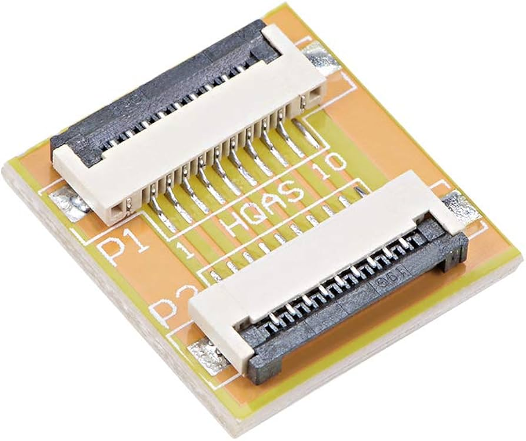<br>Adaptador de extensión de cámara | 1 | Une el flex de la cámara con la cinta larga | Placa adaptadora FPC de 24 a 24 pines, un zócalo ZIF por cara | $7.79 |
| 4 | Cinta de cámara | 1 | Lleva la señal de la cámara al morro | FFC de 24 pines, 0,5 mm, 200 mm, pack de 20 | $6.69 |
| 5 | 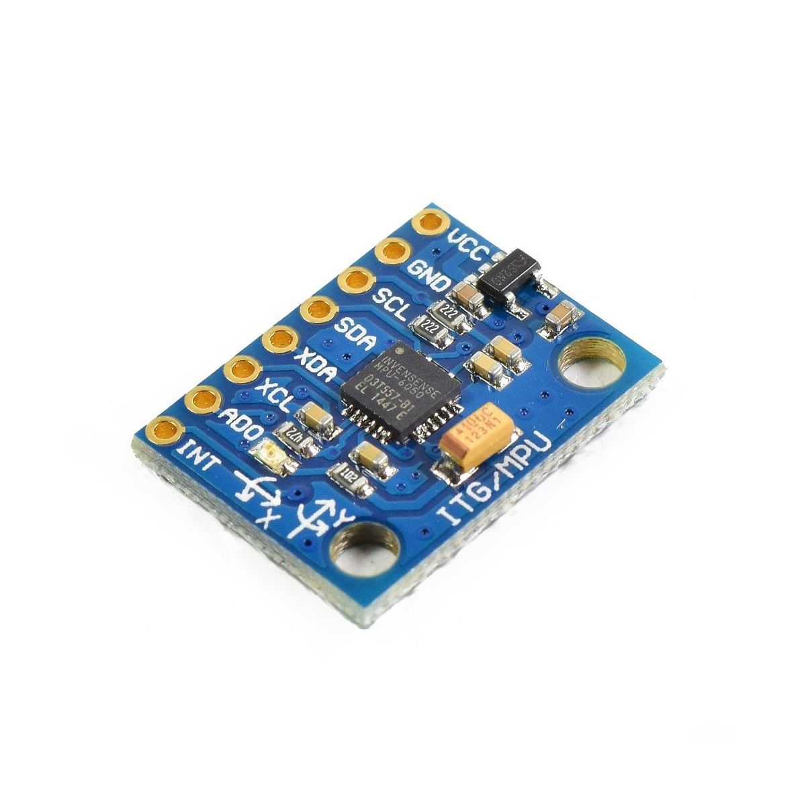<br>IMU | 1 | Rumbo y velocidad de giro | MPU-6050 en módulo GY-521, I²C en 0x68, pack de 3 | $10.00 |
| 6 | 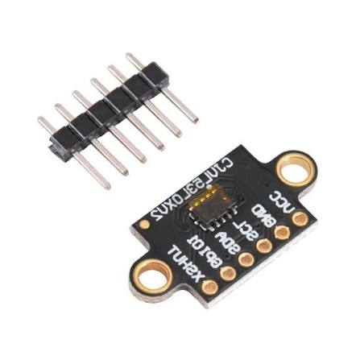<br>Sensor de tiempo de vuelo | 1 | Ve los letreros de 50 mm que el LiDAR no alcanza | VL53L0X, I²C, hasta 2 m, pack de 2 | $6.99 |
| 7 | 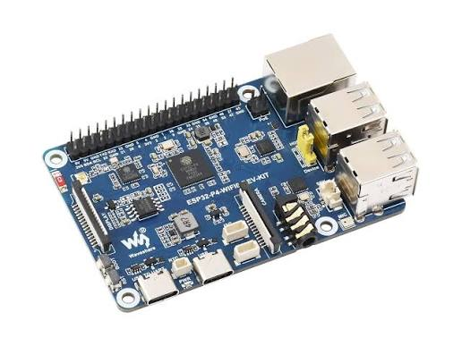<br>Placa principal | 1 | Misión, localización, planificación y control | ESP32-P4 DevKit de Waveshare, 32 MB de PSRAM, dos núcleos | $27.00 |
| 8 | 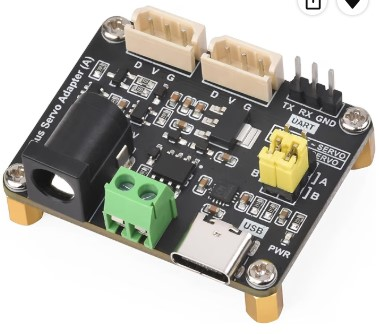<br>Adaptador de servo | 1 | Habla half-duplex con el servo | Waveshare Bus Servo Adapter (A), SKU 25514 | $13.00 |
| 9 | 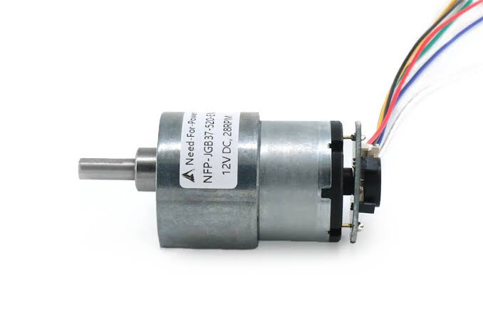<br>Motor de tracción | 1 | Tracción trasera | JGB37-520, 12 V, 800 rpm, encoder Hall, 440 cuentas por revolución | $13.00 |
| 10 | 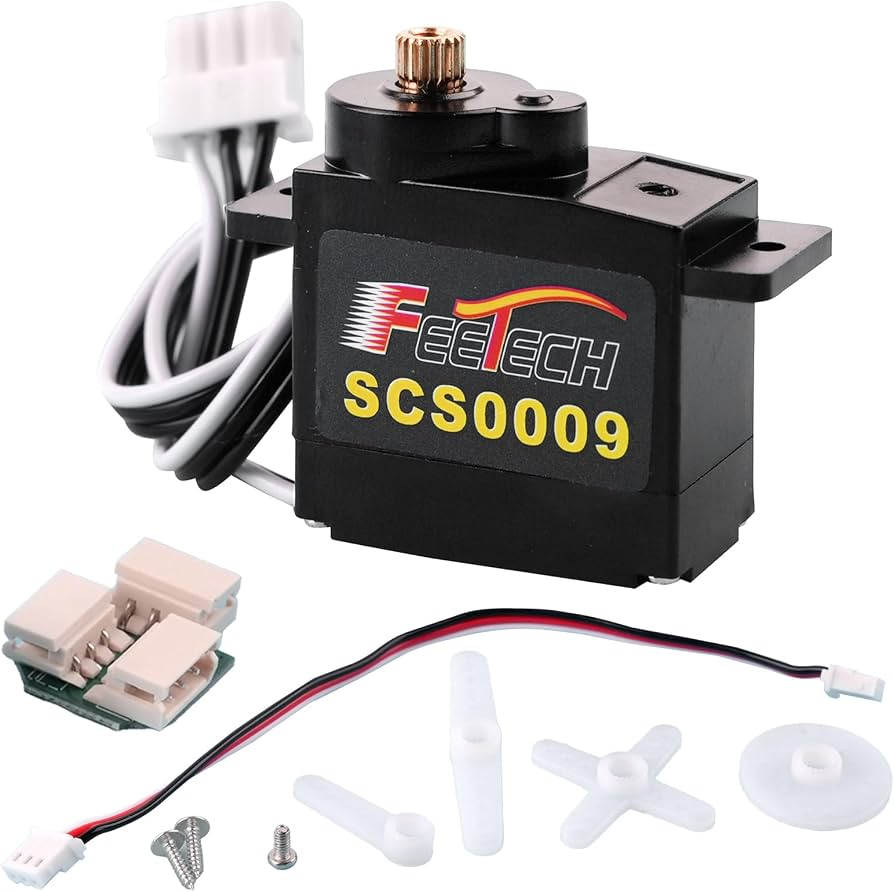<br>Servo de dirección | 1 | Gira las ruedas delanteras | Servo de bus SCS0009, engranajes metálicos, retorno de posición real | $7.00 |
| 11 | 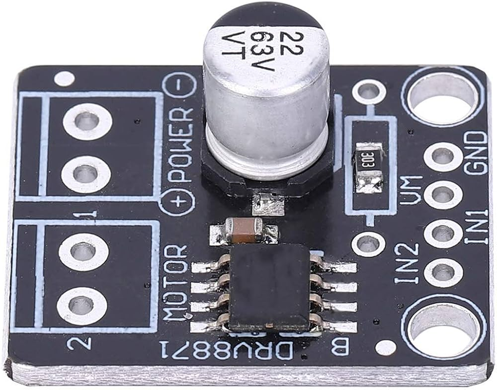<br>Puente H | 1 | Avance y retroceso | DRV8871, 3,6 A, PWM y sentido en dos pines | $9.00 |
| 12 | 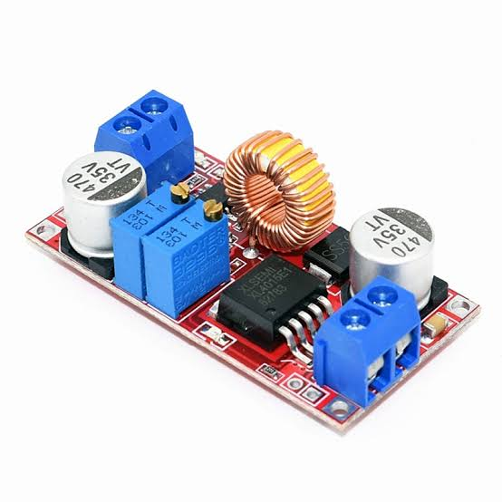<br>Convertidor reductor | 1 | Baja de 11,1 V a 5,1 V | XL4015, 5 A, no aislado | $11.00 |
| 13 | 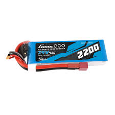<br>Batería | 1 | Fuente única | HOOVO 3S LiPo, 11,1 V, 2200 mAh, 50C, EC3, pack de 2 | $37.00 |

El presupuesto completo por categoría:

| Categoría | Total |
|---|---:|
| Percepción (LiDAR, cámara, extensión, IMU, ToF) | $124.47 |
| Control (P4, adaptador de servo) | $40.00 |
| Actuación (motor, servo, puente H) | $29.00 |
| Energía (batería, reductor, fusible) | $53.00 |
| Estructura y fabricación (filamento, ruedas, insertos, tornillería) | $43.00 |
| **Total** | **$289.47** |

Las ruedas están compradas, pero todavía no tenemos su precio exacto, así que no entran en el total. El presupuesto completo del proyecto, con transporte, inscripción y repuestos, sigue abierto.

El archivo de trabajo, con los enlaces y las fórmulas por categoría, es `BOOM.xlsx` en `Documentos_Referencia/03_Presupuesto/`.

La bitácora del 13 de noviembre habla del L298N porque en ese momento era el puente previsto. El diseño pasó después al DRV8871, que es el que está en el coche y en el presupuesto.

---

## 5. Diseño mecánico

### 5.1 De la v1 a la v2

La primera versión no falló en el papel. Falló en la pista: patinaba y derrapaba en el tren trasero. El eje no tenía rodamientos y el recorrido de dirección era corto.

| Aspecto | v1 (16 oct) | v2 (12 nov) |
|---|---|---|
| Motor | DC amarillo de doble eje, sin encoder | JGB37-520 12 V, 800 rpm, con encoder |
| Transmisión | Sin diferencial; patinaba | Diferencial y rodamientos traseros |
| Ángulo de servo | 70° programados | 62° programados |
| Chasis (CAD) | 300 × 38 × 150 mm | 260 × 120 × 45,65 mm |
| Masa | No pesada | No pesada |
| ¿Probado? | Sí, fallo por patinaje trasero | No |

Entre v1 y v2 hubo un paso intermedio: el JGB37-520 con una transmisión de dos engranajes 1:1. El eje recibía la misma fuerza y el patinaje seguía igual. Eso fue lo que nos llevó al diferencial y a los rodamientos.

No hay comparación numérica entre v1 y v2 porque no medimos peso, rigidez, torsión, deslizamiento ni ángulos de rueda. La mejora está en el diseño, no en resultados medidos.

### 5.2 Chasis y fabricación

El chasis v2 es una estructura impresa de 260 × 120 × 45,65 mm, con base de 4 mm y paredes de 3 mm en la cuna del motor. No hay chapa doblada, corte láser ni taladrado: los únicos procesos son impresión y ensamblaje.

- Base: batería, electrónica y placa del LiDAR.
- Parte trasera: cuna del motor, carcasa del diferencial, eje y rodamientos.
- Parte delantera: servo de dirección y portarruedas.
- Cubierta superior: LiDAR sobre su placa de 60 × 62 × 2 mm e IMU plana a 60 mm.

El material es PETG impreso en FDM. Lo elegimos por dos razones prácticas: aguanta mejor el calor que desprende el motor dentro de la cuna y es menos frágil cuando el coche recibe un golpe. Lo malo es que absorbe humedad, así que el filamento hay que secarlo antes de imprimir, y que deja más hilos y rebaba en las piezas.

Los parámetros de impresión (boquilla, altura de capa, perímetros, relleno, orientación) no están documentados. Hay que anotarlos con el juego definitivo para que el diseño se pueda repetir.

### 5.3 Transmisión

```
motor JGB37-520 → eje de 6 mm → piñón gear3 (Ø26,8) → corona gear_4 (Ø45,4)
→ diferencial (Base_of_gear, gear1/gear2) → Axis_of_wheel → ruedas
```

La relación calculada con los diámetros exteriores es de 1,7:1. Los archivos de SolidWorks no guardan número de dientes, módulo ni ángulo de presión, así que la relación real está pendiente de confirmar.

El eje trasero mide Ø9,8 mm y entra en rodamientos de 10 × 15 × 4 mm. El diferencial es mecánico, de engranajes cónicos, no dos motores independientes.

Ojo con esto: el firmware supone un eje trasero rígido y un solo encoder. Con diferencial, las dos ruedas pueden girar a velocidades distintas. La odometría y el lazo de la Trayectoria Inteligente tienen que validarse en el coche real.

### 5.4 Dirección Ackermann

La cadena es: servo, brazo del servo, barra de dirección, bieleta y manguetas. La barra y la bieleta comparten una separación entre agujeros de 50 mm.

El brazo del servo tiene cinco agujeros a 2,5 mm. Los más cercanos dan menos recorrido y más fuerza; los más lejanos, lo contrario. El ángulo programado es de 62° en v2 y era de 70° en v1. Cuidado con la diferencia: 62° es el giro del eje del servo, no el ángulo de la rueda.

| Dato | Valor | Estado |
|---|---|---|
| Ángulo programado del servo | 62° en v2 | Diseño |
| Ángulo máximo de rueda | No medido; el firmware usa 40° | Pendiente |
| Radio de giro | No medido | Pendiente |
| Convergencia (toe) | No medida | Pendiente |
| Separación barra y bieleta | 50 mm | CAD |

La geometría Ackermann de verdad exige que la rueda interior gire más que la exterior. El CAD lo plantea con una barra y una bieleta comunes, pero sin medir los ángulos izquierdo y derecho a tope de recorrido no podemos afirmar que cumpla. Es una de las primeras medidas de la puesta a punto.

### 5.5 Masa y centro de gravedad

No hemos pesado el coche ni medido el centro de gravedad. El CAD de v1 reporta 377,7 g de piezas y 705,6 g de ensamblaje, pero sin material asignado y con densidades imposibles: la rueda sale a 7,8 g/cm³ y el chasis a 1,0 g/cm³. No sirve como estimación.

El software trabaja con un objetivo de 1,2 kg o menos, 40 mm de altura del centro de gravedad y 62 % del peso atrás. Los tres son supuestos. El límite del reglamento es 1,5 kg.

Para medirlo usaremos una báscula para la masa total y dos pesadas cruzadas para repartir el peso entre ejes. Con la altura de cada eje conocida se calcula el centro de gravedad. Ese dato entra directo en el planificador y en el control del motor.

### 5.6 Soportes de sensores y electrónica

| Elemento | Montaje |
|---|---|
| LiDAR | Sobre placa de 60 × 62 × 2 mm, a 60 mm de altura, plano |
| IMU | Plano a 60 mm, junto al LiDAR |
| Cámara | En el morro, separada de la placa S3 por un adaptador FPC de 24 pines y una cinta de 200 mm; altura e inclinación pendientes |
| Batería | Modelada en CAD como 103 × 34 × 24 mm |
| Electrónica | Parte trasera, junto al motor |
| Servo | Dos tornillos M2 en las orejas; el brazo va en la estría con tornillo central |
| Motor | Atornillado a una base plana; cuna cilíndrica de Ø37 mm con pared de 3 mm |

### 5.7 CAD y piezas

`CAD_File/` tiene 30 archivos de SolidWorks y pesa 47,7 MB. Está dividido en cuatro carpetas:

| Carpeta | Contenido |
|---|---|
| `Main part` | `Car assembly.SLDASM`, chasis, ruedas, servo y dirección |
| `Diferencial` | Engranajes, ejes, base y ensamblaje del diferencial |
| `Dc motor` | Modelo y eje del motor |
| `Electronic part` | Batería, ESP32-P4, LiDAR y un MG90S suelto |

El ensamblaje principal es `Car assembly.SLDASM`, dentro de `Main part`. Ahí están el chasis, las ruedas `Wheel D65x25`, el servo `Feetech SCS0009 v9` y todo el tren delantero.

En `Electronic part` quedó un `Servo-MG90S.SLDPRT` que ya no corresponde al coche. El servo que usamos es el SCS0009, y su ensamblaje está en `Main part`.

### 5.8 Problemas abiertos de mecánica

1. Rodamientos delanteros o traseros. El manual de v2 los ubica en las manguetas delanteras y Sebastián corrige que van en el tren trasero. El CAD todavía muestra asientos delanteros, así que hay que resolverlo antes de fabricar.
2. Batalla. El firmware usa 184,5 mm y la medida real es 163 mm. Son 21,5 mm, entre un 12 y un 13 % de la batalla, y afecta cada giro, el parqueo y la línea simulada. Es el primer valor que hay que corregir.
3. Diámetro de rueda. La rueda comprada es de 65 mm, el CAD la modela en 69 y el firmware usa 66. Un 6,15 % de diferencia en circunferencia entra directo en la odometría.
4. Ángulo de dirección. El servo programa 62° y el firmware limita la rueda a 40°, sin un mapeo medido entre los dos.
5. Modelo del computador. El archivo se llama `Esp32p4`, pero el modelo de dentro es una Raspberry Pi 4B de 85 × 56 mm. Hay que renombrarlo o sustituirlo.

---

## 6. Electrónica

### 6.1 Bloques

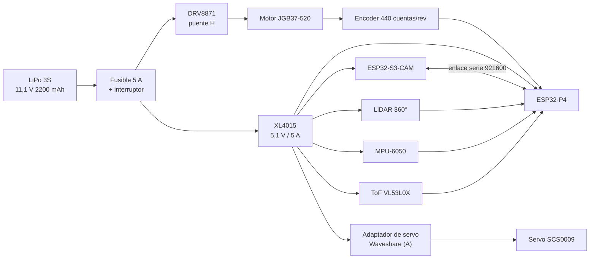

### 6.2 Potencia

La batería entra por el XT60H (EC3 con cable adaptador), pasa por un fusible de 5 A y el interruptor principal. De ahí salen dos ramas: una directa al DRV8871 a 12,6 V y otra al XL4015 a 5,1 V.

El bus de 5,1 V alimenta las dos placas, el LiDAR, la IMU, la lógica del puente y el adaptador del servo. El adaptador no regula: entrega lo que entra por DC+, y 5,1 V está dentro del rango de 4 a 7,4 V del SCS0009. Lleva un condensador de 470 µF entre DC+ y DC− para absorber el pico del servo.

| Carga del bus de 5,1 V | Típica | Pico |
|---|---:|---:|
| ESP32-P4 | 350 mA | 550 mA |
| ESP32-S3-CAM | 180 mA | 300 mA |
| LiDAR | 290 mA | 320 mA |
| Servo | 150 mA | 1000 mA |
| Adaptador, lógica del puente e IMU | 49 mA | 64 mA |
| ToF VL53L0X | 20 mA | 40 mA |
| **Total** | **≈ 1,0 A** | **≈ 2,2 A** |

El XL4015 está especificado a 5 A, pero sin disipador no conviene pasar de 2,5 A. Con el motor incluido, la batería entrega como máximo unos 3,5 A de pico, muy por debajo de lo que puede dar un paquete de 2200 mAh y 50C.

Todas las tierras van a un solo punto. Una GND flotante entre motor y señal se convierte en datos basura.

### 6.3 Motor y encoder

El motor usa un solo canal del DRV8871. Las órdenes van por IN1 e IN2 con PWM en las entradas, y el puente entrega hasta 3,6 A.

| IN1 | IN2 | Acción |
|---|---|---|
| PWM | 0 | Avance |
| 0 | PWM | Retroceso |
| 0 | 0 | Rueda libre |
| 1 | 1 | Freno duro; no se usa para detener |

El conector de seis pines del encoder está serigrafiado como M1, GND, C1, C2, VCC, M2. El esquema del vendedor no coincide, así que lo comprobamos con multímetro: M1 y M2 son el único par con baja resistencia. Los canales llevan pull-ups de 4,7 kΩ a 3,3 V.

Con 440 cuentas por revolución, cada cuenta equivale a 0,047 cm de avance. Ese es el grano fino con el que la odometría estima la posición entre escaneos del LiDAR.

### 6.4 Servo de dirección

El SCS0009 habla por un solo hilo half-duplex. El adaptador de Waveshare separa TX y RX, mantiene la respuesta a 3,3 V y reparte la alimentación. Los dos jumpers van en la fila A (UART). TX va a GPIO26 y RX a GPIO21, sin cruzarlos: RX con RX y TX con TX.

El adaptador no regula la tensión del servo. Si el LED PWR no enciende, la solución es alimentar solo el adaptador desde una rama de 6 V, no subir todo el bus.

### 6.5 Mapa de pines del P4

| Función | GPIO | Nota |
|---|---|---|
| Motor IN1 / IN2 | 32 / 33 | PWM a 1 kHz |
| Servo TX / RX | 26 / 21 | Al adaptador, 3,3 V |
| Encoder A / B | 27 / 23 | Pull-up de 4,7 kΩ |
| LiDAR RX | 22 | 230400 baudios |
| Enlace S3 RX / TX | 38 / 37 | Desde GPIO1 y hacia S3 GPIO14 |
| IMU SDA / SCL | 7 / 8 | I²C, dirección 0x68 |
| ToF SDA / SCL | Pendiente | I²C, dirección 0x29, mismo bus que la IMU |
| Botón START | 5 | A GND, pull-up interno |
| Batería (futuro) | 20 | ADC, divisor pendiente |

Quedan libres 2, 3, 4, 6, 46, 47 y 48. No usar 24 y 25 (USB OTG/JTAG), 0, 34, 35 y 36 (arranque), ni los pines de audio, microSD, Ethernet y LED de la placa.

### 6.6 Cámara y extensión FPC

La S3-CAM no va donde va la cámara. El CAD v2 reserva el morro para el módulo y deja la placa atrás, con el resto de la electrónica. Para separarlos usamos dos piezas: una placa adaptadora FPC de 24 a 24 pines, con un zócalo ZIF en cada cara, y una cinta FFC de 24 pines, 0,5 mm y 200 mm. El flex propio de la cámara entra en uno de los zócalos y la cinta sale del otro hacia la S3-CAM, así que el módulo queda en el frente sin mover el conector de la placa.

El adaptador une los contactos uno a uno y no cambia su orden ni su cara. La cinta es del mismo tipo que el flex original: 24 contactos y paso de 0,5 mm. Un flex de Raspberry Pi Zero Camera no sirve, porque tiene 22 pines y usa MIPI CSI-2, otra señal y otro conector.

La longitud es corta a propósito. La cámara va por DVP, ocho bits en paralelo, y a 20 MHz un flex largo se comporta como antena: aparecen píxeles desplazados y cuadros partidos. Con 200 mm debería alcanzar. Si aparecen errores, lo primero es bajar el reloj de la cámara, no alargar el cable.

### 6.7 Puesta en marcha

1. Sin batería, comprobar que 12 V y 5 V no tienen continuidad a GND. Alimentar el XL4015 desde una fuente de laboratorio de 12 V y ajustarlo a 5,1 V en vacío. Repetir con una resistencia de 10 Ω y volver a medir en el pin de la placa.
2. Alimentar solo la placa y confirmar que arranca. Conectar el LiDAR y verificar que gira y entrega datos. Conectar la IMU y comprobar la dirección 0x68.
3. Alimentar la S3-CAM y comprobar el enlace a 921600 sin cuadros partidos. Girar el eje del motor a mano y confirmar que el encoder cuenta en los dos sentidos.
4. Antes del servo: jumpers en A, 5,1 V entre DC+ y DC−, 5,1 V entre V y G y LED PWR encendido. Solo entonces conectar el servo y moverlo con las ruedas en el aire.
5. Por último el motor, en el aire y al 10 % de PWM.

Si algo falla, desconectamos lo último añadido y retrocedemos un paso. Así el error aparece donde está y no en medio de los veinte cables del coche.

### 6.8 Pendientes de electrónica

- Medir la corriente real del motor con el coche completo. Los 2,5 A de bloqueo son de la hoja de datos.
- Probar el servo a 1 Mbit/s con el adaptador y el cable reales, con el servo montado.
- Medir el RX del adaptador con osciloscopio (0 a 3,3 V) antes de conectar GPIO21.
- Medir el par del servo a 5,1 V con la dirección armada. Si no alcanza, usar una rama de 6 V.
- Confirmar que el regulador interno del adaptador arranca a 5,1 V (LED PWR).
- Instalar el divisor de tensión en GPIO20 para vigilar la batería.
- Probar la extensión de cámara, con el adaptador y la cinta de 200 mm, con el coche armado y fijar altura e inclinación de la cámara.
- Confirmar si la cámara de la S3 es OV3660 u OV2640 y hacer una prueba continua de tres minutos.

---

## 7. Software

### 7.1 Dos cerebros

El ESP32-P4 lleva la misión: mapa local, localización, planificación, parqueo y control. El ESP32-S3-CAM solo mira. Procesa la imagen, detecta los pilares y su color, y manda los objetos por un enlace serie a 921600 baudios. Esa separación deja el P4 libre para decidir a 10 Hz sin que una imagen lenta le robe tiempo.

### 7.2 El lazo de control

El lazo del P4 es cooperativo y tarda alrededor de 1 ms. Cada decisión ocurre una vez por escaneo del LiDAR, unas 10 veces por segundo: se reconstruye el mapa local, se actualiza la pose, se elige la orden y se escriben los actuadores. Entre escaneos, el lazo rápido de la Trayectoria Inteligente propaga la pose a 50 Hz con encoders y giroscopio. La IMU se muestrea a 400 Hz y se integra a 100 Hz. Un watchdog de 300 ms pone la orden a cero si dejan de llegar escaneos o datos del giroscopio.

El flujo completo:

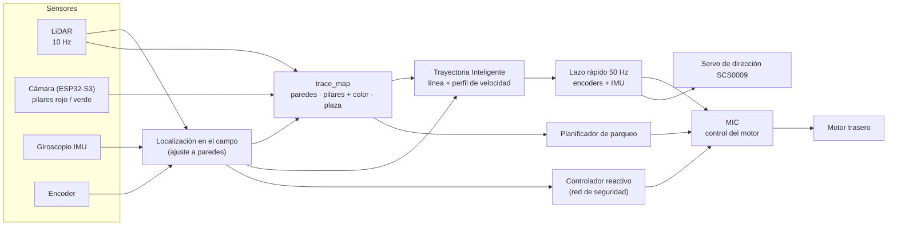

### 7.3 Máquina de fases

| Fase | Qué hace |
|---|---|
| `IDLE` | Espera el botón físico |
| `RUN` | Tres vueltas: reactivo en la primera, Trayectoria Inteligente en las siguientes |
| `PARK_SEARCH` | Busca la plaza contra la pared exterior |
| `PARKING` | Entra en la plaza con dos cambios de sentido |
| `PARK_EXIT` | Sale de la plaza si el coche arranca dentro |
| `DONE` | Detiene el coche cuando la meta está cumplida |

La seguridad es la misma en todas las fases. Si el LiDAR o el giroscopio fallan, la orden de velocidad va a cero. El arranque es físico, con el botón en GPIO5. La página web puede detener el coche, pero no arrancarlo, y así cumplimos la regla de no usar radio durante la ronda.

### 7.4 Percepción, mapa local y localización

El mapa local es una rejilla de 160 × 160 celdas de 2,5 cm, o sea 4 × 4 m, que se reconstruye en cada escaneo con raycasting de Bresenham. La cámara aporta hasta 12 objetos con color, centro y profundidad. Si el LiDAR no confirma el retorno, caducan.

`arena_localizer` ajusta la pose contra 8 segmentos de pared con Gauss-Newton y pesos de Huber, y rechaza saltos mayores de 30 cm u 8°. `park_localize` usa la pared de la plaza, su abertura y los topes.

La odometría combina el ángulo de la rueda con el rumbo del giroscopio, detecta deslizamiento y se reinicia tras un hueco de muestras mayor de 0,5 s. El controlador adelanta la pose por la latencia del LiDAR, que son 0,10 s.

En simulación el error medio es de 2,3 cm y el máximo de 3,5 cm.

Hay una limitación que viene del hardware. Los retornos a 0 mm o a más de 12 m se descartan y el modo ciego no se activa. Un obstáculo pegado al morro simplemente no aparece. Esa rama existe solo en el simulador.

### 7.5 El mapa persistente

<details>
<summary>Cómo se construye y qué guarda</summary>

Es una rejilla de 4 × 4 m con celdas de 2,5 cm en el marco del campo. Cada vuelta suma retornos del LiDAR con un peso que hace que las pasadas repetidas se promedien en vez de ensancharse. Los objetos, pilares y topes del parqueo, tienen id estable, posición y color. La plaza se detecta por geometría.

Se escribe en una partición de flash al final de la ronda, no durante, porque escribir en flash detiene la CPU. El código de guardado está escrito pero no probado en el P4, y la precisión del mapa a 34 cm/s de mapeo no está medida. En simulación el error RMS es de 0,78 cm.

El detalle técnico está en [`simulator/TRACE_MAP.md`](simulator/TRACE_MAP.md).

<div align="center">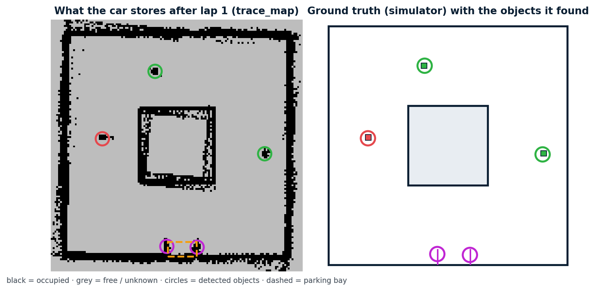</div>

</details>

### 7.6 Trayectoria Inteligente

<details>
<summary>Qué tiene de inteligente</summary>

- Descubre la línea, no se la damos. Minimiza el tiempo real de vuelta sobre el espacio libre que dejan los pilares, respetando rojo a la derecha y verde a la izquierda.
- Conoce el coche: peso trasero, círculo de fricción, límite de dirección de 40°, velocidad del servo y la huella del chasis de 26 × 13 cm. El morro sobresale 22 cm por delante del eje trasero.
- Los márgenes crecen con la velocidad. El error de pose y de seguimiento sube al acelerar, así que los huecos estrechos se cruzan despacio y los amplios deprisa.
- Aprende el agarre vuelta a vuelta. Empieza prudente y solo sube el agarre que supone mientras el coche va limpio.
- Encoders e IMU cierran el lazo. Entre escaneos del LiDAR, que a 150 cm/s son 15 cm, la pose se propaga a 50 Hz. Sin eso el error lateral se duplica.

El plan cuesta unos 0,4 s en un PC. En el P4 no hemos medido el tiempo, así que el plan se corta en trozos de unos 10 ms para no bloquear el lazo.

Una advertencia: el simulador modela un servo MG90S, pero el servo del coche es un SCS0009. Antes de confiar en la línea que calcula la Trayectoria Inteligente hay que medir velocidad, retardo y par del servo real.

</details>

### 7.7 MIC, el control del motor

MIC (Motor Intelligent Control) es el control central de tracción. Usa un modelo físico del JGB37-520 con fuerza contraelectromotriz, fricción, batería, caída del puente y límite de corriente. Un observador de tercer orden predice entre cuentas del encoder y se corrige con el modelo, y un planificador con adelanto decide cuándo frenar.

Tiene dos modos de frenado: progresivo, sin tensión inversa, y agresivo, con tensión inversa. El agresivo estaba limitado por los 2 A del L298N que se documentó entonces. El DRV8871 admite 3,6 A, así que ese límite hay que recalibrarlo.

| Prueba con motor simulado | Resultado |
|---|---|
| Ruta de 300 cm con curva y parqueo | 300,8 cm en 8,8 s, frente a unos 11,4 s con rampas conservadoras; 0 s de tensión inversa; 2,0 A de pico |
| Misma ruta con R +15 %, masa +30 %, fricción +40 % y batería baja | Igual de preciso, 0 s de frenado activo |
| Parada desde 100 cm/s | Progresivo: 38,6 cm en 1,12 s. Agresivo: 25,4 cm en 0,52 s |

MIC está probado solo contra un motor simulado. Está integrado en `hw_motors.c` detrás de `CONFIG_WRO_USE_MIC` y desactivado. Los parámetros que usa son supuestos: resistencia 2,6 Ω, masa 1,2 kg, fricción seca 0,6 N y viscosa 0,5 N·s/m.

### 7.8 Parqueo

La plaza mide 1,5 veces el largo del coche. El coche entra con una maniobra paralela de dos cúspides: avance, S en reversa y avance de acoplamiento, siempre dentro del límite de dirección.

<div align="center">
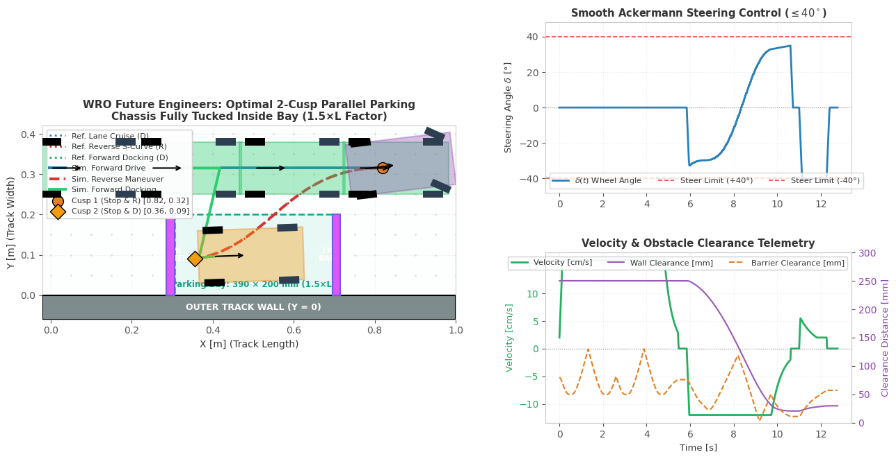
</div>

- Planificador: A* sobre una rejilla de pose de 121 × 71 × 36 (1 cm, 10°), primitivas de 3,5 cm y dirección en {−1, 0, +1}.
- Coste: 3,5 cm por paso, 1,1 veces en reversa, más 12 cm por cada cambio de sentido.
- Meta de entrada: las cuatro esquinas dentro de la plaza con 0,5 cm de holgura y |θ| ≤ 4°. La salida se da por buena con |θ| ≤ 10°.
- Entrada normal: simétrica a la salida, cruzando el carril hasta 2 cm por delante y 1,5 cm más lejos de la pared que la pose donde terminó la salida.
- Planes candidatos: cinco, si la pose de llegada no tiene plan. Si la medida se solapa con la plaza, se usa la pose libre más cercana, hasta 2 cm y 6°.
- Arcos: se cortan por rumbo de giroscopio y la dirección se aplica con el coche detenido.

El resultado en simulación es de 2 a 5 pasadas, unas 4 de media, en 16 a 17 s. En las semillas 1 a 8 no hubo fallos. En las semillas 9 a 32 fallaron 5 de 56, un 9 %, cuando antes fallaba el 17 %.

### 7.9 Control reactivo y seguridad

<details>
<summary>La red que nunca deja de funcionar</summary>

El planificador reactivo evalúa 343 caminos de tres arcos de 20 cm y los puntúa por holgura, desviación lateral, rumbo, curvatura, avance y escalón. Usa tres capas de histéresis: banda de empate de 2 puntos, preferencia por la acción anterior y, en empate, el giro más suave.

Si no hay camino, hace una maniobra de escape y, si se agota, se detiene. El giro sobre el sitio se usa tras 2 s sin camino y una desviación de rumbo de 15° o más, si hay espacio.

El watchdog de 300 ms pone la orden a cero si faltan datos del LiDAR o del giroscopio. No detecta por sí solo un encoder desconectado, y eso sigue pendiente. El arranque es físico; la página web solo puede detener el coche.

</details>

### 7.10 Decisiones descartadas

Documentar lo que no funcionó también es parte del método. Estas ideas se probaron y se dejaron fuera:

| Idea | Por qué se descartó |
|---|---|
| Línea de carrera histórica (`race_line`) | Con 7 letreros no ahorraba tiempo y reducía la fiabilidad |
| Mirar pilares sin color (`peek`) | Bajaba las pistas perfectas de 95 a 89 en el banco |
| Frenado por holgura (`tight_clear`) | Costaba unos 18 s y rompía el parqueo |
| Maniobra de tres segmentos | El patrón de dirección estaba invertido y, corregido, no encontraba solución |
| S en dos arcos desde el carril | La esquina trasera enganchaba el tope a 6,5 cm |

---

## 8. El simulador

### 8.1 Qué es

El simulador no es un modelo aparte. Carga `wro_core.wasm`, que es el mismo código C del P4 y del S3 compilado a WebAssembly. Lo que se valida ahí es el firmware real, no una copia en JavaScript.

El mundo avanza con dt de 0,01 s, 8 ms de retardo de proceso y 12 ms de retardo de orden. El coche es un modelo de bicicleta con servo de primer orden a 420°/s y τ de 0,045 s, motor con τ de 0,16 s, aceleración máxima de 180 cm/s², ganancia 0,94, deslizamiento por saturación y colisión deslizante.

### 8.2 Qué modela y qué no

| Sí modela | No modela, o lo hace distinto al coche |
|---|---|
| LiDAR con ruido y latencia | El LiDAR real no emite modo ciego ni puntos a menos de 5 cm |
| Visión sintética con colores | La cámara real puede fallar por luz o por la cinta |
| IMU y encoder con ruido | El coche real tiene un solo encoder; el simulador promedia dos ruedas |
| Servo MG90S de primer orden | El servo real es un SCS0009 |
| Motor JGB37-520 con modelo físico | Los actuadores reales reciben órdenes en pasos de 100 ms |
| Topes, paredes y letreros | El servo real tiene topes, no una rampa |
| Juez con las reglas de puntuación | El límite de velocidad del hardware es 40 cm/s |

Hay cosas que pueden funcionar en el simulador y fallar en el coche: el servo configurable contra el servo con topes, un encoder contra dos, el LiDAR sin puntos cercanos y la espera de 50 muestras limpias del giroscopio antes de arrancar.

### 8.3 Cómo ejecutarlo

```bash
python simulator/build_simulator.py          # genera simulator/build/simulador.html
# ábrelo, marca "trayectoria inteligente (IT)" y pulsa "Simular"
node simulator/tests/test_it_mission.js      # ronda completa con IT: puntos, sin contactos, cesión
```

<div align="center">
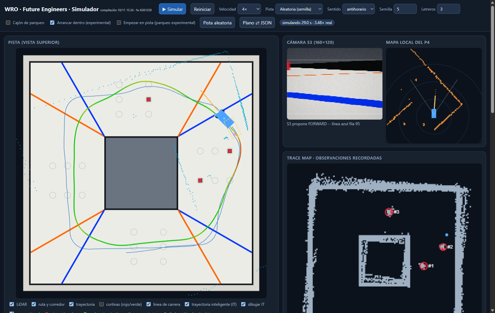
<br><sub>El simulador mientras conduce IT: línea planificada en verde, recorrido real en azul, vista de la cámara, mapa local y mapa persistente.</sub>
</div>

Hay más pruebas: geometría y sensores, contrato entre firmware y simulación, encoder de eje, entrada y salida del cajón, interfaz y misiones completas. Todas están listadas en [`simulator/README.md`](simulator/README.md).

Un paso de simulación tarda 1,5 ms en el navegador. Se sostiene a 4× y a 8× no.

Grabamos una ronda completa el 10 de noviembre: [youtu.be/XHigaxjfDUE](https://youtu.be/XHigaxjfDUE). Es simulación, no una prueba en pista.

---

## 9. Resultados

### 9.1 Simulación

<div align="center">
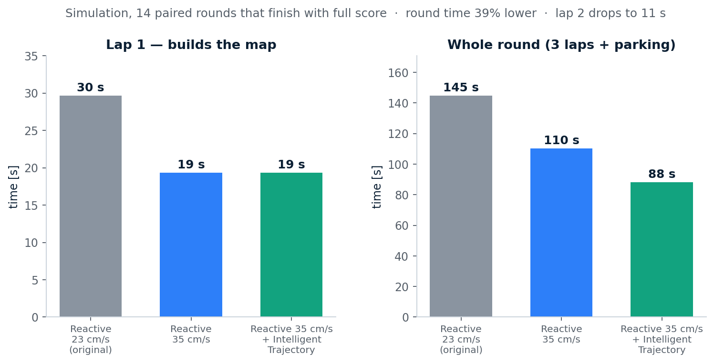
</div>

| Prueba | Resultado |
|---|---|
| Misión completa en pistas factibles, 3 letreros, 24 rondas | 24 de 24 con 62 puntos y 0 contactos, media de 118,9 s |
| Entrada al parqueo, semillas 1 a 8 | 2 a 5 pasadas, unas 4 de media, 16 a 17 s, 0 fallos |
| Entrada al parqueo, semillas 9 a 32 | 5 fallos de 56, un 9 %, cuando antes era el 17 % |
| Vuelta 1 de mapeo a 34 cm/s | 19,4 s frente a 29,6 s a la velocidad anterior |
| Trayectoria Inteligente en misión completa | 12 de 12 con 62 puntos, 11 de 12 antes del último arreglo |
| Trayectoria Inteligente con MIC | 7 rondas completas, 62 puntos, 0 contactos, 151 cm/s de punta |
| Banco de 100 pistas, etapa anterior | 99 de 100 en ajuste y 95 de 100 en validación, 0 contactos |
| Localizador y mapa | 2,3 cm de media y 3,5 cm máximo, 0,78 cm RMS |
| Barrido del controlador en el P4 | 84,5 ms, p95 92,5, antes 142,6 ms |
| Plan de la Trayectoria Inteligente en el P4 | 18 s, ahora 4,2 s con la evaluación incremental |
| A* del parqueo en el P4 | de 11 a 27 s, ahora de 5 a 11 s |
| Cámara de la S3 | 71,4 fps estables durante 120 s, 0 tablas malas y sin huecos de secuencia |
| 48 rondas con 5 letreros, simulador con los costes medidos del P4 | 62 puntos y 0 contactos, 90,3 s por ronda, vueltas de 21,6 s y 10,8 s |

<div align="center">
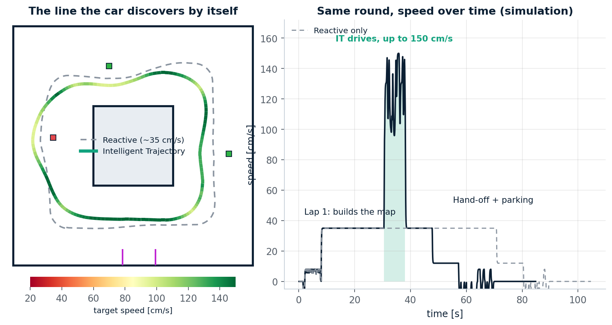
</div>

En pistas aleatorias factibles, las que dibuja la interfaz, 24 de 24 rondas terminan con 62 puntos y sin contactos. El sentido cw tarda unos segundos más que ccw, porque la salida acaba con otro rumbo y el plan de parqueo cw sale más largo. El antiguo "1 de cada 3 acaba en wrong-side" venía de que la herramienta de medida sorteaba pistas que ningún chasis puede pasar, como un letrero a 45 cm de la salida del cajón. La precisión del mapa a 34 cm/s de mapeo todavía no está medida. El planificador tarda unos 0,4 s en un PC; en el P4 tardaba 18 s y ahora tarda 4,2 s, por eso el trabajo se corta en trozos y se pasa al segundo núcleo.

Las medidas del 16 de noviembre cambiaron dos cosas. Primero, el C en el P4 corre unas 40 veces más lento que en un PC, así que el barrido del controlador de 142 ms no cabía en el presupuesto de 100 ms; ahora son 84,5 ms. Segundo, el simulador aplica esos costes reales por defecto, así que sus tiempos dejaron de ser optimistas: 90,3 s en vez de 89,1 s, y la diferencia entre una ronda ideal y una real es pequeña. El detalle está en `MEDIDAS_HARDWARE_P4.md`.

### 9.2 Hardware

Tres cosas se han medido en hardware real. La cámara de la S3 corre a 71,4 fps durante 120 s sin tablas malas. El motor gira a 844 rpm sin carga a 12,0 V, y por eso la documentación usa 800 rpm. El P4 se cronometró con el firmware real: el barrido del controlador, el plan de la Trayectoria Inteligente y el A* del parqueo ya tienen números de verdad, y la memoria y el mapa de pines se comprobaron contra la placa.

Los motores, encoders, LiDAR, IMU, servo y el guardado del mapa en flash están integrados en el firmware, pero no se han probado en el coche. La electrónica de potencia está documentada y se está armando, con las mediciones finales pendientes. El VL53L0X está comprado y su uso definido, pero todavía no está cableado ni en el firmware.

El chasis v1 sí se probó y falló por patinaje trasero. El v2 sigue sin probarse, sin pesar y sin medir centro de gravedad ni ángulo real.

### 9.3 Riesgos al pasar al coche real

| Riesgo | Por qué |
|---|---|
| Servo | El simulador modela un MG90S; el coche lleva un SCS0009 y sus valores reales hay que medirlos |
| Agarre | µ, reparto de peso y altura del centro de gravedad son supuestos. Si el agarre real es 0,40 o menos, la Trayectoria Inteligente falla |
| Un solo encoder | El simulador promedia dos ruedas; el deslizamiento y el diámetro efectivo cambian la odometría |
| LiDAR | No emite modo ciego ni puntos a menos de 5 cm; un obstáculo pegado al morro no aparece |
| Actuadores | El coche recibe órdenes discretas cada 100 ms y el servo real tiene topes |
| Plan y flash | El tiempo del plan en el P4 y el guardado del mapa no están medidos |
| ToF | Está comprado pero no cableado ni en el firmware; la altura de montaje y la detección del letrero de 50 mm no están probadas |

---

## 10. Problemas y soluciones

### 10.1 El atasco de 120 segundos

El problema más difícil que tuvimos no estaba en la mecánica ni en la electrónica. Era un signo en una comparación.

En las pruebas de misión completa el coche se quedaba 120 segundos parado en la esquina de la vuelta 3. No chocaba, no perdía el mapa y no se reiniciaba. Se quedaba quieto, con el planificador convencido de que no había salida. Reproducirlo era fácil. Entenderlo, no.

El diagnóstico fue una mezcla de dos cosas. El error de rumbo en esa esquina llegaba a 93°, y el código trataba cualquier error por encima de 90° como si el objetivo estuviera detrás. Con esa interpretación pedía un giro en el sentido contrario al que hacía falta. El coche giraba, volvía a medir 93° y repetía. Un bucle perfecto.

La corrección fue acotar el caso: entre 90° y 135° de error, pedir 85° hacia el lado corto en vez de tratar el objetivo como si estuviera detrás. Con eso la maniobra sale del atasco en un giro y la misión completa pasó a 24 de 24 sin atascos.

Lo que enseña este caso es que el fallo no estaba en la percepción ni en el control, sino en una convención de signos que solo se rompía en un rango estrecho de ángulos. En simulación lo podíamos reproducir cien veces. En la pista habría sido un coche parado sin explicación y veinte minutos perdidos.

### 10.2 Los otros problemas

| Problema | Diagnóstico | Cambio | Resultado |
|---|---|---|---|
| Contacto con el tope al aparcar | La comprobación de arco era más estricta que el plan | Margen de 0,5 a 0,75 cm | 0 contactos en semillas 21 a 32 |
| "1 de cada 3 acaba en wrong-side" | La herramienta sorteaba pistas imposibles | `measure_mission.js` usa pistas factibles por defecto | 22 de 24 con 62 puntos |
| El parqueo se quedaba bloqueado | La pose se solapaba con la plaza sin holgura | Pose libre más cercana, 2 cm y 6° | Desbloqueado |
| La Trayectoria Inteligente perdía distancia a 150 cm/s | `odometry.c` descartaba muestras de más de 150 cm/s | Límite subido a 300 cm/s | El localizador deja de quedarse atrás |
| 10 cm de error lateral a 150 cm/s | El seguidor corría a 10 Hz | Lazo rápido a 50 Hz | 4,7 cm de error lateral |
| A 35 cm/s la pista del equipo fallaba | `plano_corregido.json` termina en wrong-side | Velocidad de mapeo a 34 cm/s | Limpio a 31, 33 y 34 |
| El juez esperaba 15 s tras aparcar | Retardo fijo heredado | 3 s y parar cuando el coche se detiene | Menos tiempo muerto |

### 10.3 Lo que aprendimos

1. Un resultado cuenta cuando se repite en semillas nuevas y en dos bancos. Las semillas 1 a 8 se usaron para ajustar y quedaron sobreajustadas. La validación empieza en la 21.
2. Las herramientas de medida también fallan. El "1 de cada 3" era un error del sorteo, no del coche. Antes de culpar al firmware hay que dudar del instrumento.
3. Cada cifra necesita su configuración al lado. Un tiempo sin la velocidad, el agarre y el plano no dice nada.
4. En electrónica conviene probar por bloques: conectar lo siguiente solo cuando lo anterior está verificado y desconectar lo último añadido cuando algo falla.
5. Las ideas descartadas se documentan. Evitan que alguien las vuelva a probar y explican por qué el diseño es como es.

---

## 11. Guía del repositorio

### 11.1 Árbol

```text
AutoNex/
├── LIDAR System/        # controlador de misión, planificadores, Trayectoria Inteligente (main/it_plan.c), firmware del P4
├── Vision System/       # procesamiento de cámara en el ESP32-S3
├── S3 Robot/            # aplicación del S3: panel web y enlace de cámara
├── Motor Control/       # MIC (control del motor) y archivos de diseño del encoder
├── shared/              # protocolos y configuración compartidos por los dos chips
├── simulator/           # simulador WebAssembly, pruebas, mediciones e informes
├── docs/                # diseño, electrónica, bitácora y recursos del README
├── CAD_File/            # piezas y ensamblajes de SolidWorks
├── t-photos/            # fotos del equipo
├── v-photos/            # fotos del vehículo, seis vistas
├── video/               # enlaces al video de la competencia
└── ARQUITECTURA.md · ESTADO.md · ACKERMANN.md · PENDIENTES_PARQUEO.md · MEDIDAS_HARDWARE_P4.md
```

### 11.2 Documentación

Cada subsistema lo documenta el ingeniero que lo construyó.

| Documento | Qué cubre |
|---|---|
| [`docs/DESIGN.md`](docs/DESIGN.md) | Chasis, geometría Ackermann, presupuesto de masa, CAD y fabricación |
| [`docs/ELECTRONICS.md`](docs/ELECTRONICS.md) | Potencia, cableado, sensores, driver del motor, puesta en marcha |
| [`ARQUITECTURA.md`](ARQUITECTURA.md) | Arquitectura del software: sensores, estado, decisión y motores |
| [`ESTADO.md`](ESTADO.md) | Resultados verificados, configuración final y lo que falta |
| [`ACKERMANN.md`](ACKERMANN.md) | Qué cambia el chasis Ackermann en el firmware |
| [`PENDIENTES_PARQUEO.md`](PENDIENTES_PARQUEO.md) | Parqueo: límites abiertos, experimentos y mediciones |
| [`simulator/README.md`](simulator/README.md) | Simulador: cómo funciona y cómo medir con él |
| [`MEDIDAS_HARDWARE_P4.md`](MEDIDAS_HARDWARE_P4.md) | Medidas en el P4 real: barrido, planes, memoria, cámara y motor |
| [`docs/LOGBOOK.pdf`](docs/LOGBOOK.pdf) | Bitácora de ingeniería, del 6 al 16 de noviembre de 2026 |

### 11.3 Por dónde empezar

| Si eres | Lee, en este orden |
|---|---|
| Jurado | Este README, [`ESTADO.md`](ESTADO.md), [`docs/LOGBOOK.pdf`](docs/LOGBOOK.pdf) y [`ARQUITECTURA.md`](ARQUITECTURA.md) |
| Ingeniero de software | [`ARQUITECTURA.md`](ARQUITECTURA.md), `LIDAR System/` y [`simulator/README.md`](simulator/README.md) |
| Ingeniero mecánico | [`docs/DESIGN.md`](docs/DESIGN.md) y `CAD_File/` |
| Ingeniero electrónico | [`docs/ELECTRONICS.md`](docs/ELECTRONICS.md) y [`ACKERMANN.md`](ACKERMANN.md) |
| Alguien que solo quiere ver el coche | [`v-photos/`](v-photos/) y [`t-photos/`](t-photos/) |

---

## 12. Compilar y ejecutar

Hace falta Python 3.10 o superior, Node 18 o superior y ESP-IDF 5.5 para el firmware del P4. Para recompilar el WebAssembly se necesita un WASI SDK, pero el `.wasm` ya está versionado en el repositorio y no hace falta para usar el simulador.

Simulador:

```bash
python simulator/build_simulator.py          # genera simulator/build/simulador.html
node simulator/tests/test_it_mission.js      # ronda completa con IT
```

Firmware del P4:

```bash
cd "LIDAR System/p4_firmware"
idf.py set-target esp32p4
idf.py build
```

No habilites el motor de tracción antes de leer [`ACKERMANN.md`](ACKERMANN.md). El firmware original mezclaba las dos ruedas como si hubiera un diferencial eléctrico. Con el chasis Ackermann, `hw_motors_drive` usa un solo canal y las ganancias de dirección no son las de antes.

Si cambias el C de `LIDAR System/main`, `Vision System/main` o `shared/`, hay que recompilar el WebAssembly:

```powershell
$env:WASI_SDK_PATH = "C:\ruta\wasi-sdk"   # o usa -Download para bajarlo a simulator\.toolchain
.\simulator\wasm\build.ps1
```

---

## 13. Cumplimiento del reglamento

| Requisito | Cómo se cumple | Evidencia |
|---|---|---|
| Dirección Ackermann, sin giro por diferencia de velocidad | Servo y manguetas; el diferencial es mecánico | [`ACKERMANN.md`](ACKERMANN.md) y el firmware |
| Dimensiones de 300 × 200 × 300 mm como máximo | 260 × 130 mm de chasis y unos 80 mm de alto | CAD v2 y el informe de Sebastián |
| Masa de 1,5 kg como máximo | Objetivo de 1,2 kg o menos | Pendiente de medir |
| Ruedas convencionales, no omnidireccionales | Cuatro ruedas | Diseño mecánico |
| Rojo a la derecha, verde a la izquierda | Regla en el planificador y en el control reactivo | Este README y las pruebas |
| Tres vueltas y parqueo | Máquina de fases | `wro_controller.c` |
| Sin radio durante la ronda | Wi-Fi y Bluetooth apagados; arranque físico | `hw_start.c` y [`docs/ELECTRONICS.md`](docs/ELECTRONICS.md) |
| Trabajo propio y repositorio abierto | Historial de commits, código, documentos y CAD propios | GitHub |
| Regla sorpresa, opcional | Un ToF cubre los letreros de 50 mm; el equipo decide antes de cada intento | Sección 2.1 de este README |

| Material exigido | Dónde |
|---|---|
| Fotos del equipo | [`t-photos/`](t-photos/) |
| Fotos del vehículo, seis vistas | [`v-photos/`](v-photos/) |
| Video de la competencia | [`video/video.md`](video/video.md) |

El reglamento pide video de las dos pruebas. Esta documentación describe la conducción autónoma del Obstacle Challenge, que es la que exige mapear una pista aleatoria. El video incluirá las dos pruebas cuando estén grabadas.

---

## 14. Lo que sigue

### 14.1 Hoja de ruta

1. Cerrar la mecánica: pesos, batalla real, ángulo máximo y montaje de sensores.
2. Medir servo y motor: velocidad, retardo y par del SCS0009; velocidad contra PWM y corriente del JGB37-520.
3. Probar por bloques en banco: LiDAR, IMU, ToF, encoder, enlace P4-S3, extensión de cámara y mapa en flash.
4. Calibrar odometría y localizador en el coche real.
5. Activar MIC y después la Trayectoria Inteligente, solo con las mediciones anteriores cargadas.
6. Cablear el VL53L0X, fijar su altura de montaje y probar la detección del letrero de 50 mm.
7. Hacer una prueba continua de tres minutos y ajustar los tiempos finales.

### 14.2 Datos pendientes de medición

| Dato | Por qué importa |
|---|---|
| Masa total y reparto entre ejes | Límite de 1,5 kg y modelo de MIC y de la Trayectoria Inteligente |
| Altura del centro de gravedad | Estabilidad en curva y frenada |
| Batalla real en el firmware | Hoy usa 184,5 mm contra 163 mm medidos, entre un 12 y un 13 % de error |
| Diámetro real de rueda | 65, 66 o 69 mm cambian la odometría hasta un 6 % |
| Ángulo real de rueda y radio de giro | El planificador pide 40° y el servo programa 62° |
| Velocidad, retardo y par del SCS0009 | Sin esto la Trayectoria Inteligente no puede confiar en su línea |
| Corriente real del motor | Los 2,5 A de bloqueo son de hoja de datos |
| Precisión del mapa a 34 cm/s | El mapa es la base de la Trayectoria Inteligente y del parqueo |
| Tiempo del plan en el P4 | Hoy solo conocemos el del PC, unos 0,4 s |
| Precio y proveedor de las ruedas | Falta cerrar esa línea del presupuesto |
| Tiempos en pista | No existen todavía. Cualquier número sería inventado |
| Altura y alcance de detección del VL53L0X | El letrero de 50 mm solo aparece si el ToF apunta a la franja correcta |

---

## 15. Créditos

Equipo AutoNex (RDX), Instituto Tecnológico de Las Américas, Boca Chica, Santo Domingo, República Dominicana.

- Eddy Manuel Piantini Martinez: software, simulador y pruebas.
- Sebastian Josue Diaz Encarnacion: mecánica, CAD y dirección Ackermann.
- Yeremy Manuel Bautista Portes: electrónica, potencia y puesta en marcha.
- Rafael Vargas: entrenador y logística.

Agradecemos al ITLA por el espacio, las herramientas y el apoyo para llevar el proyecto a la WRO, y a WRO República Dominicana por la organización de la competencia nacional.

<div align="center">

**AutoNex** · construido por el equipo, documentado para el jurado, probado en simulación.

</div>
