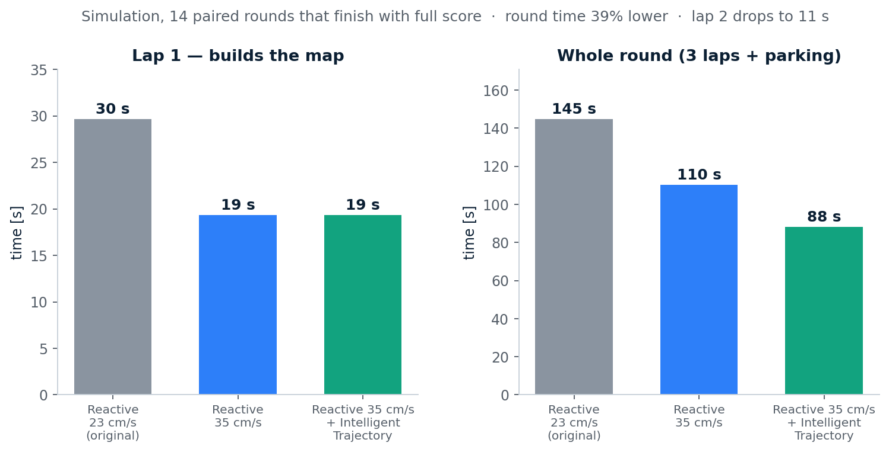
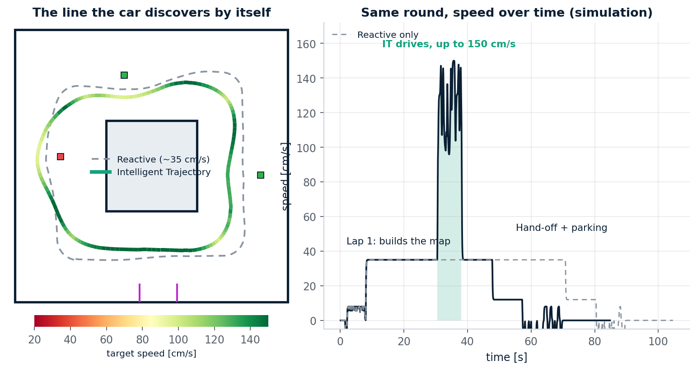
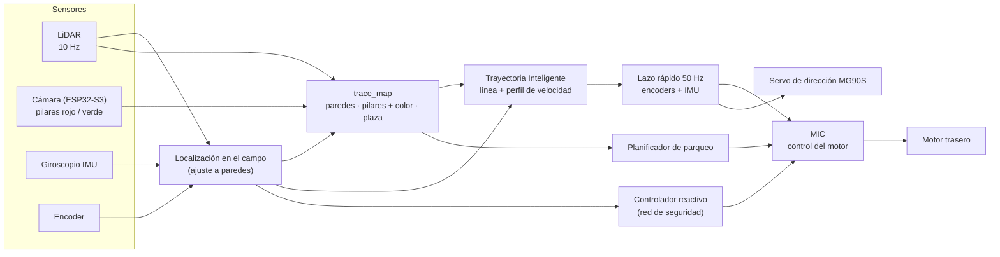
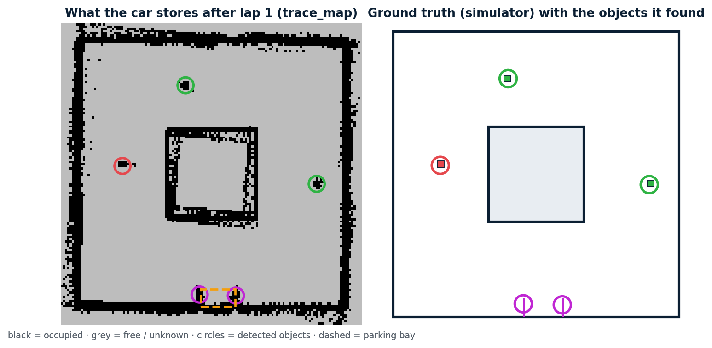
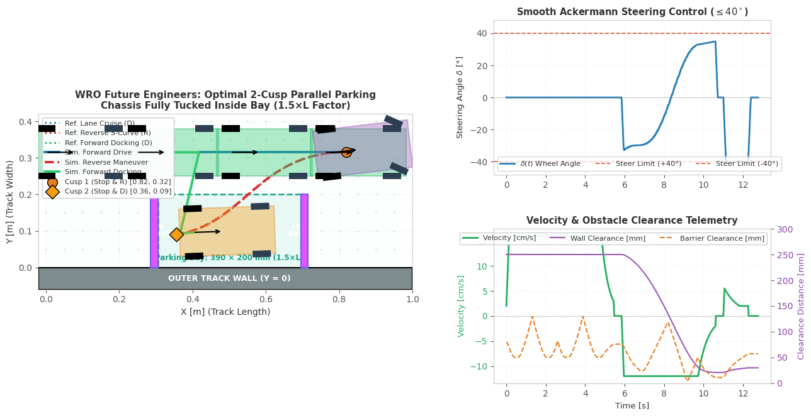
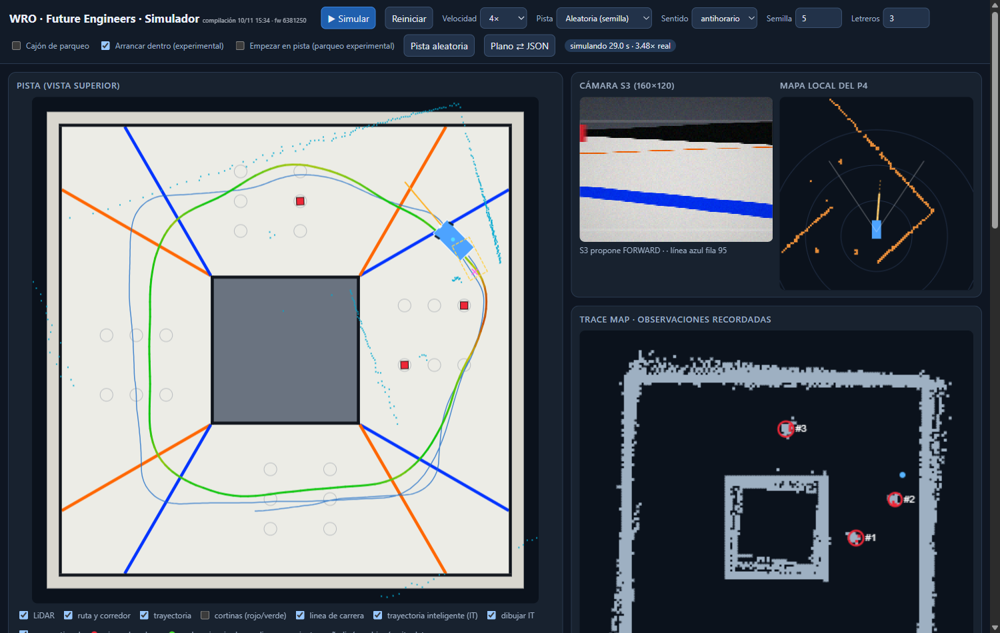

<div align="center">

# AutoNex

### Un coche autónomo Ackermann que mapea la pista una vez y después conduce la línea más rápida que encuentra

**WRO 2026 · Future Engineers · Self-Driving Cars** &nbsp;·&nbsp; 🇬🇧 [Read in English](README.md)




<sub>Una ronda completa simulada con el mismo firmware en C que corre en el robot. Línea roja = cursor sobre la gráfica de velocidad.</sub>

</div>

---

## En un minuto

El Obstacle Challenge cambia la pista en cada ronda, así que no se puede programar una ruta fija. Nuestro coche trabaja en tres fases:

| Fase | Qué hace el coche | Por qué |
|---|---|---|
| **1 · Mapear** (vuelta 1, 35 cm/s) | Conduce con cuidado con LiDAR y cámara y construye un **mapa** persistente: paredes, cada pilar con su **color** y la **plaza de parqueo**. | Los pilares no se mueven durante la ronda: una vuelta basta para conocer toda la pista. |
| **2 · Optimizar** (vueltas 2–3, hasta 150 cm/s en simulación) | La **Trayectoria Inteligente** (IT) calcula la línea segura más rápida entre los pilares y una velocidad para cada centímetro. Un lazo rápido (50 Hz) alimentado por **encoders + IMU** la sigue. | Enfoque de coche de carreras: frenar solo donde un pilar o una pared no deja margen, mantener la velocidad en el resto. |
| **3 · Aparcar** (última vuelta) | IT cede el mando al planificador de parqueo, que mete el coche en la plaza con una maniobra paralela de 2 cúspides. | Aparcar pide maniobras Ackermann lentas y precisas, no carrera. |

Si algo falla (pierde la posición, camino bloqueado, obstáculo inesperado), el controlador reactivo original recupera el mando al instante. IT nunca tiene la última palabra.

## Resultados (simulación)

<div align="center">

</div>

14 rondas simuladas pareadas que terminan con puntaje completo (62/62 puntos, parqueo incluido): tiempo de ronda **145 s → 88 s (−39 %)**, vuelta 1 **30 s → 19 s**, vuelta 2 **34 s → 11 s**, sin contacto con pilares ni paredes. Reproducible con `simulator/tools/measure_mission.js`.

> [!IMPORTANT]
> **Todo lo anterior está validado solo en simulación.** El simulador ejecuta el firmware real (compilado a WebAssembly) contra un modelo del coche (servo MG90S, saturación de neumáticos, peso repartido hacia atrás), pero el chasis físico aún se está construyendo. El agarre, la velocidad del servo y la aceleración del motor se medirán en el coche real antes de activar IT (`it_enabled` está **apagado por defecto**). El método, los fallos que encontramos y lo que falta están en [`simulator/INTELLIGENT_TRAJECTORY.md`](simulator/INTELLIGENT_TRAJECTORY.md).

<div align="center">

</div>

## Cómo funciona



<details>
<summary><b>El mapa (<code>trace_map</code>)</b></summary>

Una rejilla de 4 × 4 m con celdas de 2,5 cm en el marco del campo. Cada vuelta suma retornos del LiDAR con un peso que hace que las pasadas repetidas se **promedien** en vez de ensancharse. Los objetos (pilares, topes del parqueo) tienen id estable, posición y color. El firmware lo guarda en una partición de flash al final de la ronda (no durante, porque escribir en flash detiene la CPU); ese código de guardado está escrito pero aún no probado en el P4. Detalle: [`simulator/TRACE_MAP.md`](simulator/TRACE_MAP.md).

<div align="center"></div>
</details>

<details>
<summary><b>Trayectoria Inteligente: qué tiene de "inteligente"</b></summary>

* **Descubre la línea, no se la damos.** Minimiza el tiempo real de vuelta sobre el espacio libre que dejan los pilares, respetando rojo → derecha / verde → izquierda.
* **Conoce el coche.** Peso trasero (el eje delantero agarra menos y solo frena el trasero), círculo de fricción, límite de dirección, velocidad del servo MG90S y la *huella* del chasis de 26 × 13 cm (el morro sobresale 22 cm por delante del eje trasero).
* **Los márgenes crecen con la velocidad.** El error de pose y de seguimiento sube con la velocidad: los huecos estrechos (un pilar junto a una pared) se cruzan despacio y los amplios deprisa, automáticamente.
* **Aprende el agarre vuelta a vuelta.** Empieza prudente y solo sube el agarre que supone mientras el coche va limpio.
* **Encoders + IMU cierran el lazo.** Entre escaneos del LiDAR (cada 100 ms = 15 cm a 150 cm/s) la pose se propaga a 50 Hz; sin eso el error lateral se duplica.
</details>

## Parqueo

La plaza mide 1,5 veces el largo del coche. El coche entra con una **maniobra paralela de dos cúspides** (avance, S en reversa, avance de acoplamiento), siempre dentro del límite de 40° de la geometría Ackermann.

<div align="center">

</div>

## El vehículo

| | |
|---|---|
| **Configuración** | Dirección Ackermann (servo), tracción trasera. Chasis de 260 × 130 mm, batalla 184,5 mm, ruedas de 66 mm |
| **Cerebros** | ESP32-P4 (planificación, control) + ESP32-S3 CAM (visión de color) |
| **Sensores** | LiDAR WitMotion D6 (10 Hz), IMU MPU-6050, encoder de rueda/eje, cámara OV3660 |
| **Actuadores** | Servo de dirección MG90S de engranajes metálicos, motor JGB37-520 + L298N, LiPo 3S |

Cada área la explica el ingeniero que la construyó:

* 🛠️ **[Mecánica y diseño](docs/DESIGN.md)**: chasis, geometría de dirección, presupuesto de masa, archivos CAD.
* ⚡ **[Electrónica](docs/ELECTRONICS.md)**: potencia, cableado, sensores, driver del motor, puesta en marcha.
* 💻 **Software**: esta página, [`ARQUITECTURA.md`](ARQUITECTURA.md) y [`ESTADO.md`](ESTADO.md).

## Pruébalo

El simulador es un solo archivo HTML que ejecuta el firmware real en el navegador.

```bash
python simulator/build_simulator.py          # genera simulator/build/simulador.html
# ábrelo, marca "trayectoria inteligente (IT)" y pulsa "Simular"
node simulator/tests/test_it_mission.js      # ronda completa con IT: puntos, sin contactos, cesión
```

<div align="center">

<br><sub>El simulador mientras conduce IT: línea planificada (verde), recorrido real (azul), vista de la cámara, mapa local y mapa persistente.</sub>
</div>

Compilar el firmware (ESP-IDF 5.5, ESP32-P4): `cd "LIDAR System/p4_firmware" && idf.py set-target esp32p4 && idf.py build`. **No habilites el motor de tracción antes de leer [`ACKERMANN.md`](ACKERMANN.md).**

## Mapa del repositorio

```text
AutoNex/
├── LIDAR System/        # controlador de misión, planificadores, Trayectoria Inteligente (main/it_plan.c), firmware del P4
├── Vision System/       # procesamiento de cámara (ESP32-S3)        S3 Robot/  aplicación del S3
├── Motor Control/       # MIC (control del motor) y archivos de diseño del encoder
├── shared/              # protocolos y configuración compartidos por los dos chips
├── simulator/           # simulador WebAssembly, pruebas, mediciones e informes
├── docs/                # documentos por rol (diseño, electrónica) y recursos del README
└── ARQUITECTURA.md · ESTADO.md · ACKERMANN.md · PENDIENTES_PARQUEO.md
```

## Estado, sin adornos

| Área | Estado |
|---|---|
| Simulación de la ronda completa (mapa → IT → parqueo) | ✅ funciona, con pruebas |
| Trayectoria Inteligente en el chasis real | ⬜ falta calibrar (servo, agarre, motor, error de seguimiento) |
| Parqueo, MIC, encoders y guardado del mapa en el coche real | 🔄 integrados en el firmware, **sin probar en hardware** |
| Chasis y electrónica | 🔄 en curso, ver los documentos por rol |

Límites conocidos: en pistas aleatorias *factibles* (las que dibuja la interfaz) 22 de 24 rondas simuladas terminan con 62 puntos; las otras dos son un contacto en el parqueo y un atasco en una esquina al empezar la vuelta 3 (caótico: cambia de semilla al mover 1 cm/s la velocidad de mapeo, ver [`ESTADO.md`](ESTADO.md)). El antiguo "1 de cada 3 acaba en `wrong-side`" venía de que la herramienta de medida sorteaba pistas que ningún chasis puede pasar (un letrero a 45 cm de la salida del cajón); la precisión del mapa a los 34 cm/s de mapeo aún no está medida; el planificador tarda ~0,4 s en un PC y su tiempo en el P4 no está medido (por eso se reparte en pasos de ~10 ms).

## Equipo

| Rol | Nombre |
|---|---|
| **Ingeniero de Software** | [Eddy Manuel Piantini Martinez](https://github.com/Eddym06) |
| **Ingeniero Mecánico y de Diseño** | Sebastian <!-- añadir apellido y enlace al perfil --> |
| **Ingeniero Electrónico (colaborador)** | Yeremmy <!-- añadir apellido y enlace al perfil --> |

## Cumplimiento del reglamento

Dirección Ackermann (sin tracción diferencial), dentro de 300 × 200 × 300 mm y 1,5 kg, sin comunicación inalámbrica durante la ronda, trabajo propio y repositorio abierto. Regla de los pilares: **rojo → pasar por la derecha, verde → pasar por la izquierda.**

<div align="center">

**AutoNex** · *construido por el equipo, documentado para el jurado, probado en la pista.*

</div>
