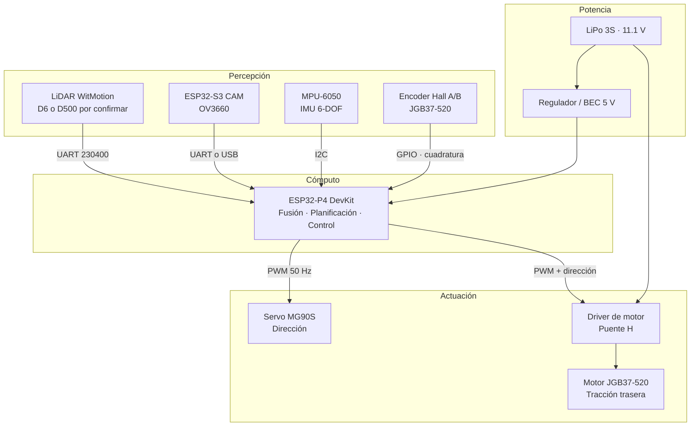
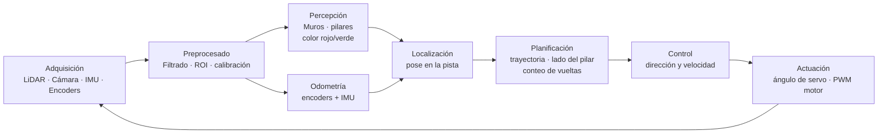
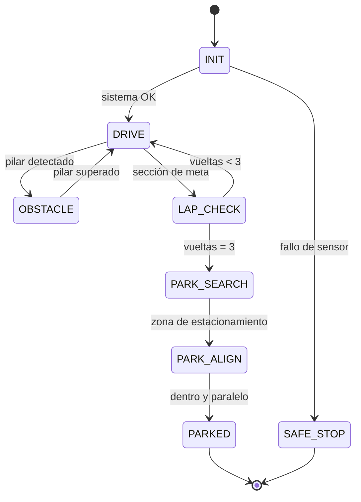

<div align="center">

# AutoNex

### WRO 2026 · Future Engineers · Self-Driving Cars

**12-móvil** — vehículo autónomo de dirección tipo Ackermann

> **Integración en curso:** el firmware y el simulador aún no están validados
> para el nuevo chasis. La tracción está bloqueada por defecto y la odometría
> del encoder y el parqueo requieren calibración y adaptación. Consulta
> [ACKERMANN.md](ACKERMANN.md) antes de usar el vehículo.


</div>

---

## Tabla de contenidos

- [1. El equipo y el reto](#1-el-equipo-y-el-reto)
- [2. El vehículo: 12-móvil](#2-el-vehículo-12-móvil)
- [3. Arquitectura del sistema](#3-arquitectura-del-sistema)
- [4. Hardware](#4-hardware)
- [5. Software](#5-software)
- [6. Puesta en marcha](#6-puesta-en-marcha)
- [7. Estructura del repositorio](#7-estructura-del-repositorio)
- [8. Estado del proyecto y hoja de ruta](#8-estado-del-proyecto-y-hoja-de-ruta)
- [9. Documentación y reglamento](#9-documentación-y-reglamento)
- [10. Riesgos y mitigaciones](#10-riesgos-y-mitigaciones)
- [11. Equipo](#11-equipo)

---

## 1. El equipo y el reto

**AutoNex** es un equipo que compite en **WRO 2026**, en la categoría **Future Engineers**, dentro del desafío *Self-Driving Cars* de la World Robot Olympiad.

En esta categoría los equipos no reciben un robot: reciben un **problema de ingeniería completo**. Hay que diseñar el chasis, elegir la electrónica, desarrollar el software de percepción y control, documentar cada decisión y demostrar que el vehículo es capaz de recorrer un circuito **de forma totalmente autónoma**. Es una competencia de proceso, no solo de resultado.

### El formato de competencia

Cada temporada se corre en dos modalidades sobre el mismo circuito:

| Modalidad | Descripción | Puntaje máximo |
|---|---|---|
| **Open Challenge** | Tres vueltas cronometradas sin obstáculos. Mide consistencia y velocidad. | 30 pts |
| **Obstacle Challenge** | Tres vueltas con señalización vial aleatoria (pilares rojos y verdes) y estacionamiento final. | 62 pts |
| **Documentación** | Bitácora de ingeniería y repositorio público en GitHub. | 30 pts |

El puntaje total de la competencia es de **122 puntos**, de los cuales cerca del **25 % corresponde a la documentación**. Un vehículo rápido con mala documentación no gana.

### Qué se randomiza en cada ronda

- La **dirección de conducción** (horario o antihorario).
- La **sección de arranque** y la **zona de estacionamiento**.
- La **posición y el color** de los pilares de señalización.
- Reglas sorpresa que se anuncian el día de la competencia.

Por eso el vehículo **no puede estar programado para una pista fija**: tiene que leer el entorno y decidir en tiempo de ejecución.

### Reglas técnicas que condicionan el diseño

| Restricción | Valor |
|---|---|
| Dimensiones máximas | 300 × 200 × 300 mm |
| Peso máximo | 1.5 kg |
| Tipo de tracción | Dirección obligatoria (Ackermann). **Tracción diferencial: descalificación** |
| Ruedas | Prohibidas las omnidireccionales, esféricas y las ruedas locas tipo *ball caster* |
| Comunicación | Totalmente autónomo. Sin radio, sin control remoto, sin cables durante la ronda |
| Electrónica | Libre elección de controladores, sensores y actuadores |

### Señalización vial

- **Pilar rojo** → el vehículo debe pasar por la **derecha**.
- **Pilar verde** → el vehículo debe pasar por la **izquierda**.

Los pilares pueden tocarse o moverse, pero hacerlo cuesta puntos. Pasar por el lado incorrecto invalida la sección.

---

## 2. El vehículo: 12-móvil

**12-móvil** es nuestro vehículo de competencia: un chasis de dirección Ackermann con tracción trasera, un ESP32-P4 principal y un ESP32-S3 para visión, además de LiDAR e IMU.

### Filosofía de diseño

1. **Percepción redundante.** El LiDAR entrega geometría precisa pero es ciego al color; la cámara entrega color y contexto pero es sensible a la iluminación. Juntos cubren lo que ninguno resuelve solo.
2. **Cómputo distribuido.** El nodo de visión procesa imagen; el nodo principal fusiona sensores, planifica y controla. Cada uno hace lo que mejor sabe hacer.
3. **Trazabilidad.** Todo el proceso —decisiones, pruebas, fallos y correcciones— queda registrado en este repositorio, porque así se evalúa.

### Especificaciones objetivo

| Parámetro | Objetivo |
|---|---|
| Configuración | Ackermann, tracción trasera, dirección delantera |
| Masa | ≤ 1.5 kg (objetivo interno: 1.2 kg) |
| Dimensiones | ≤ 300 × 200 × 300 mm |
| Autonomía por ronda | ≥ 3 minutos de operación continua |
| Velocidad de crucero | 0.6 – 1.0 m/s (ajustable por software) |
| Actualización del lazo de control | ≥ 50 Hz |

---

## 3. Arquitectura del sistema

### Arquitectura física



> **Nota sobre conectividad:** el ESP32-P4 no tiene radio integrada. Esto **no es una limitación para la competencia** —el reglamento prohíbe la comunicación inalámbrica durante la ronda— y simplifica el diseño. La telemetría se obtiene por USB o UART antes y después de cada prueba.

### Pipeline de software



### Subsistemas

**Percepción geométrica — LiDAR WitMotion.** Detecta muros y obstáculos; el modelo exacto (D6 o D500), el montaje y el protocolo deben confirmarse antes de validar el driver.

**Percepción visual — ESP32-S3 CAM con OV3660.** Captura imágenes y clasifica colores mediante HSV. La configuración y los resultados deben calibrarse con la cámara y la iluminación reales.

**Localización — MPU-6050 + encoder.** El giroscopio aporta rumbo y el encoder del eje común aporta desplazamiento longitudinal. Los parámetros del encoder y las medidas de rueda siguen pendientes de validación física.

**Control de dirección — MG90S.** Servo de engranajes metálicos que posiciona la dirección delantera. El ángulo de consigna se calcula con geometría de Ackermann a partir de la curvatura deseada. La tracción es trasera y proporcional, mediante un puente H controlado por PWM.

**Gestión de energía.** Batería LiPo 3S (11.1 V nominal, 12.6 V a plena carga). Un regulador entrega 5 V estables para lógica, LiDAR y servo; los motores se alimentan directamente desde la batería a través del driver. La separación de rieles evita que el pico de arranque del motor reinicie el cómputo.

---

## 4. Hardware

### Componentes principales

| # | Componente | Modelo | Función | Interfaz |
|---|---|---|---|---|
| 1 | Controlador principal | **ESP32-P4 DevKit** | Fusión de sensores, planificación, control, telemetría | — |
| 2 | Nodo de visión | **ESP32-S3 CAM · OV3660** | Captura y procesamiento de imagen | UART o USB |
| 3 | Sensor de distancia | **WitMotion D6 o D500** | Escaneo del entorno; variante por confirmar | UART |
| 4 | Unidad inercial | **MPU-6050** | Giroscopio + acelerómetro de 3 ejes | I2C |
| 5 | Motor de tracción | **JGB37-520 + encoder Hall** | Tracción trasera, caja reductora metálica | PWM + cuadratura |
| 6 | Servo de dirección | **MG90S (engranajes metálicos)** | Ángulo de dirección Ackermann | PWM 50 Hz |
| 7 | Batería | **LiPo 3S · 11.1 V** | Alimentación del sistema | — |
| 8 | Puente H | **L298N** | Control del motor trasero | PWM |

### Detalle técnico

| Componente | Especificaciones relevantes |
|---|---|
| **ESP32-P4** | Dual-core RISC-V @ 400 MHz · 768 KB SRAM · hasta 32 MB PSRAM · MIPI-CSI/DSI · ISP y encoder H.264 1080p · USB 2.0 · **sin radio integrada** |
| **LiDAR** | WitMotion D6 o D500; confirmar modelo, protocolo y posición |
| **MPU-6050** | Giroscopio y acelerómetro por I2C; orientación por confirmar |
| **JGB37-520** | 12 V DC · 600 rpm · encoder Hall A/B · eje trasero común |
| **MG90S** | Servo micro de engranajes metálicos · ~2.2 kg·cm a 4.8 V · control por PWM |
| **LiPo 3S** | 11.1 V nominal · 12.6 V máximo · requiere BEC para el riel de 5 V |

### Elementos pendientes de definir

El diseño eléctrico aún no está cerrado. Falta especificar y documentar:

- **Puente H L298N y regulador de 5 V.** Confirmar cableado, corriente disponible y comportamiento bajo carga.
- **Protección de batería.** Monitoreo de voltaje por celda y corte por baja tensión.
- **Chasis y tren delantero.** Geometría de Ackermann, relación de transmisión y montaje del servo.

Estos puntos se irán resolviendo en `docs/` y en el BOM conforme avance el proyecto.

---

## 5. Software

### Stack

| Capa | Tecnología |
|---|---|
| Firmware | **ESP-IDF** (C/C++) sobre ESP32-P4 |
| Visión | Procesamiento de imagen en el nodo ESP32-S3 CAM |
| Control | Lazo en tiempo real sobre FreeRTOS |
| Herramientas | Git, CMake, `idf.py` |
| Documentación | Markdown + Mermaid en este repositorio |

### Lazo de control

```
┌──────────────────────────────────────────────────────────┐
│  Cada 20 ms (50 Hz)                                      │
│                                                          │
│  1. Leer LiDAR  → nube de puntos en coordenadas locales  │
│  2. Leer cámara → color de pilares + offset de carril    │
│  3. Leer IMU    → yaw y velocidad angular                │
│  4. Leer encoder→ distancia recorrida                    │
│  5. Fusionar    → pose estimada (x, y, θ)                │
│  6. Decidir     → lado del pilar, curvatura, velocidad   │
│  7. Calcular    → ángulo de servo, PWM de motor          │
│  8. Actuar      → servo + driver                         │
│                                                          │
└──────────────────────────────────────────────────────────┘
```

### Máquina de estados de la ronda



### Decisiones de ingeniería registradas

Las decisiones técnicas, sus alternativas y la justificación de cada elección se documentan en `docs/`. El formato es deliberadamente simple: contexto, opciones consideradas, decisión y consecuencias.

---

## 6. Puesta en marcha

> **Estado:** código integrado sin compilar ni probar en este chasis. Los pines,
> la geometría y la calibración siguen pendientes. No habilitar la tracción hasta
> verificar el montaje y las limitaciones documentadas en [ACKERMANN.md](ACKERMANN.md).

### Requisitos

- **ESP-IDF 5.5 o posterior** para el P4 de revisión v1.x indicado en la configuración actual; confirmar la revisión de la placa.
- Python 3.10+
- Toolchain RISC-V para ESP32-P4
- Drivers USB-C (el ESP32-P4 usa USB 2.0 nativo)

### Instalación del entorno

```bash
# Clonar el repositorio
git clone https://github.com/Eddym06/AutoNex.git
cd AutoNex

# Instalar ESP-IDF (Linux/macOS)
git clone -b v5.5 --recursive https://github.com/espressif/esp-idf.git
cd esp-idf && ./install.sh esp32p4 && . export.sh
```

```powershell
# Instalar ESP-IDF (Windows)
git clone -b v5.5 --recursive https://github.com/espressif/esp-idf.git
cd esp-idf ; .\install.bat esp32p4 ; .\export.ps1
```

### Compilar y flashear

```bash
cd "LIDAR System/p4_firmware"
idf.py set-target esp32p4
idf.py menuconfig        # configuración de pines y sensores
idf.py build
idf.py -p <PUERTO> flash monitor
```

### Verificación rápida

1. Encender sin motores conectados y verificar el arranque por monitor serie.
2. Confirmar lectura del LiDAR (escaneo estable a 10 Hz).
3. Confirmar lectura de la IMU (yaw sin deriva apreciable en reposo).
4. Verificar el sentido de giro de los encoders y la dirección del servo.
5. Solo entonces conectar la tracción y probar en piso elevado.

---

## 7. Estructura del repositorio

```text
AutoNex/
├── README.md              # descripción del equipo y arquitectura
├── ACKERMANN.md           # adaptación y datos pendientes
├── LIDAR System/          # percepción, navegación y firmware del P4
│   ├── orchestrator/      # ciclo de ejecución y controlador de misión
│   ├── main/              # algoritmos de percepción y navegación
│   └── p4_firmware/       # aplicación y drivers del P4
├── Vision System/         # procesamiento de cámara ESP32-S3
├── S3 Robot/              # aplicación del S3 y panel local
├── shared/                # protocolos y configuración compartidos
├── simulator/             # simulador y herramientas de análisis
└── Motor Control/         # componentes y diseños históricos de encoder
```

La documentación de cada subsistema contiene detalles adicionales; las medidas y
resultados históricos no deben considerarse una validación del nuevo chasis.

---

## 8. Estado del proyecto y hoja de ruta

| Fase | Entregable | Estado |
|---|---|---|
| 0 | Definición del reto y reglamento | ✅ Completado |
| 1 | Selección de componentes y arquitectura | ✅ Completado |
| 2 | Chasis y tren delantero Ackermann | 🔄 En curso |
| 3 | Bring-up de electrónica y drivers | ⬜ Pendiente |
| 4 | Percepción: LiDAR y cámara | ⬜ Pendiente |
| 5 | Odometría y localización | ⬜ Pendiente |
| 6 | Control de trayectoria | ⬜ Pendiente |
| 7 | Open Challenge completo | ⬜ Pendiente |
| 8 | Obstacle Challenge y estacionamiento | ⬜ Pendiente |
| 9 | Bitácora de ingeniería final | ⬜ Pendiente |

**Hitos de validación:** el vehículo debe completar tres vueltas sin intervención antes de optimizar velocidad. Primero se gana consistencia, después se gana tiempo.

---

## 9. Documentación y reglamento

El reglamento de Future Engineers exige un **repositorio público en GitHub** con la documentación del proceso de ingeniería. Los puntos que condicionan nuestro flujo de trabajo:

- La documentación debe cubrir **movilidad, energía, percepción y programación** del vehículo, no solo el resultado final.
- El **primer commit** debe realizarse **al menos dos meses antes** de la competencia y contener **no menos de un quinto del código final**.
- El código y el diseño deben ser **trabajo propio del equipo**. Los jueces pueden hacer preguntas técnicas sobre cualquier decisión.
- Se evalúa la **bitácora de ingeniería**: pruebas, errores, iteraciones y aprendizajes, no solo los aciertos.

Por eso este repositorio se construye **en paralelo al vehículo**, no al final.

---

## 10. Riesgos y mitigaciones

| Riesgo | Impacto | Mitigación |
|---|---|---|
| Torque del MG90S insuficiente para la dirección | Pérdida de precisión en curva | Reducir masa del eje delantero, geometría de baja fricción, evaluar servo de mayor torque |
| Peso por encima de 1.5 kg | Descalificación en revisión técnica | Presupuesto de masa por subsistema y pesaje en cada iteración |
| Deriva del giroscopio del MPU-6050 | Error acumulado en la orientación | Calibración en reposo y corrección con localización LiDAR; validar en pista |
| LiDAR a 10 Hz con el vehículo en movimiento | Detección tardía de pilares | Limitar velocidad, predicción de trayectoria y ventana de anticipación |
| El LiDAR no distingue color | Imposible decidir el lado del pilar | Clasificación cromática obligatoria por cámara |
| Caída de tensión al arrancar motores | Reinicio del cómputo en plena ronda | Riel de lógica separado con BEC y capacitores de desacople |
| Falta de driver de motor definido | Bloqueo del bring-up | Selección y compra en fase 3, antes de las pruebas dinámicas |
| Iluminación variable en la pista | Falsa clasificación rojo/verde | Segmentación HSV calibrada + validación con LiDAR |

---

## 11. Equipo

**AutoNex** — WRO 2026, categoría Future Engineers.

> Completar con los integrantes, roles y coach antes de la revisión técnica.

| Rol | Responsabilidad |
|---|---|
| Líder de proyecto | Coordinación, cronograma y documentación |
| Ingeniería mecánica | Chasis, tren Ackermann, montaje de sensores |
| Ingeniería electrónica | Potencia, cableado, integración de sensores |
| Software | Percepción, localización, control y pruebas |

---

<div align="center">

**AutoNex · 12-móvil**

*Construido por el equipo, documentado para el jurado, probado en la pista.*

</div>
