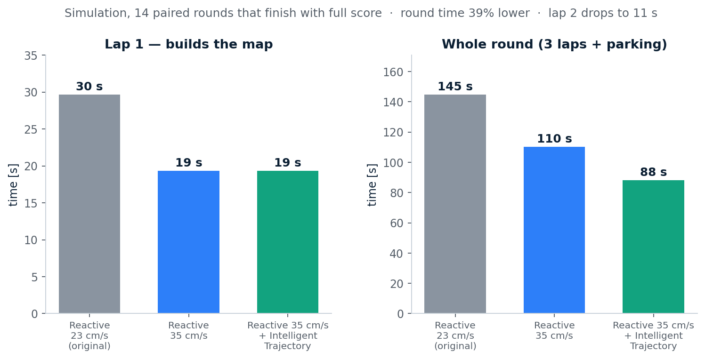
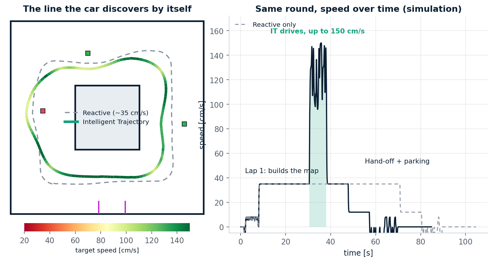
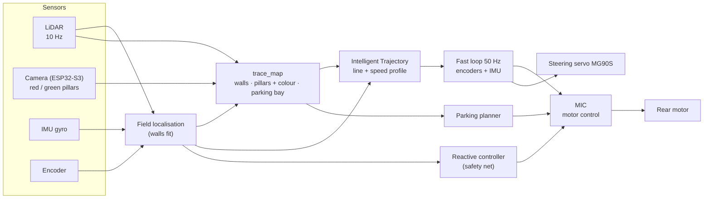
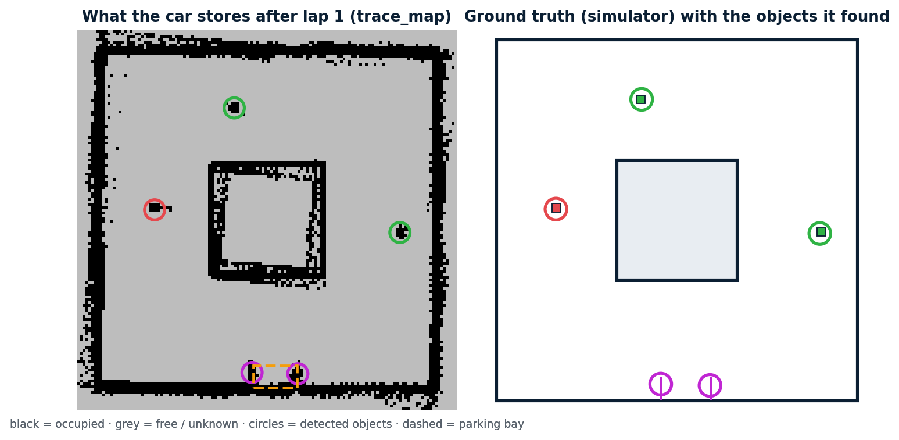
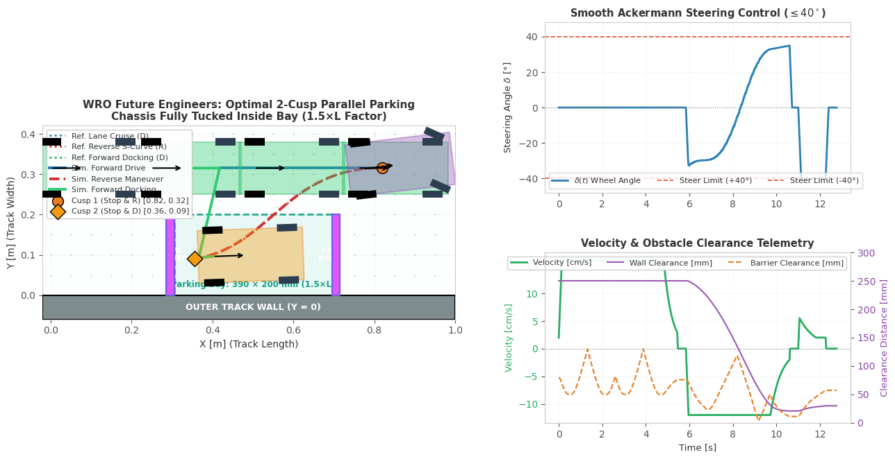
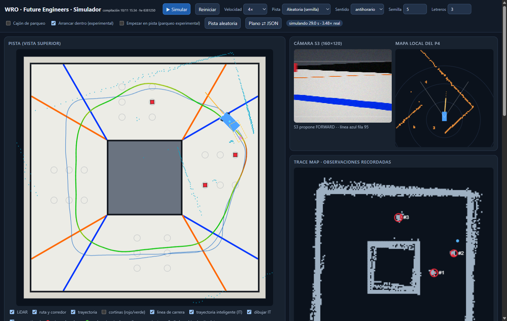

<div align="center">

# AutoNex

### An Ackermann self-driving car that maps the track once, then drives the fastest line it finds

**WRO 2026 · Future Engineers · Self-Driving Cars** &nbsp;·&nbsp; 🇪🇸 [Leer en español](README.es.md)




<sub>One full round, simulated with the same C firmware that runs on the robot. Red line = playhead on the speed graph.</sub>

</div>

---

## In one minute

The Obstacle Challenge randomises the track every round, so we cannot pre-program a path. Our car works in three phases:

| Phase | What the car does | Why |
|---|---|---|
| **1 · Map** (lap 1, 35 cm/s) | Drives carefully with LiDAR + camera and builds a persistent **map**: walls, every pillar with its **colour**, and the **parking bay**. | Pillars never move during a round, so one lap is enough to know the whole track. |
| **2 · Optimise** (laps 2–3, up to 150 cm/s in simulation) | The **Intelligent Trajectory** (IT) planner computes the quickest safe line through the pillars and a speed for every centimetre of it. A fast loop (50 Hz) fed by **encoders + IMU** follows it. | A race-car approach: brake only where a pillar or wall leaves no margin, carry speed everywhere else. |
| **3 · Park** (last lap) | IT hands over to the parking planner, which docks the car in the bay with a 2-cusp parallel manoeuvre. | Parking needs slow, precise Ackermann manoeuvres, not racing. |

If anything looks wrong (lost position, blocked path, surprise obstacle), the original reactive controller takes over instantly. IT never has the last word.

## Results (simulation)

<div align="center">

</div>

14 paired simulated rounds that finish with full score (62/62 points, parking included): round time **145 s → 88 s (−39 %)**, lap 1 **30 s → 19 s**, lap 2 **34 s → 11 s**, no contact with pillars or walls. Reproducible with `simulator/tools/measure_mission.js`.

> [!IMPORTANT]
> **Everything above is validated in simulation only.** The simulator runs the real firmware (compiled to WebAssembly) against a model of the car (MG90S servo, tyre saturation, rear-heavy weight distribution), but the physical chassis is still being built. Grip, servo speed and motor acceleration are measured on the real car before IT is enabled (`it_enabled` is **off by default**). See [`simulator/INTELLIGENT_TRAJECTORY.md`](simulator/INTELLIGENT_TRAJECTORY.md) for the method, the failure modes we found and what is still missing.

<div align="center">

</div>

## How it works



<details>
<summary><b>The map (<code>trace_map</code>)</b></summary>

A 4 × 4 m grid of 2.5 cm cells in the field frame. Each lap adds LiDAR returns, weighted so repeated passes **average out** instead of smearing. Objects (pillars, parking limiters) get a stable id, position and colour. The firmware saves it to a dedicated flash partition at the end of the round (not during it, because flash writes stall the CPU); this storage code is written but not yet tested on the P4. Details: [`simulator/TRACE_MAP.md`](simulator/TRACE_MAP.md).

<div align="center"></div>
</details>

<details>
<summary><b>Intelligent Trajectory: what is "intelligent" about it</b></summary>

* **It discovers the line, it is not given one.** It minimises the real lap time over the free space left by the pillars, respecting red → right / green → left.
* **It knows the car.** Rear-heavy weight (the front axle grips less, only the rear brakes), friction circle, steering limit, MG90S servo speed, and the *footprint* of the 26 × 13 cm chassis (the nose sticks out 22 cm ahead of the rear axle).
* **Margins grow with speed.** Pose error and tracking error rise with speed, so narrow gaps (a pillar next to a wall) are crossed slowly and wide ones fast, automatically.
* **It learns grip lap by lap.** It starts conservative and raises the grip it assumes only while the car stays clean.
* **Encoders + IMU close the loop.** Between LiDAR scans (every 100 ms = 15 cm at 150 cm/s) the pose is propagated at 50 Hz; without it the lateral error doubles.
</details>

## Parking

The parking bay is 1.5 × the car length. The car enters with a **two-cusp parallel manoeuvre** (forward, reverse S-curve, forward docking), all within the 40° steering limit of the Ackermann geometry.

<div align="center">

</div>

## The vehicle

| | |
|---|---|
| **Layout** | Ackermann steering (servo), rear-wheel drive. 260 × 130 mm chassis, 184.5 mm wheelbase, 66 mm wheels |
| **Brains** | ESP32-P4 (planning, control) + ESP32-S3 CAM (colour vision) |
| **Sensors** | WitMotion D6 LiDAR (10 Hz), MPU-6050 IMU, wheel/axle encoder, OV3660 camera |
| **Actuators** | MG90S metal-gear steering servo, JGB37-520 motor + L298N, 3S LiPo |

Each area is explained by the engineer who built it:

* 🛠️ **[Mechanical & design](docs/DESIGN.md)**: chassis, steering geometry, mass budget, CAD files.
* ⚡ **[Electronics](docs/ELECTRONICS.md)**: power, wiring, sensors, motor driver, bring-up.
* 💻 **Software**: this page, [`ARQUITECTURA.md`](ARQUITECTURA.md) and [`ESTADO.md`](ESTADO.md).

## Try it

The simulator is a single HTML file that runs the real firmware in your browser.

```bash
python simulator/build_simulator.py          # builds simulator/build/simulador.html
# open it, tick "trayectoria inteligente (IT)", press "Simular"
node simulator/tests/test_it_mission.js      # full round with IT: score, no contacts, hand-off
```

<div align="center">

<br><sub>Simulator while IT drives: planned line (green), actual path (blue), camera view, local map and the persistent map.</sub>
</div>

Build the firmware (ESP-IDF 5.5, ESP32-P4): `cd "LIDAR System/p4_firmware" && idf.py set-target esp32p4 && idf.py build`. **Do not enable the drive motor before reading [`ACKERMANN.md`](ACKERMANN.md).**

## Repository map

```text
AutoNex/
├── LIDAR System/        # mission controller, planners, Intelligent Trajectory (main/it_plan.c), P4 firmware
├── Vision System/       # camera processing (ESP32-S3)        S3 Robot/  S3 application
├── Motor Control/       # MIC (motor control) and encoder design files
├── shared/              # protocols and configuration shared by both chips
├── simulator/           # WebAssembly simulator, tests, measurements and reports
├── docs/                # role documents (design, electronics) and README assets
└── ARQUITECTURA.md · ESTADO.md · ACKERMANN.md · PENDIENTES_PARQUEO.md
```

## Honest status

| Area | State |
|---|---|
| Simulation of the full round (map → IT → parking) | ✅ working, covered by tests |
| Intelligent Trajectory on the real chassis | ⬜ needs calibration (servo, grip, motor, tracking error) |
| Parking, MIC, encoders and map storage on the real car | 🔄 integrated in firmware, **not tested on hardware** |
| Chassis and electronics | 🔄 in progress, see the role documents |

Known limits: on random but *feasible* layouts (the ones the interface draws) 24 of 24 simulated rounds finish with 62 points and no contacts (3 signs, `largo26d`); cw takes a few seconds longer than ccw (the exit ends with another heading and the cw parking plan comes out longer). The old "1 in 3 ends with `wrong-side`" came from the measurement tool drawing layouts that no chassis can pass (a sign 45 cm in front of the parking exit); map precision at the new 34 cm/s mapping speed is not yet measured; the planner takes ~0.4 s on a PC and its time on the P4 is unmeasured (it is sliced into ~10 ms steps for that reason).

## Team

| Role | Name |
|---|---|
| **Software Engineer** | [Eddy Manuel Piantini Martinez](https://github.com/Eddym06) |
| **Mechanical & Design Engineer** | Sebastian <!-- add surname and profile link --> |
| **Electronics Engineer (collaborator)** | Yeremmy <!-- add surname and profile link --> |

## Competition compliance

Ackermann steering (no differential drive), within 300 × 200 × 300 mm and 1.5 kg, no wireless link during a round, own work and open-source repository. Pillar rule: **red → pass on the right, green → pass on the left.**

<div align="center">

**AutoNex** · *built by the team, documented for the judges, tested on the track.*

</div>
