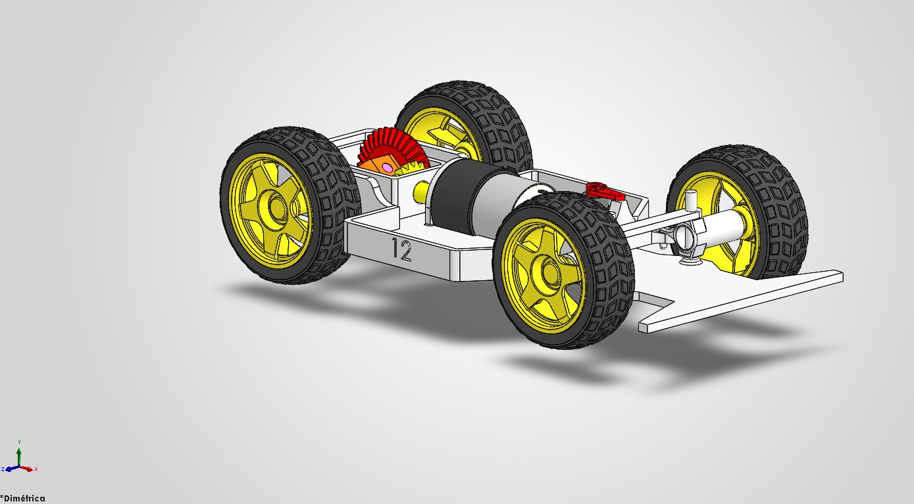
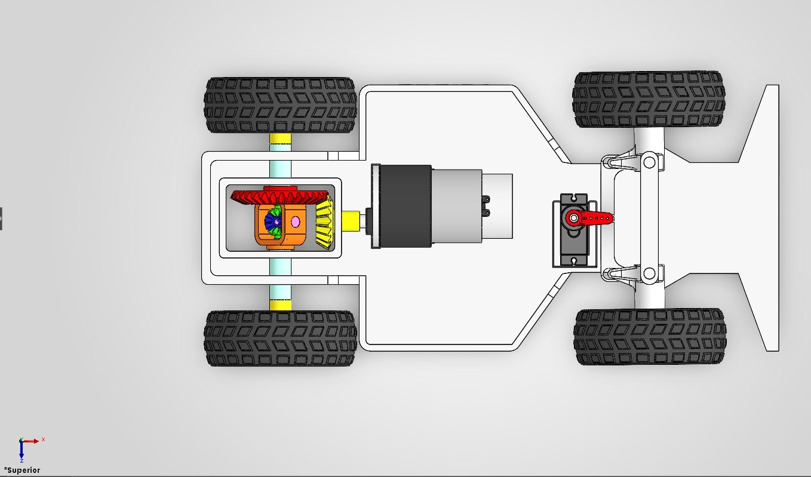
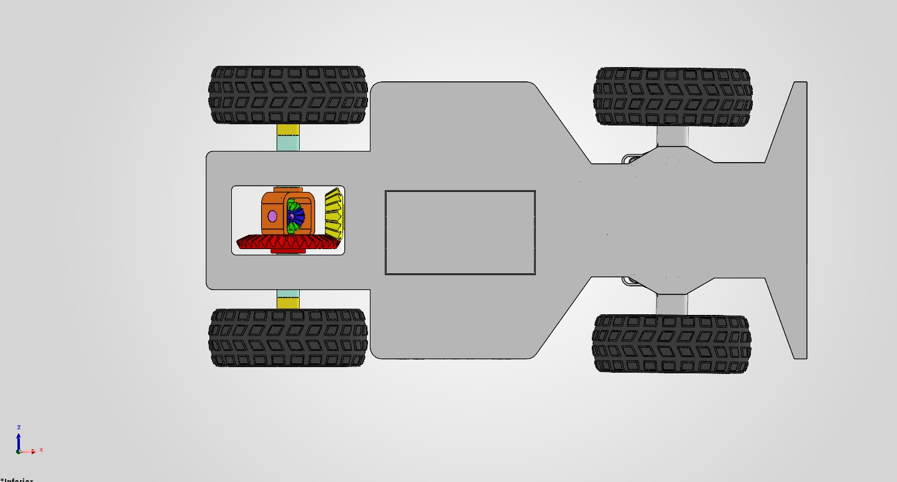
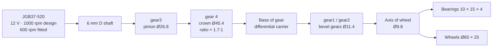
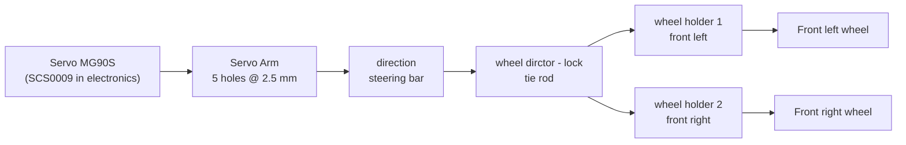

# Mechanical & Design - AutoNex

**WRO 2026 · Future Engineers · Self-Driving Cars**  
**Owner:** Sebastian — Mechanical & Design Engineer  
**Status:** v2 designed and documented; **not yet tested on the track**  
**Last updated:** 12 November 2026  
**Related:** [README](../README.md) · [Electronics](ELECTRONICS.md) · [Ackermann notes](../ACKERMANN.md)

> [!IMPORTANT]
> This page separates **measured** values from **CAD** values and **pending** work. The v2 chassis has not been driven. The car has not been weighed, its centre of gravity has not been measured, and the steering angles have not been measured at the road wheels. Anything marked `[CAD]` or `[calculated]` is a design value, not a test result.

## In two minutes

- AutoNex is a rear-wheel-drive car with **Ackermann front steering**. The v2 chassis is **260 × 120 × 45.65 mm** in CAD and **260 × 130 × ~80 mm** assembled, with a **163 mm wheelbase** and **34 mm** of ground clearance.
- The first chassis (v1) was tested and failed because the **rear axle had no bearings and the car slipped**. v2 adds **10 × 15 × 4 bearings** and a **mechanical bevel-gear differential**.
- The chassis is **PLA printed in 3D**: 4 mm base, 3 mm walls in the motor cradle. It is light and quick to iterate, but the mass has **not been weighed** and the centre of gravity has **not been measured**.
- The car is **designed, not validated**. There is no numerical comparison between v1 and v2 because v2 has not run and neither version was measured.
- The next milestone is a **measurement pass**: mass, CG, wheelbase, track width, wheel diameter, road-wheel angles, turning radius, gear ratio, servo and LiDAR models. Those values then go into the firmware configuration.


*AutoNex v2 in SolidWorks. The rear axle carries the motor, the gear train and the differential; the front axle carries the steering.*

**Status tags used in this document**

| Tag | Meaning |
|---|---|
| `[measured]` | Measured on the assembled car with a caliper, scale, protractor or test. |
| `[CAD]` | Read from the SolidWorks model. A design value, not a measurement. |
| `[calculated]` | Derived from CAD or catalogue data with the formula stated next to it. |
| `[pending]` | Not measured or not tested. |
| `[assumed]` | A value used by the firmware or the simulator that has not been confirmed on the car. |
| `[design]` | A value chosen in the design but not yet measured on the car. |

**Contents:** [1. Requirements](#1-what-the-car-has-to-do) · [2. Key numbers](#2-key-numbers) · [3. Chassis](#3-chassis) · [4. Drivetrain](#4-drivetrain) · [5. Steering](#5-steering-geometry-ackermann) · [6. Weight and CG](#6-weight-distribution-and-centre-of-gravity) · [7. Sensor mounting](#7-sensor-and-electronics-mounting) · [8. CAD and BOM](#8-cad-files-and-bom) · [9. Decisions](#9-design-decisions-and-trade-offs) · [10. Tests and changes](#10-what-we-tested-and-what-we-changed) · [11. Software integration](#11-integration-with-software) · [12. Risks](#12-open-issues-and-risks) · [13. Test plan](#13-bench-and-track-test-plan) · [14. Summary](#14-summary)

## 1. What the car has to do

### 1.1 Competition constraints

| Rule | Design response | Status |
|---|---|---|
| Ackermann steering | One servo driving the two front wheel holders through a bar and a tie rod | Intended; the left/right road-wheel angles have not been measured |
| No differential drive | One rear motor; the left and right rear wheels are joined by a mechanical bevel-gear differential, not by independent motors | Complies with the "no independent left/right motors" reading; confirm the exact wording with the organiser |
| No omni, spherical or ball-caster wheels | Four conventional wheels | Complies |
| Maximum 300 × 200 × 300 mm | 260 × 130 × ~80 mm assembled | Complies `[measured]` |
| Maximum 1.5 kg | Target ≤ 1.2 kg | **Unverified: the car has not been weighed** |
| No wireless link during a round | Mechanical scope; the electronics team disables Wi-Fi and Bluetooth | Electronics responsibility |

### 1.2 Mechanical design drivers

1. **Traction.** The car has rear-wheel drive. The driven axle must carry the motor torque without slipping or derailing, which is exactly what failed in v1.
2. **Steering range and repeatability.** The car has to map a random track, drive it for three laps and park in a bay. The steering must reach the angles the planner asks for and return to centre without play.
3. **Stiffness and mass.** The chassis carries the motor, the battery, the electronics and the sensors. It must stay straight under load and stay under the 1.5 kg limit with margin.
4. **Sensor field of view.** The LiDAR needs a clear 360° sweep; the camera needs the pillars and the parking bay; the IMU needs a rigid, flat mount.
5. **Manufacturability.** The chassis is FDM-printed PLA. The design has to print without supports where possible, accept fasteners, and be serviceable.
6. **Serviceability.** Bearings, gears, wheels, servo and battery have to be reachable without cutting the chassis.

## 2. Key numbers

### 2.1 Geometry, mass and materials

| Parameter | Value | Source | Note |
|---|---|---|---|
| Overall length | 260 mm | `[measured]` | Assembled car |
| Overall width | 130 mm | `[measured]` | The chassis alone is 120 mm `[CAD]`; the wheels add about 5 mm per side |
| Overall height | ~80 mm | `[measured]` | 34 mm clearance + 45.65 mm chassis = 79.65 mm, which agrees with the measurement; the reference for the LiDAR top is not documented |
| Wheelbase | **163 mm** | `[measured]` | Front axle to rear axle |
| Ground clearance | 34 mm | `[measured]` | Chassis underside to the floor |
| Track width | **not measured** | `[pending]` | Centre of the left tyre to centre of the right tyre |
| Rear overhang | **not measured** | `[pending]` | Rear axle to the rear bumper; firmware assumes 37.75 mm |
| Chassis envelope | 260 × 120 × 45.65 mm | `[CAD]` | Main printed structure |
| Base thickness | 4 mm | `[CAD]` / `[measured]` | Main chassis base |
| LiDAR plate | 60 × 62 × 2 mm | `[CAD]` | `Bsae of lidar` |
| Motor cradle wall | 3 mm | `[CAD]` | Cylindrical cradle, Ø37 mm |
| Wheel | Nominal Ø65 × 25 mm; CAD envelope 69 × 69 × 30 mm | `[CAD]` | The real wheel has not been measured |
| Mass | **not weighed**; target ≤ 1.2 kg; limit 1.5 kg | `[pending]` | The CAD mass is not usable (see 3.3) |
| Rear weight share | **not measured**; 62 % assumed | `[pending]` / `[assumed]` | Firmware `it.rear_weight` |
| Centre-of-gravity height | **not measured**; 40 mm assumed | `[pending]` / `[assumed]` | Firmware `it.cg_height_cm` |
| Material | PLA, FDM printed | `[measured]` | No laser cutting, bending or drilling was used |

### 2.2 Drivetrain and steering

| Parameter | Value | Source | Note |
|---|---|---|---|
| Motor | JGB37-520, 12 V, 1000 rpm design; 600 rpm unit fitted for tests; integrated encoder | `[CAD]` / `[measured]` | Confirm which unit is final |
| Motor reduction | 10:1 | `[design]` | Integrated gearbox; from the motor specification |
| Encoder | 11 pulses per channel per motor revolution; 440 counts per output revolution in quadrature | `[calculated]` | 11 × 4 × 10 |
| Final drive | `gear3` Ø26.8 → `gear 4` Ø45.4; ratio ≈ 1.7:1 | `[CAD]` / `[calculated]` | Outside diameters; tooth counts are not stored in the CAD |
| Rear axle | Ø9.8 mm | `[CAD]` | `Axis of wheel` |
| Rear bearings | 10 × 15 × 4 mm | `[CAD]` | The author places them in the rear axle |
| Differential | Bevel gears: housing `Base` 36 × 20 × 55 mm, carrier `Base of gear` 23 × 12.5 × 21 mm, satellites `gear1`/`gear2` Ø11.4 mm, pin `Axis of gear 2` Ø2.5 mm | `[CAD]` | Exact tooth counts not stored |
| Steering servo | MG90S in the CAD; SCS0009 in the electronics document | `[CAD]` / `[design]` | **Must be reconciled before the final mount** |
| Servo command | 62° in v2 (70° in v1) | `[design]` | This is the servo shaft rotation, **not** the road-wheel angle |
| Maximum road-wheel angle | **not measured**; firmware uses 40° | `[pending]` / `[assumed]` | Measure left and right at full travel |
| Turning radius | **not measured** | `[pending]` | Measure on the floor; see 5.4 |
| Servo arm | 5 holes at 2.5 mm pitch | `[CAD]` | Hole choice changes travel and force; the chosen hole is not documented |
| Steering bar / tie rod | 50 mm hole spacing | `[CAD]` | `direction` and `wheel dirctor - lock` |
| LiDAR / IMU height | 60 mm, flat (0°) | `[design]` | Verify on the assembled car |

### 2.3 What the numbers mean

- The measured **wheelbase of 163 mm** is **21.5 mm shorter** than the 184.5 mm used by the firmware. That is about **12–13 %** of the wheelbase. Every turn, the parking manoeuvre and the simulated line depend on it. This is the first value to correct.
- The assembled **width of 130 mm** matches the firmware. The CAD chassis is 120 mm because the wheels protrude; do not use the 120 mm as the car width.
- The **wheel diameter is ambiguous**: 65 mm nominal, 69 mm CAD envelope and 66 mm in the firmware. A 69 mm wheel has a **6.15 %** longer circumference than a 65 mm wheel, which goes straight into the odometry.
- The **steering angle is ambiguous**: 62° is the servo command, while the firmware limits the road wheel to 40°. There is no measured mapping between the two.
- The **mass and centre of gravity are unknown**. The car may be under the 1.2 kg target or close to the 1.5 kg limit; the handling model may be wrong in either direction.

## 3. Chassis

### 3.1 Layout

The v2 chassis is a **260 × 120 × 45.65 mm** printed structure. The base is **4 mm** thick and the motor cradle has **3 mm** walls. The main chassis is a printed structure, not a folded sheet: the base carries the battery, the electronics and the LiDAR plate; the rear carries the motor cradle and the differential housing; the front carries the steering servo and the wheel holders.


*Top view: differential and crown at the rear, motor in the centre, servo arm and steering bar at the front.*


*Bottom view: the differential housing window at the rear and the rectangular opening in the base.*

- **Rear:** JGB37-520 motor, `gear3` pinion, `gear 4` crown, differential, Ø9.8 mm axle, 10 × 15 × 4 bearings, rear wheels.
- **Front:** MG90S servo, `Servo Arm`, `direction` bar, `wheel dirctor - lock` tie rod, `wheel holder 1` and `wheel holder 2`, front wheels, `Sure1`/`Sure2` retainers.
- **Centre:** battery, ESP32-P4, L298N, XL4015, servo adapter, camera board.
- **Upper deck:** LiDAR on its 60 × 62 × 2 mm plate, IMU flat at 60 mm.

The layout is rear-heavy on purpose: the driven axle needs load for traction, and the motor, gearbox, differential and battery are all at the back. The trade-off is front grip and steering authority; see section 6.

### 3.2 Material and manufacturing

The chassis is **PLA printed in 3D**. No laser cutting, sheet bending or drilling was used; the only processes are printing and assembly.

**Why PLA?** The reason was not recorded. The practical reasons are that PLA is available, prints easily and allows fast iteration. The design consequences are:

- **Low heat resistance.** PLA softens around **55–60 °C** (typical). The motor is a heat source inside a PLA cradle. Check the motor and cradle temperature after a three-minute run; add ventilation or a heat shield if the cradle creeps.
- **Creep under sustained load.** Screw bosses and the motor cradle can deform over time. Use metal inserts or through-bolts for parts that are disassembled; do not rely on a thread cut directly into PLA.
- **Brittle impact behaviour.** A crash or a drop can crack a printed part. Keep spare wheel holders and retainers.
- **Anisotropy.** FDM parts are weaker between layers. Orient structural parts so the layers are not in tension across the main load path.
- **Tolerance.** Printed holes and fits vary with the printer. Test-fit the bearings, the axle and the servo before printing the final set.

The print parameters (nozzle, layer height, perimeters, infill, orientation) were not documented. Record them with the final parts so the design can be reproduced.

### 3.3 Mass and stiffness

**The car has not been weighed.** The CAD mass is not a substitute:

- The v1 CAD reports **377.7 g** of individual parts and **705.6 g** for the assembly, but no material was assigned.
- Dividing mass by volume gives **7.8 g/cm³** for the wheel (steel density) and **1.0 g/cm³** for the chassis, motor and supports. Those numbers are artefacts of the default density, not measurements.
- Each v1 wheel appears as **167 g**; four wheels would be **~668 g**, almost the whole 705.6 g assembly. A plastic wheel of this size weighs much less.
- The v2 model has the same problem: no material or mass assigned.

The mass target is **≤ 1.2 kg** to leave margin under the **1.5 kg** WRO limit. Weigh the complete car with the battery, then weigh the major parts if the total is over target.

**Stiffness and torsion have not been measured.** The 4 mm base and the walls are the design response. A simple torsion check is enough: support the car at the rear axle, load one front corner, and measure the deflection of the opposite front corner. Record the value and repeat after any change.

### 3.4 Ground clearance

The measured clearance is **34 mm**. On a flat WRO mat this is generous. A lower chassis would reduce the centre-of-gravity height and improve cornering, but it would also reduce clearance for the electronics, the wiring and any track transition. Do not lower it before measuring the CG and checking the wheel travel; the current height is a margin, and whether it was deliberate is not documented.

## 4. Drivetrain

### 4.1 Motor

The design uses a **JGB37-520** 12 V gearmotor with an integrated **10:1** reducer and a Hall encoder. The v2 document specifies the **1000 rpm** version; the unit fitted for tests is **600 rpm**. The encoder gives **11 pulses per channel per motor revolution**, which is **440 counts per output revolution** in quadrature.

The motor is driven by an **L298N** H-bridge and is mounted on a flat base, inside a **Ø37 mm** cylindrical cradle with **3 mm** walls. The CAD does not describe the motor alignment or the gear mesh; check both by hand before powering the motor.

### 4.2 Gear train

The chain is:



*Schematic of the rear drivetrain, inferred from the CAD. Not to scale.*

The ratio by outside diameters is **45.4 / 26.8 ≈ 1.69**, rounded to **1.7:1**. The CAD does not store the number of teeth, the module or the pressure angle, so the ratio must be confirmed by counting teeth. If the ratio changes, the speed, the torque and the odometry all change.

**Theoretical speed** with a Ø65 mm wheel (`[calculated]`, ignoring efficiency, slip and load):

| Motor speed | Axle speed | Wheel circumference | Theoretical speed |
|---|---|---|---|
| 600 rpm (fitted) | 353 rpm | 204.2 mm | **1.20 m/s = 120 cm/s** |
| 1000 rpm (design) | 588 rpm | 204.2 mm | **2.00 m/s = 200 cm/s** |

The simulator plans up to **150 cm/s**. The 600 rpm motor is below that, while the 1000 rpm motor is above it. That is one reason to confirm which motor is final: with the 600 rpm unit the car cannot reach the speed the planner may ask for. A 69 mm wheel would add another 6 % to these numbers.

The gear train multiplies torque by roughly the same 1.7 factor, minus the losses in the gears, bearings and differential. The wheel torque has not been measured. A pull test or a current measurement under load is the next step.

### 4.3 Differential

The differential is the main change from v1. In v1 the rear axle was a plain shaft without bearings; the car slipped and derailed. v2 adds a **mechanical bevel-gear differential** so the inner and outer rear wheels can turn at different speeds in a corner, reducing tyre scrub.

The CAD shows the arrangement:

- `Base` housing: **36 × 20 × 55 mm**.
- `Base of gear` carrier: **23 × 12.5 × 21 mm**.
- Two bevel satellites, `gear1` and `gear2`: **Ø11.4 mm**.
- `Axis of gear 2` pin: **Ø2.5 mm**.
- Final drive: `gear3` pinion to `gear 4` crown.

**Function check:** hold the pinion or the axle still and turn one rear wheel; the other wheel should turn in the opposite direction. With both wheels free, the axle should spin. If the differential locks, the assembly is wrong.

**Impact on odometry:** the car has one encoder on the motor/axle. With a differential, the encoder measures the average axle speed, but the two wheels can turn at different speeds. The firmware currently assumes a **solid axle**. This must be validated on the track; if the error is large, two wheel encoders or a different odometry model are needed.

### 4.4 Axle, bearings and wheels

- **Axle:** `Axis of wheel`, **Ø9.8 mm**.
- **Bearings:** **10 × 15 × 4 mm**, in the rear axle. The author corrected the v2 manual, which placed them in the front wheel holders.
- **Fit:** a Ø9.8 mm shaft in a Ø10 mm bearing bore gives **0.2 mm diametral clearance**. That is a lot for a bearing. Confirm whether the shaft is printed, bought or glued; check radial play with the wheel fitted. Play here changes camber, toe and odometry.
- **Bearing location discrepancy:** the CAD still shows bearing seats in the front wheel holders, while the author says the bearings are at the rear. Resolve this before printing the final parts: either the front seats are unused, or the rear housing is the only bearing support.
- **Wheels:** `Wheel D65x25`, nominal **Ø65 × 25 mm**; the CAD envelope is **69 × 69 × 30 mm**. Measure the real wheel. The 69 mm envelope is **6.15 %** larger in circumference than the 65 mm nominal, which is significant for odometry.
- **Wheel screws:** `wheel screws`; check thread engagement and use a threadlocker or a mechanical stop. A wheel that comes loose is a safety issue.

No measurements of wheel torque, rolling resistance, slip or efficiency are available. The v1 failure was a traction failure, so the v2 test must include a standing start and a corner, not only a straight line.

## 5. Steering geometry (Ackermann)

### 5.1 What Ackermann means here

In a turn, the inner front wheel follows a smaller radius than the outer wheel, so it must turn **more**. For a rear-wheel-drive car with front steering, the ideal relation is:

```text
cot(δ_outer) − cot(δ_inner) = t / L
```

where `t` is the track width and `L` the wheelbase. If both wheels turn the same angle, the car has **parallel steering** and the tyres scrub. If the inner wheel turns too much, the car is over-Ackermann. The percentage has to be measured; the CAD alone does not prove it.

For an equivalent road-wheel angle `δ`, the turning radius at the rear axle centreline is approximately:

```text
R ≈ L / tan(δ)
```

With the measured **L = 163 mm** (`[calculated]`, ideal Ackermann, no slip):

| Equivalent road-wheel angle | Theoretical turning radius |
|---|---|
| 20° | 448 mm |
| 30° | 282 mm |
| 40° | 194 mm |

These are design targets, not measurements. The real radius will be larger because of tyre slip, steering play and the actual angle reached at the wheels. The parking planner needs the real number.

### 5.2 Linkage



*Steering chain inferred from the CAD. The bar and the tie rod share a 50 mm hole spacing.*

- The servo arm has **five holes at 2.5 mm pitch**. The hole closest to the spline gives less travel and more force; the farthest gives more travel and less force. The chosen hole is not documented. Record it; it is a tuning parameter.
- The `direction` bar and the `wheel dirctor - lock` tie rod share **50 mm** hole spacing, so the linkage is geometrically consistent in the CAD.
- The **62°** figure is the **servo shaft rotation** programmed in v2 (70° in v1). It is not the road-wheel angle. The road-wheel angle depends on the arm length, the bar geometry and the wheel-holder geometry. Do not put 62° into the firmware as a road-wheel limit.
- The **servo model is unresolved**: the CAD uses an **MG90S** (pulse servo), while the electronics document uses an **SCS0009** (bus servo). They have different cases, splines, torque and control. The final choice changes the mount, the arm and the wiring. Decide before printing the final bracket.

### 5.3 What is not measured

| Item | Why it matters | Status |
|---|---|---|
| Left and right road-wheel angle at full servo travel | Defines the real steering limit and the firmware `steer_hard_deg` | `[pending]` |
| Ackermann percentage | Tells whether the inner wheel turns more than the outer | `[pending]` |
| Toe-in / toe-out | Drag and tyre wear; straight-line stability | `[pending]` |
| Caster, camber, king-pin inclination, scrub radius | Self-centring, steering effort and tyre contact | `[pending]` |
| Bump steer and steering play | The car must hold a line over small track irregularities | `[pending]` |
| Turning radius on the floor | Parking and the tightest track corners | `[pending]` |
| Servo speed, delay and torque with the steering loaded | The simulator assumes 420°/s, 20 ms delay and 0.5° dead band; the real values are unknown | `[pending]` |

The CAD does not document caster, camber or toe. Do not claim them as zero; measure them or state that they are unknown.

### 5.4 Steering test

1. Put the car on a flat floor with the battery fitted.
2. Mark the chassis centreline and the rear-axle centre.
3. Command the servo to centre, full left and full right. Measure the angle of each front wheel with a protractor or a laser pointer fixed to the wheel.
4. Compute the inner/outer difference and the Ackermann percentage from the formula in 5.1.
5. Drive a constant-radius circle at low speed. Measure the radius to the rear-axle centre and compare it with the table.
6. With the servo fixed, rock each front wheel by hand and measure the play. If the play is visible, find it: arm, bar, tie rod, holder or servo gear.

**Software impact:** the firmware uses a **40°** road-wheel limit and a **184.5 mm** wheelbase. The mechanical car has a **163 mm** wheelbase and an unknown road-wheel angle. Until the mapping is measured, the planner is driving a different car from the one on the floor.

## 6. Weight distribution and centre of gravity

### 6.1 Why it matters

The motor, gearbox, differential, rear axle and battery sit at the back. The front carries the servo and the steering linkage; the sensors sit on the upper deck. The layout is intentionally rear-heavy for traction, but too much rear weight reduces front grip and steering authority; a high centre of gravity increases load transfer and roll.

The firmware assumes **62 % of the weight on the rear axle** and a **40 mm CG height**. Both are `[assumed]`. A wrong value makes the trajectory planner either too brave or too timid: it changes the understeer margin, the braking point and the speed it dares to carry into a corner.

### 6.2 Measurement method

1. **Weight split.** Put one scale under the front axle and one under the rear axle. The car must be fully assembled, with the battery fitted and the wheels on the floor. Rear share = rear scale / (front + rear). Record the total mass at the same time.
2. **CG height.** Use the lift method: place the car on a level board, lift the front axle to a known angle, and read the rear scale. The change in load gives the CG height. Alternatively, hang the car from two points and find the balance line. Record the method and the numbers, not only the result.
3. **Component mass.** If the total is over the 1.2 kg target, weigh the motor, battery, differential, chassis and wheels separately. The CAD mass is not usable (see 3.3).

| Parameter | Target / assumption | Measured | Status |
|---|---|---|---|
| Total mass | ≤ 1.2 kg target; 1.5 kg limit | — | `[pending]` |
| Rear weight share | 62 % `[assumed]` | — | `[pending]` |
| CG height | 40 mm `[assumed]` | — | `[pending]` |

## 7. Sensor and electronics mounting

### 7.1 LiDAR

- Mounted on the **60 × 62 × 2 mm** `Bsae of lidar` plate at **60 mm**, **flat (0°)** `[design]`. The reference plane for the 60 mm is not documented.
- The LiDAR needs a **clear 360° sweep**. Check for shadows from the servo arm, the camera, the wheels and the cables. Rotate the sensor by hand or review a full scan; a shadow is easy to miss in a single view.
- The model is unresolved: the CAD has an **LD19**, the electronics document has a **D500**, and the firmware uses a **D6**. The final sensor changes the bolt pattern, the height and the protocol. Confirm before printing the final plate.

### 7.2 IMU

- **MPU-6050**, at **60 mm**, flat, `[design]`.
- Mount it **rigidly** and away from the motor vibration. A soft mount can add phase lag to the yaw measurement.
- Confirm the axis orientation in the firmware; a 90° error is easy to introduce when the board is rotated.

### 7.3 Camera

- **ESP32-S3-CAM**, at the front. The height and tilt are **not measured** `[pending]`.
- The camera must see the coloured pillars and the parking bay. A locking tilt bracket is recommended; a camera that moves after a bump changes the colour calibration.
- The module is documented as **OV3660**, but the photo may show **OV2640**. Confirm the real sensor before finalising the mount.

### 7.4 Electronics and battery

- The `Esp32p4` assembly is a **placeholder and it is wrong**: it contains a **Raspberry Pi 4B**, not the ESP32-P4 used by the car. Replace the model before checking clearances; the board size and mounting holes are different.
- The ESP32-P4, L298N, XL4015 and servo adapter need a layout with **airflow** and **cable strain relief**. The motor and the battery are the heat sources.
- The battery is modelled at **103 × 34 × 24 mm**. Use a strap and a physical stop; the connector must not carry the battery load. Keep the battery away from the motor and from sharp edges.

### 7.5 Mounting summary

| Component | Location | Height | Orientation | Status |
|---|---|---|---|---|
| LiDAR | Upper deck, on the 60 × 62 × 2 mm plate | 60 mm | 0° | `[design]`; model unresolved |
| IMU | Upper deck | 60 mm | 0° | `[design]`; verify axes |
| Camera | Front | Not measured | Not measured | `[pending]` |
| ESP32-P4 | Centre | — | — | CAD placeholder wrong |
| L298N / XL4015 / servo adapter | Centre / rear | — | — | Check clearance and airflow |
| Battery | Rear / centre | — | — | CAD 103 × 34 × 24; retention pending |

## 8. CAD files and BOM

The v2 manual documents **24 parts + 2 assemblies** (the car and the differential). The SolidWorks folder used to generate it also contains three reference assemblies: the motor, the LiDAR and the electronics mockup. The table lists the files used by the design. File names are kept exactly as in the CAD, including typos, so the document and the model match; rename only with a commit that updates every reference.

| File | Type | Role | Key data |
|---|---|---|---|
| `Car assembly.SLDASM` | Assembly | Full car | v2 main assembly |
| `Assembly dc motor.SLDASM` | Reference assembly | Motor and shaft | JGB37-520 |
| `assambly of diferencial.SLDASM` | Assembly | Differential | Bevel-gear assembly |
| `LIDAR.SLDASM` | Reference assembly | LiDAR mockup | LD19 |
| `Esp32p4.SLDASM` | Reference assembly | Electronics mockup | Contains a Raspberry Pi 4B (wrong) |
| `Chassis.SLDPRT` | Part | Main chassis | 260 × 120 × 45.65 mm; 4 mm base; 3 mm cradle wall |
| `Dc motor.SLDPRT` | Part | Motor body | JGB37-520 |
| `Axis of dc motor.SLDPRT` | Part | Motor shaft | 6 mm D |
| `gear3.SLDPRT` | Part | Pinion | Ø26.8 mm |
| `gear 4.SLDPRT` | Part | Crown | Ø45.4 mm |
| `Base.SLDPRT` | Part | Differential housing | 36 × 20 × 55 mm |
| `Base of gear.SLDPRT` | Part | Differential carrier | 23 × 12.5 × 21 mm |
| `gear1.SLDPRT` | Part | Bevel satellite | Ø11.4 mm |
| `gear2.SLDPRT` | Part | Bevel satellite | Ø11.4 mm |
| `Axis of gear 2.SLDPRT` | Part | Differential pin | Ø2.5 mm |
| `Axis of wheel.SLDPRT` | Part | Rear axle | Ø9.8 mm |
| `bearing.SLDPRT` | Part | Rear bearing | 10 × 15 × 4 mm |
| `Wheel D65x25.SLDPRT` | Part | Wheel | Nominal Ø65 × 25 mm; CAD envelope 69 × 69 × 30 mm |
| `wheel screws.SLDPRT` | Part | Wheel fastener | — |
| `Servo-MG90S.SLDPRT` | Part | Steering servo | MG90S (design; electronics uses SCS0009) |
| `Servo Arm.SLDPRT` | Part | Servo arm | 5 holes at 2.5 mm pitch |
| `direction.SLDPRT` | Part | Steering bar | 50 mm hole spacing |
| `wheel dirctor - lock.SLDPRT` | Part | Tie rod / lock | 50 mm hole spacing |
| `wheel holder 1.SLDPRT` | Part | Front wheel holder | Left |
| `wheel holder 2.SLDPRT` | Part | Front wheel holder | Right |
| `Sure1.SLDPRT` | Part | Front holder retainer | — |
| `Sure2.SLDPRT` | Part | Front holder retainer | — |
| `Batery.SLDPRT` | Part | Battery mockup | 103 × 34 × 24 mm |
| `Bsae of lidar.SLDPRT` | Part | LiDAR plate | 60 × 62 × 2 mm |

Quantities, purchased-part numbers and fastener lengths are not stored in the CAD. Complete them from the assembly before ordering; the mechanical BOM is not frozen yet.

**Files in this repository:**

| File | What it is |
|---|---|
| [`Motor Control/design 3d/DiscoEncoder_30ranuras.f3d`](../Motor%20Control/design%203d/) | Fusion 360 source of the 30-slot encoder disc; `.step` and `.stl` next to it |
| [`photos/`](../photos/) | CAD renders: `dimetric`, `top`, `bottom`, `front`, `rear`, `left`, `right` |

**Source documents** (team archive, not all in this repository):

- **v1 manual:** `AutoNex_V1.pdf`, 20 pages, 8 parts + 1 assembly (also referred to as `Manual_Carrito_V1.pdf`).
- **v2 manual:** `AutoNex_V2.pdf`, 13 pages, 24 parts + 2 assemblies (also referred to as `AutoNex_Part_Manuals_V2.pdf`).
- **Author's report:** `Informe_Mecanica_AutoNex_Sebastian.md`, 12 November 2026.
- **Team bitácora:** internal document, not published.
- **CAD:** SolidWorks files in the team's `wro/` folder.

**Note on v1:** the v1 assembly has only the motor, the two motor mounts, the motor shaft, two axles and four wheels active. The steering parts and the `nuevo chasis` are **suppressed** and come from a folder that was not delivered. The v1 manual therefore does not document the steering, and the 70° figure has no CAD backing.

## 9. Design decisions and trade-offs

| Decision | Alternative | Why | Status / evidence |
|---|---|---|---|
| PLA FDM chassis | Laser-cut sheet, CNC, bought chassis | Available, prints easily, fast iteration | Reason not recorded; the material is `[measured]` |
| Rear-wheel drive | Front-wheel drive | Load on the driven axle for traction; the front is busy with steering | Design choice |
| Mechanical bevel-gear differential | Solid rear axle | v1 slipped and derailed; the differential lets the rear wheels turn at different speeds in a corner | v2 design, **not tested** |
| Bearings 10 × 15 × 4 in the rear axle | Plain axle, as in v1 | The v1 axle had no bearings and derailed under load | v2 design, **not tested** |
| 4 mm base, 3 mm motor-cradle walls | Thinner, lighter chassis | Stiffness and printability; the mass is not measured | `[CAD]`; no mass data |
| Five-hole servo arm | Fixed arm | Tune travel versus force without a new part | `[CAD]`; the chosen hole is not documented |
| 62° servo command | 70° in v1 | v2 steering redesign | Servo command, not road-wheel angle; not measured |
| 34 mm ground clearance | Lower chassis | Clearance for electronics and track transitions | `[measured]`; CG not measured |
| MG90S servo | SCS0009 bus servo | The CAD was built around the MG90S | **Unresolved**; electronics uses SCS0009 |
| LD19 LiDAR | D500 / D6 | The CAD was built around the LD19 | **Unresolved**; electronics and firmware use D500/D6 |
| 65 mm wheel | 69 mm CAD envelope | Nominal wheel size | **Unresolved**; measure the real wheel |
| Mechanical differential | Two independent motors | The car uses one motor, not differential drive; the mechanical differential is the traction solution from v1 | **Confirm the rule wording** with the organiser |

## 10. What we tested and what we changed

| Iteration | Date | Problem | Change | Result |
|---|---|---|---|---|
| v1 | 16 Oct 2026 | Rear axle had no bearings; the car slipped and derailed; no differential | First chassis, yellow DC motor with one shaft per side; 8 documented parts; main chassis 300 × 38 × 150 mm `[CAD]` | **Tested; failed traction** |
| Intermediate | No date | Still slipping | JGB37-520 motor with a 1:1 two-gear transmission | Still slipping; not the final design |
| v2 | 12 Nov 2026 | v1 traction failure | New 260 × 120 × 45.65 mm chassis; rear bearings 10 × 15 × 4; bevel-gear differential | **Not tested** |

**What happened in v1.** The car ran, but the rear end slipped and derailed. The rear axle had no bearings to support it, and there was no differential. The motor was a yellow DC unit with a shaft on each side. The v1 manual documents 8 parts and 1 assembly, but its assembly has the steering and the `nuevo chasis` suppressed, so the steering geometry of v1 is not documented.

**What changed in v2.** The chassis was redesigned around a single JGB37-520 motor with an encoder, a bearing-supported rear axle and a bevel-gear differential. The v2 manual documents 24 parts + 2 assemblies. The car is **designed and documented but not run**.

**What is missing from the comparison.** There are no measurements of mass, centre of gravity, stiffness, torsion, slip, wheel angle or turning radius for either version. The v1 CAD mass is invalid because no material was assigned. There is therefore **no numerical comparison** between v1 and v2: the improvement is a design change, not a measured result.

**Lesson learned.** v1 was redesigned before its slip was quantified. The next iteration should record mass, CG, wheel angles, turning radius and a simple straight-line slip test **before** changing the geometry again. Otherwise the next version will also be a hypothesis.

## 11. Integration with software

The firmware already has a vehicle model. These are the mechanical values it uses and what the car actually has. The mechanical team owns the measurement; the software team owns the configuration change.

| Parameter | Firmware today | Mechanical value | Action | Why it matters |
|---|---|---|---|---|
| Wheelbase | 184.5 mm | **163 mm** `[measured]` | Set `planner.wheelbase_cm` to 16.3 | Every turn and the parking manoeuvre |
| Chassis width | 130 mm | 130 mm assembled; 120 mm CAD | Confirm `planner.chassis_width_cm` = 13 | Collision margin |
| Chassis length | 260 mm | 260 mm `[measured]` | Confirm `planner.chassis_length_cm` = 26 | Parking bay and obstacle clearance |
| Rear overhang | 37.75 mm `[assumed]` | **Not measured** | Measure and set `planner.chassis_rear_cm` | Parking and rear clearance |
| Wheel diameter | 66 mm | 65 mm nominal; 69 mm CAD | Measure and set `odom.wheel_diameter_cm` | Odometry, speed and distance |
| Maximum road-wheel angle | 40° | **Not measured**; 62° is the servo command | Measure and set `planner.steer_hard_deg` | Tight corners and parking |
| Mass | Goal ≤ 1.2 kg | **Not weighed** | Weigh the car | 1.5 kg limit and acceleration model |
| Rear weight share | 62 % `[assumed]` | **Not measured** | Measure and set `it.rear_weight` | Traction and understeer |
| CG height | 40 mm `[assumed]` | **Not measured** | Measure and set `it.cg_height_cm` | Load transfer and roll |
| Rear axle | Solid axle | Mechanical differential | Validate odometry and MIC | The encoder no longer sees both wheels locked together |
| Steering servo | SCS0009 | MG90S in CAD | Reconcile the model and the control | Mount, arm, torque and protocol |
| LiDAR | D500 / D6 | LD19 in CAD | Reconcile the model and the protocol | Mount and scan data |
| Camera height / tilt | Assumed | **Not measured** | Measure `planner.camera_forward_cm` and the tilt | Pillar detection and parking |
| LiDAR position | Configured | 60 mm high, flat; forward offset not measured | Measure `planner.lidar_forward_cm` | Map alignment |
| Tyre grip | Simulator value | **Not measured** | Pull test; set `it.mu` | Braking and cornering speed |

**The three corrections that matter most:**

1. **Wheelbase: 184.5 → 163 mm.** The error is 21.5 mm, about 12–13 % of the wheelbase. It changes the steering angle needed for every corner and the geometry of the parking manoeuvre.
2. **Wheel diameter: 66 → 65 or 69 mm.** The 6.15 % circumference difference accumulates in odometry and in the speed estimate. Measure the real wheel before choosing.
3. **Steering: 40° road wheel vs 62° servo command.** There is no measured mapping. The planner may ask for an angle the wheels cannot reach, or the car may turn more than the model expects.

## 12. Open issues and risks

| Priority | Issue | Impact | Closure criterion |
|---|---|---|---|
| **P0** | v2 has not been tested | No evidence that the traction fix works | Full track test: map, three laps, parking |
| **P0** | Mass and CG not measured | 1.5 kg limit and handling model are unverified | Scale and CG measurement recorded |
| **P0** | Road-wheel angles and turning radius not measured | Steering limit and parking are guesses | Left/right angles and floor radius recorded |
| **P0** | Wheelbase mismatch 163 vs 184.5 mm | Wrong turns and parking in firmware | `planner.wheelbase_cm` updated |
| **P0** | Wheel diameter ambiguity 65 / 69 / 66 mm | Odometry drift | Real wheel measured and configured |
| **P0** | Servo model mismatch MG90S vs SCS0009 | Mount, arm, torque and control may not fit | Final servo chosen and mounted |
| **P0** | LiDAR model mismatch LD19 vs D500/D6 | Mount and protocol may not fit | Final LiDAR chosen and mounted |
| **P0** | Differential and the "no differential drive" rule | Eligibility risk | Written confirmation from the organiser |
| **P1** | Bearing location: rear (author) vs front holders (CAD) | Wrong parts printed or axle unsupported | CAD corrected and test-fitted |
| **P1** | Axle Ø9.8 mm in Ø10 mm bearing | Radial play, vibration and odometry error | Fit measured; shaft or bearing corrected |
| **P1** | Gear ratio from outside diameters only | Speed and torque may be wrong | Tooth counts recorded |
| **P1** | Motor 600 rpm fitted vs 1000 rpm design | Top speed below the planned 150 cm/s | Final motor chosen and measured |
| **P1** | Camera height and tilt not measured | Perception and parking calibration | Mount measured and locked |
| **P1** | Battery retention not designed | Safety under impact | Strap and physical stop fitted |
| **P1** | `Esp32p4` CAD contains a Raspberry Pi 4B | Wrong clearances and mounting holes | Model replaced with the ESP32-P4 |
| **P1** | PLA heat and creep near the motor | Cradle deformation after a long run | Temperature measured after 3 minutes |
| **P1** | Print parameters not documented | Parts cannot be reproduced | Nozzle, layer, walls, infill and orientation recorded |
| **P1** | Fasteners not locked | Vibration loosens screws | Threadlocker or mechanical stop on critical joints |
| **P2** | LiDAR shadows from the servo, camera or cables | Missing map data | Full 360° scan checked |
| **P2** | Cable routing near the motor | Noise and unreliable signals | Signal and power routes separated and labelled |
| **P2** | File-name typos (`Bsae`, `Batery`, `assambly`, `dirctor`) | Confusion in the repository | Rename with all references updated |

## 13. Bench and track test plan

| # | Test | Method | Pass criterion | Status |
|---|---|---|---|---|
| 1 | Mass and weight split | Two scales under the axles, battery fitted | Total ≤ 1.5 kg hard limit, ≤ 1.2 kg target; rear share recorded | `[pending]` |
| 2 | CG height | Lift the front axle to a known angle and read the rear scale, or hang from two points | Value recorded with the method | `[pending]` |
| 3 | Main dimensions | Caliper and tape | Wheelbase 163 ± 1 mm; track width, overhangs and clearance recorded | `[pending]` |
| 4 | Wheel size | Caliper | Diameter and width measured; odometry constant calculated | `[pending]` |
| 5 | Steering angles | Protractor or laser pointer on each front wheel | Left/right angles at full travel; Ackermann percentage; no binding | `[pending]` |
| 6 | Turning radius | Constant-radius circle on the floor | Radius at full lock recorded; compare with 5.1 | `[pending]` |
| 7 | Servo | Step command from -30° to +30°, film at 240 fps or use an angle sensor | Speed (°/s), delay (ms), play and torque with the steering loaded; values go to `steerDelayS` / `steerRateDegS` (simulator) and `it.lag_s` / `it.steer_rate_dps` (firmware) | `[pending]` |
| 8 | Drivetrain | Count gear teeth; measure motor rpm vs PWM; measure current | Ratio confirmed; speed and current recorded; no slip | `[pending]` |
| 9 | Differential | Hold one rear wheel and turn the other | Free differential; no lock; both wheels drive | `[pending]` |
| 10 | Bearings and axle | Rock each rear wheel by hand | No visible radial play; free rotation | `[pending]` |
| 11 | Sensor mounting | Full LiDAR scan; camera view; IMU orientation | 360° scan without shadows; camera sees pillars and bay; IMU axes correct | `[pending]` |
| 12 | Three-minute run | Continuous run with everything on | No overheating, no loose fasteners, no cracks | `[pending]` |
| 13 | Track test | Full mission: map, three laps, park | Completes the mission; failures logged | `[pending]` |
| 14 | Rules check | Measure and weigh the complete car | ≤ 300 × 200 × 300 mm; ≤ 1.5 kg; Ackermann; no omni wheels | `[pending]` |
| 15 | Tyre grip (μ) | Pull the car on the competition mat with a spring scale until it slides; μ = pull force / weight | μ recorded and set in `it.mu` | `[pending]` |

**Minimum data set before the next CAD revision:** mass, CG height, rear weight share, wheelbase, track width, wheel diameter, left/right road-wheel angles, turning radius, gear ratio, servo model and LiDAR model. Without these, the next revision is another guess.

## 14. Summary

The v2 chassis is a direct answer to the v1 traction failure: a bearing-supported rear axle and a mechanical differential inside a compact PLA structure. It is a sensible design direction, and it is documented well enough to build.

It is **not validated**. The car has not been weighed, the centre of gravity is unknown, the road-wheel angles have not been measured, and the wheelbase in the firmware is 21.5 mm longer than the real one. The servo and LiDAR models are still unresolved between the CAD, the electronics document and the firmware. Those are not details: they decide whether the car steers, stops and parks where the planner expects.

The next step is a measurement pass, not another CAD revision. Once the numbers are in the firmware and the car has run three laps, the design can be judged on results instead of intentions.

---

*Mechanical design document for the AutoNex WRO 2026 Future Engineers car. The source manuals, the author's report and the SolidWorks files are in the team archive; this page is the public summary.*
