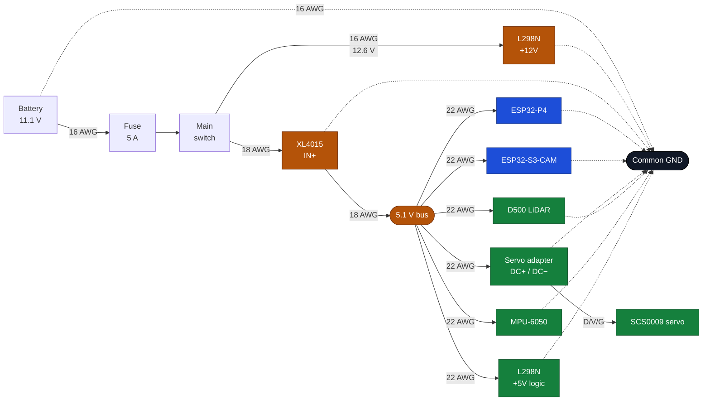
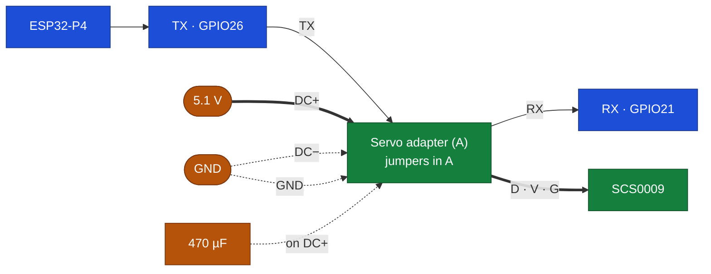
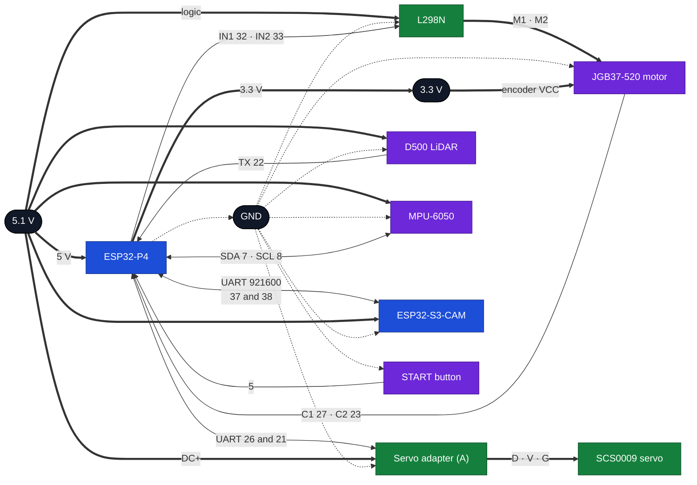

# AutoNex electronics

This is the electrical side of the car: which components we chose, how they are powered and
how they ended up connected to each other. The idea is simple: anyone on the team should be
able to open the car, look at a wire and know where it comes from, what it is for and what
happens if they unplug it.

We worked in three steps. First we reviewed what the rules require of the vehicle
electrically, which in the end is what decides between one component and another. Then we
chose each part by comparing datasheets rather than shop descriptions, because sales
listings mix variants and change without warning. And finally we built the wiring and tested
it piece by piece, writing down what we measured.

---

## The components

**3S LiPo battery.** It is the only energy source. Three cells in series, 11.1 V nominal,
12.6 V charged and 2200 mAh at 25C discharge. We use XT60 connectors because they cannot be
reversed, and we have marked the positive in red since day one. The safety cutoff is at
9.9 V (3.3 V per cell); below that the battery is damaged.

**XL4015 converter.** It steps the battery's 12.6 V down to the 5.1 V that the boards, the
LiDAR and the servo need. It is a 5 A non-isolated buck, so input and output share ground.
That defines a rule for the whole build: there is a single GND in the car. We set it to
5.1 V rather than 5.0 V to compensate for the drop in the cables; we never go above 5.5 V
because at that point the electronics are at risk.

**L298N.** It is the H-bridge that drives the motor. It receives the logic commands and
switches the battery voltage, which lets us move forward, reverse and brake. It handles 2 A
per channel with a 4 A peak, and at full load it drops about 2 V along the way, a detail to
keep in mind when calculating speeds.

**JGB37-520 motor.** A 12 V gearmotor with a built-in quadrature Hall encoder. The unit
fitted now is 600 rpm and the final one will be 1000 rpm. The reduction is 10:1 and the
encoder delivers 11 pulses per channel per motor revolution, so at the output shaft we count
440 counts per revolution. It is mounted on the rear axle, with both wheels physically
joined.

**SCS0009 servo.** It moves the steering. It is a bus servo, not a pulse servo: it is sent
the position over a serial protocol and it answers with its status. It works between 4 and
7.4 V, with 2.3 kg·cm of stall torque at 6 V, 300° of travel split into 1024 steps and metal
gears. It draws 150 mA idle and up to 1 A if it stalls. A single data wire carries both the
question and the answer, so the bus is half-duplex. We connect it through the serial bus
servo driver board, which separates TX and RX, keeps the reply at 3.3 V and distributes power
from the 5.1 V bus.

**Serial bus servo driver board (253 ST/SC).** It is the Waveshare adapter that sits between
the P4 and the SCS0009. It supports up to 253 ST/SC servos, has two `D/V/G` ports, a 3.3 V
UART header and jumpers to select UART or USB. We power it from the 5.1 V bus and the servo
plugs directly into one of its ports.

**MPU-6050.** The GY-521 module with a six-axis accelerometer and gyroscope over I²C. We
care about the rotation on the Z axis, which is what tells us how much the car is turning.
It has a 3.3 V regulator and pull-up resistors on the board itself, so it can be powered at
5 V without risk to the bus. With `AD0` tied to ground it responds at address 0x68. We do
not use the auxiliary `XDA` and `XCL` pins.

**D500 LiDAR.** A 360° time-of-flight laser scanner. It reaches 12 m, spins at 10
revolutions per second and delivers about 5000 points per second over UART at 230400 baud.
It is powered at 5 V with about 290 mA and uses a four-pin ZH1.5 connector. It is the sensor
that gives us the map of the surroundings, so it sits on the upper part of the car with
nothing blocking its sweep.

**ESP32-P4.** The board that coordinates everything. 32 MB of PSRAM, two RISC-V cores and
27 usable GPIOs spread over two 20-pin rows. It is powered at 5 V through the header and has
two USB-C ports: one for data and one, with a CH343P chip, that is the console.

**ESP32-S3-CAM.** The second board, the camera one. It is an ESP32-S3-WROOM N16R8 module with
8 MB of PSRAM, 16 MB of flash, a dual-core LX7 and a 2 MP OV3660 camera soldered onto the
board itself. We chose it because the camera comes already mounted and the PSRAM is enough
for the frames, without having to add another board. Electrically three things matter to us:
it hangs off the same 5.1 V bus, it draws about 180 mA with the camera working and up to
300 mA at start-up, and it talks to the P4 over a UART at 921600 baud. Its Wi-Fi and
Bluetooth are off during the rounds, as the rules require, and that also removes the current
spike of the radio.

**Protection.** A main switch, a start button and a fuse. All three are mandatory, not
accessories: without a switch the car cannot be turned on as the rules require, without a
button there is no way to start, and without a fuse a short on the LiPo is a fire.

---

## The complete system

This is how it all fits together. Thick arrows are power and thin ones are signal.

---

## How the car is powered

Everything hangs off the same point. The battery comes in through the XT60, goes through the
fuse and then through the switch. From there two branches leave: one straight to the L298N
for the motor, and another to the XL4015 for the 5 V.

The fuse is 5 A and we chose it with numbers, not by habit. The final motor asks for 2.5 A in
the worst case according to the catalogue, and the electronics are around 1 A, so the total
peak comes to about 3.5 A: a 5 A fuse leaves room for start-ups and blows quickly if there is
a short circuit. The 600 rpm one fitted now is still to be measured, but the fuse does not
change.

The consumption on the 5 V line works out like this:

| Load | Typical | Peak |
|---|---|---|
| ESP32-P4 | 350 mA | 550 mA |
| ESP32-S3-CAM | 180 mA | 300 mA |
| LiDAR | 290 mA | 320 mA |
| Servo | 150 mA | 1000 mA |
| Servo adapter (logic) | 20 mA | 30 mA |
| L298N logic | 25 mA | 30 mA |
| IMU | 4 mA | 4 mA |
| **Total** | **≈ 1.0 A** | **≈ 2.2 A** |

The XL4015 delivers 5 A, but without a heatsink we prefer not to go above 2.5 A, so we are
tight but within limits. Adding the motor, the battery delivers at most 3.5 A peak, well
below what a 2200 mAh 25C pack can handle.

There are three things that must be clear in the build. First: the 5 V supplied by the L298N
itself cannot be used to power the board, because it comes from a small regulator that heats
up and injects noise. Second: the servo adapter must hang off the converter with its own pair
of cables and its capacitor, because the servo's start-up peak is enough to bring the board
down. Third: all the negatives go to the same point. A floating GND between the motor and the
signal turns into garbage data.

---

## Motor and steering

The motor uses a single channel of the L298N. The commands go through `IN1` and `IN2`, and
the `ENA` jumper stays fitted so that the channel is always enabled. PWM is applied to the
inputs, not to the enable, which is why that jumper cannot be removed.

The unit fitted now is 600 rpm, for testing; the final one is 1000 rpm. The wiring does not
change, because the reduction and the encoder are the same, but the maximum speed and the
odometry do: the 440 pulses per revolution stay, but the relationship between duty cycle and
speed changes, and it has to be measured again the day the motor is swapped. The difference
between the two units is 1.67 times.

| IN1 | IN2 | What the motor does |
|---|---|---|
| PWM | 0 | Moves forward, speed follows the duty cycle |
| 0 | PWM | Moves backward |
| 0 | 0 | Freewheels |
| 1 | 1 | Brakes hard, we do not use it to stop |

The module's 5 V jumper is removed and we power the logic from the XL4015. It is a small
change that keeps the L298N regulator from heating up and contaminating the line.

### The motor connector

The motor has a six-pin connector on the rear cover. The order is silkscreened on the board
itself, and that is the one we use:

| Pin | Silkscreen | Signal | Goes to |
|---|---|---|---|
| 1 | `M1` | Motor + | L298N `OUT1` |
| 2 | `GND` | Encoder ground | Common GND |
| 3 | `C1` | Channel A | GPIO27 |
| 4 | `C2` | Channel B | GPIO23 |
| 5 | `VCC` | Encoder supply | 3.3 V |
| 6 | `M2` | Motor − | L298N `OUT2` |

The seller includes a different numbered diagram, which lists `MOTOR+`, `MOTOR−`,
`HALL GND`, `HALL Vcc`, `HALL A` and `HALL B` in that order. It does not match the
silkscreen, which is why the number in the drawing is useless. Before connecting, it is
checked with the multimeter: `M1` and `M2` are the only pair with low resistance, a few
ohms, because they are the motor winding; the rest are signals.

The encoder channels have 4.7 kΩ resistors to 3.3 V, because the sensor output is open
collector and without them the counts arrive incomplete.

### The steering servo

The SCS0009 is not controlled with pulses like a normal servo. It is a bus servo: it receives
packets over one wire and answers over the same wire, half-duplex. To connect it to the P4 we
use the Waveshare servo bus adapter (A) (SKU 25514), which bridges that single wire and the
microcontroller's UART, keeps the reply at 3.3 V on the board side and distributes the
servo's power. The servo ships with a small TTL board in the box; we do not use it, it stays
as a spare to test the servo on its own with a USB-TTL adapter.

The adapter is a 42 × 33 mm board with two identical servo ports, a three-pin UART header, a
`DC+`/`DC−` terminal block, a DC5521 jack and a USB-C port. Both jumpers go in row `A`, which
connects the bus driver to the UART header; row `B` connects it to the USB CH343P. In `A` the
adapter does not need a PC.

The servo connector is three-pin and has a tab, but it can be forced in backwards. The
adapter port is silkscreened `D V G`; before plugging it in we check that black sits on `G`,
red on `V` and white on `D`:

| Servo pin | Color | Signal | Goes to |
|---|---|---|---|
| 1 | black | GND | adapter `G` port |
| 2 | red | VCC | adapter `V` port, which delivers the 5.1 V bus |
| 3 | white | DATA | adapter `D` port |

The adapter has two identical ports in parallel. We use one and the other stays free to chain
a second servo with another ID. The adapter connections are these:

| Connection | Goes to | Cable |
|---|---|---|
| `DC+` | 5.1 V bus | 22 AWG |
| `DC−` | common GND | 22 AWG |
| `TX` | P4 `GPIO26`, TX | 22 AWG |
| `RX` | P4 `GPIO21`, RX | 22 AWG |
| UART header `GND` | common GND | 22 AWG |
| Port `D`, `V`, `G` | servo | servo cable |

On the board the header reads `TX`, `RX`, `GND` from left to right, with `GND` next to the
corner screw. It is three pins.

Mind the names: the adapter's `TX` is the input through which the P4 transmits and `RX` is
the output through which the P4 receives, so they go with the same name and are not crossed.
Waveshare says so explicitly in its documentation: RX with RX and TX with TX. If they are
crossed, the servo does not answer and looks dead.

The UART header is 3.3 V. Both buffers on the adapter are powered from the board's own
AMS1117-3.3, so the servo reply never reaches 5 V at `GPIO21`. No divider or level shifter is
needed. The P4's `TX` at 3.3 V goes in without a problem, because the servo datasheet accepts
2 to 5 V on its input. The header has no power pin: no 3.3 V is taken from the P4 to the
adapter. Its logic comes from `DC+`, and the only wire it shares with the board is GND.

**Power.** The adapter does not regulate the servo voltage: the port's `V` pin delivers the
same voltage that enters through `DC+`. That is why we power it from the 5.1 V bus, which is
within the SCS0009's 4 to 7.4 V range. The silkscreen says `DC 9~12.6V` because the board is
designed for ST servos, which run at 12 V; for SC servos the useful range is 5 to 8.4 V and
our 5.1 V is valid. The logic is powered separately, from an internal regulator that steps
the input down to 5 V and then to 3.3 V; with 5.1 V in, the 5 V regulator has no headroom to
regulate and the voltage passes almost as is, so during bring-up we measure that the 3.3 V is
present before connecting the servo. If it does not start, the solution is to power only the
adapter from a 6 V branch, not to raise the whole bus.

The input has a reverse-polarity protection MOSFET and a TVS, so a reversed cable does not
burn the board. We use the terminal block and not the jack, because the terminal block does
not come loose with vibration; the cables go with ferrule terminals. The 470 µF capacitor
goes between `DC+` and `DC−`, right next to the terminal block: it is what absorbs the servo's
start-up peak before it reaches the 5.1 V bus.

The adapter is not a simple connector. It has two buffers and a transistor that detect when
the P4 is transmitting: when the TX line is idle, the transmit buffer goes high-impedance and
a resistor holds the wire high, so the servo can answer; when the P4 starts transmitting, the
transistor enables the buffer, which pulls the wire low. The receive buffer is disabled while
the line is low, so the adapter does not hear itself. That is how the P4 can use a normal
UART, with TX and RX separate, even though the servo talks over a single wire.

The direct wiring we tried before, with a 1 kΩ resistor on TX and a divider on receive, is
ruled out for the final installation: the adapter does both things and also distributes
power. The resistor is still only useful to test the servo on its own with a supply and a
USB-TTL adapter, never inside the car.

The values that must be respected: 4 to 7.4 V supply, 2.3 kg·cm stall torque at 6 V,
0.7 kg·cm rated torque, 300° in 1024 steps (0.293° per step), 0.1 s per 60° at 6 V, 150 mA
idle and 1 A stall. It comes from the factory with ID 1 and at 1 Mbit/s; if the speed is
changed it must be done carefully, because if it is written wrong the servo stops responding
and has to be recovered with the manufacturer's tool.

Because it is a bus servo, it also returns the actual position it is in. That lets us know the
wheel angle without depending on having measured the pulses by hand, which was the most
fragile point of the previous servo.

---

## Connection map

This diagram shows both things at once: the signals and the two lines that run through every
module. Thick arrows are power, thin ones are signal and dotted ones are ground.

### Power and ground

Each module needs its positive and its negative, and those do not appear in the signal
tables. Here they all are, including the ones going to 3.3 V.

| Module | Pin | Goes to | Cable |
|---|---|---|---|
| Battery | XT60 `+` | 5 A fuse | 16 AWG |
| Battery | XT60 `−` | Common GND | 16 AWG |
| XL4015 | `IN+` | Main switch, 12.6 V | 18 AWG |
| XL4015 | `IN−` | Common GND | 18 AWG |
| XL4015 | `OUT+` | 5.1 V bus | 18 AWG |
| XL4015 | `OUT−` | Common GND | 18 AWG |
| ESP32-P4 | `5V` | 5.1 V bus | 22 AWG |
| ESP32-P4 | `GND` | Common GND | 22 AWG |
| ESP32-P4 | `3V3` | Encoder `VCC` and pull-ups | 22 AWG |
| ESP32-S3-CAM | `5V` | 5.1 V bus | 22 AWG |
| ESP32-S3-CAM | `GND` | Common GND | 22 AWG |
| L298N | `+12V` | Fuse and switch | 16 AWG |
| L298N | `GND` | Common GND | 16 AWG |
| L298N | `+5V` | 5.1 V bus, logic only | 22 AWG |
| Motor | `VCC` | P4 `3V3` | 22 AWG |
| Motor | `GND` | Common GND | 22 AWG |
| Servo adapter | `DC+` | 5.1 V bus | 22 AWG |
| Servo adapter | `DC−` | Common GND | 22 AWG |
| Servo adapter | UART header `GND` | Common GND | 22 AWG |
| Servo | `V`, red | Adapter `V` port | servo cable |
| Servo | `G`, black | Adapter `G` port | servo cable |
| LiDAR | `P5V` | 5.1 V bus | 22 AWG |
| LiDAR | `GND` | Common GND | 22 AWG |
| IMU | `VCC` | 5.1 V bus | 22 AWG |
| IMU | `GND` | Common GND | 22 AWG |
| IMU | `AD0` | GND, to leave the address at 0x68 | 22 AWG |
| Button | Terminal 2 | Common GND | 22 AWG |

### Signals

| Module | Pin | Goes to | Cable |
|---|---|---|---|
| L298N | `IN1` | P4 `GPIO32` | 22 AWG |
| L298N | `IN2` | P4 `GPIO33` | 22 AWG |
| L298N | `OUT1` | Motor `M1` | 16 AWG |
| L298N | `OUT2` | Motor `M2` | 16 AWG |
| L298N | `ENA` | Jumper fitted, no cable | — |
| Motor | `C1` | P4 `GPIO27` | 22 AWG |
| Motor | `C2` | P4 `GPIO23` | 22 AWG |
| Motor | `C1` and `C2` | 4.7 kΩ pull-ups to 3.3 V | 22 AWG |
| Servo adapter | `TX` | P4 `GPIO26`, TX | 22 AWG |
| Servo adapter | `RX` | P4 `GPIO21`, RX | 22 AWG |
| Servo | `D`, white | Adapter `D` port | servo cable |
| LiDAR | `TX` | P4 `GPIO22` | 22 AWG |
| LiDAR | `PWM` | GND, not to the P4 | 22 AWG |
| IMU | `SDA` | P4 `GPIO7` | 22 AWG |
| IMU | `SCL` | P4 `GPIO8` | 22 AWG |
| S3-CAM | `GPIO1`, TX | P4 `GPIO38` | 22 AWG |
| S3-CAM | `GPIO14`, RX | P4 `GPIO37`, only if the return path is used | 22 AWG |
| Button | Terminal 1 | P4 `GPIO5` | 22 AWG |

### What is left unconnected

| Module | Pins | Why |
|---|---|---|
| L298N | `IN3`, `IN4`, `OUT3`, `OUT4`, `ENB` | The second channel is not used: there is only one motor |
| IMU | `INT` | No part of the car uses it |
| IMU | `XDA`, `XCL` | They are the module's auxiliary I²C gateway and are not needed |
| S3-CAM | microSD and RGB LED | Not used in the car; the card occupies `GPIO38` to `GPIO40` and the LED `GPIO48` |
| Servo adapter | USB-C and DC5521 jack | USB is for configuring it from a PC and the jack duplicates the terminal block; we power it through the terminal block |
| Servo adapter | Second `D/V/G` port | Stays free for a second servo with another ID |

### The four connections that invite confusion

**The LiDAR has a single signal because it only talks.** The D500 does not receive commands:
it delivers the sweep and nothing else. Its four-pin connector is `P5V`, `GND`, `TX` and
`PWM`, and of those four only `TX` goes to the P4 (`GPIO22`). `PWM` is not a signal from the
microcontroller: it is taken to GND so that the sensor spins at 10 Hz on its own. If it is
left floating, the internal motor does not spin and not a single data point arrives. Power
goes separately, from the 5.1 V bus, with its own pair of cables.

**The IMU has four wires, not two.** `VCC` and `GND` to power it, `SDA` and `SCL` for the
data. `AD0` is tied to GND so that it responds at 0x68; if it is left floating the address is
undefined. The `INT` interrupt is not connected, which is why the P4's `GPIO6` stays free.

**On the S3-CAM the link pins are on the other side of the header.** The camera occupies
`GPIO4` to `GPIO13` and `GPIO15` to `GPIO18`, and the microSD occupies `GPIO38` to `GPIO40`,
so the link uses `GPIO1` to transmit and `GPIO14` to receive, which are two of the few that
remain free. `GPIO2` is also free, but it has a board LED on it and we prefer not to confuse
the blinking with link activity. On the P4 side the link comes in on `GPIO38` and goes out on
`GPIO37`, and both run twisted with their GND.

**The servo is not connected straight to the P4.** The SCS0009 talks over a single wire and
the P4 has a UART with separate TX and RX. The Waveshare adapter makes that conversion and
keeps the reply at 3.3 V. That is why `GPIO26` goes to the adapter's `TX` and `GPIO21` to
`RX`, with the same name and without crossing them. Power does not come from the P4 either:
it enters through `DC+` from the 5.1 V bus and leaves through the `V` pin of the `D/V/G`
port.

### The P4 pins that are left alone

There are pins that are not used even though they look free, because on this board they
already have an owner. `GPIO24` and `GPIO25` are USB OTG and JTAG over USB: if we occupy them
we lose the way to flash and to see the logs. `GPIO7` and `GPIO8` are the board's own I²C bus,
where the audio codec and the touch panel hang; we use them for the IMU because the MPU-6050
responds at 0x68 and does not clash with the codec's 0x18 or the touch panel's 0x5D.

The board also has audio on `GPIO9` to `GPIO13`, the microSD on `GPIO39` to `GPIO44`,
Ethernet on `GPIO28` to `GPIO31` and on `GPIO49` to `GPIO52`, the sound amplifier on
`GPIO53`, the Wi-Fi chip reset on `GPIO54` and the indicator LED on `GPIO45`.

`GPIO0`, `GPIO34`, `GPIO35` and `GPIO36` are boot configuration pins. `GPIO37` and `GPIO38`
are too, and they also go to the console's CH343P, but we use them for the link with the
S3-CAM: normal boot only looks at `GPIO35`, which has its own pull-up and is not touched, and
the console USB is disconnected during the rounds.

With all that, the ones left free are `GPIO2`, `GPIO3`, `GPIO4`, `GPIO6`, `GPIO20`,
`GPIO46`, `GPIO47` and `GPIO48`. The first three are the board's JTAG pins, which we do not
use because we debug over USB, so they remain as normal GPIOs. `GPIO20` also has an ADC,
which is what is needed for the divider that will monitor the battery. We do not count
`GPIO0` and `GPIO1` as free: the board shares them with the 32 kHz crystal and a resistor
would have to be lifted to use them cleanly.

### How each cable runs

| From | To | Gauge |
|---|---|---|
| Battery + | Fuse, switch and L298N `+12V` | 16 AWG |
| Battery − | Common GND point | 16 AWG |
| L298N `OUT1` and `OUT2` | Motor `M1` and `M2` | 16 AWG |
| XL4015 `OUT+` | 5.1 V bus | 18 AWG |
| 5.1 V bus | Both boards, LiDAR and L298N logic | 22 AWG |
| 5.1 V bus | Servo adapter, with its own pair from the distribution point | 22 AWG |
| Signals and encoder | Board | 22 AWG |
| 3.3 V source | Encoder `VCC` and pull-ups | 22 AWG |
| Servo adapter | Servo | servo cable, short |
| UART link to the S3-CAM | Board | 22 AWG, short and twisted with GND |

The LiDAR's `PWM` pin goes to GND: if it is left floating, the internal motor does not spin
and there is no data. The power connectors are XT60 and terminal blocks; dupont only remains
for signals.

The link between the two boards runs short, twisted with its own GND and away from the motor
cables. At 921600 baud the cable behaves like a transmission line and a long loop next to the
motor introduces errors that are hard to find later, because the symptom is a detection table
that arrives half complete.

---

## Bring-up

We do not connect anything without having done this first, and we repeat it every time we
change a cable.

1. Without the battery, we check with the multimeter that the 12 V positive has no
   continuity to GND, and the same for the 5 V one.
2. We power the XL4015 alone, with a 12 V lab supply, and set the output to 5.1 V with no
   load. We repeat with a 10 Ω resistor connected and adjust again.
3. We connect the 5 V bus and measure again at the board's pin.
4. We turn the board on alone and confirm that it boots.
5. We connect the LiDAR and check that it spins and delivers data.
6. We connect the IMU and check that it responds over I²C at address 0x68.
7. We power the S3-CAM and check the link at 921600: that the table arrives complete and
   that there are no truncated frames or framing errors.
8. We turn the motor shaft by hand and see that the encoder counts in both directions.
9. Before connecting the servo, we check that both adapter jumpers are in row `A`, measure
   5.1 V between `DC+` and `DC−` and 5.1 V between `V` and `G` on the servo port. The
   adapter's `PWR` LED must light: it is the sign that the internal regulator produced the
   3.3 V. Only then do we connect the servo and move it with the wheels in the air, first
   just a few degrees, and check that it responds and returns a coherent position. If the LED
   does not light with 5.1 V in, we do not continue: we move the adapter to a 6 V branch.
10. Finally the motor, also in the air and with PWM at 10 %.

If something fails, the last thing that was added is disconnected and we go back. That way
the error shows up where it is and not in any one of the twenty cables inside the car.

---

## Decisions we made

**The driver.** We had two options on the table: two IRF520 modules or an L298N. We went
with the L298N because the IRF520 is a one-way MOSFET: it connects the load to ground and
cannot reverse polarity. Two of them do not make an H-bridge, they are still two switches to
GND, and the car needs to go forward and backward. It was not a matter of taste.

**Starting.** The rules require a switch to turn on and a button to start, and forbid any
wireless communication, including the Wi-Fi the board ships with. That is why we ruled out
starting from the phone and also the board's button, which is also a configuration pin and
can leave the car in download mode if pressed at the wrong moment. The solution is an
external button between `GPIO5` and GND, with the internal pull-up.

**The servo and its adapter.** We moved from the pulse servo to the SCS0009 for two reasons.
The first is that its gears are metal and its torque is similar with less wear, which matters
in a car that will turn thousands of times. The second is that it returns the actual
position, so we do not depend on having measured the pulses by hand to know where the wheels
are. The price is that it has to be treated as a serial bus and not as a PWM output. For that
we chose the Waveshare adapter and not the small board that comes in the box: the adapter
already brings the half-duplex driver, the 3.3 V levels, the power terminal block with
reverse-polarity protection and two servo ports, so the wiring reduces to two power cables
and three signal cables, and nothing is left soldered in the air. The included board stays as
a spare to test the servo on its own. The jumpers go in `A` because the P4 speaks UART;
position `B` is for configuring the servo from a PC over USB.

**The IMU.** The GY-521 with MPU-6050 is the most documented module there is for this, it
comes in packs of three and its library is everywhere. For measuring rotation in Z it is more
than enough, and the fact that it has a regulator and pull-ups on board simplifies the
wiring.

**The two boards.** The P4 does not have a camera; the S3-CAM does, with the lens soldered on
and PSRAM to spare for the frames. That is why the car carries two: the P4 keeps the sensors
and the control, and the S3-CAM the camera and the serial link. Each has its own 3.3 V
regulator, so the noise of one does not leak into the other through the power supply, and
between the two there is only a serial link with shared GND.

**The LiDAR.** We went with the D500. Compared with alternatives in the same range, it works
by time of flight and not by triangulation, which lets it work under strong ambient light and
detect dark objects. The trade-off is that its protocol has to be followed to the letter, but
the sensor is clearly better for a track with walls and colored pillars.

**The connectors.** The battery already came with XT60 and we moved the rest of the car to
that same type. Dupont only remains for signals, never for power.

---

## What is still missing

We still have to measure the real motor current with the complete car, because the 2.5 A
stall figure is taken from the 1000 rpm motor's catalogue and not from our own measurement;
the 600 rpm one fitted now may give another number. We also have to test the servo at
1 Mbit/s with the adapter and the real cable, and confirm that the cable length does not
introduce errors, because the bus is half-duplex and sensitive to wire capacitance. The test
is done with the servo mounted, not with the short bench cable.

With the oscilloscope we have to look at the adapter's `RX`, which is what arrives at
`GPIO21`. It must stay between 0 and 3.3 V. The adapter should already deliver it that way
because its buffers are powered from the internal 3.3 V; if a 5 V spike appears, we do not
connect `GPIO21` and we check the board before continuing.

We still have to measure the servo torque at 5.1 V with the steering mounted. If it is not
enough to turn the wheels while stopped, we change only the adapter's power to a 6 V branch;
the rest of the car stays at 5.1 V. And confirm that the adapter's internal regulator starts
with 5.1 V in, which is what the `PWR` LED says.

And the motor swap is pending: going from the 600 rpm one to the 1000 rpm one and measuring
speed, current and odometry again. The encoder and the wiring do not change, but the
relationship between duty cycle and speed does, and it has to be measured again.

Separately, building the voltage divider on `GPIO20`, which has an ADC, to monitor the
battery during the round, and fixing the final position of the switch and the button, so that
the judge can see them and operate them without taking anything apart.

On the S3-CAM we have to confirm the camera when the board arrives: the supplier's text says
OV3660 and in the photo an OV2640 is silkscreened, so the real revision is checked on the
module and noted here. Power and the link do not change, but the model does affect what has
to be configured in the sensor.

When the car is closed up we will do a three-minute continuous test with everything on,
which is exactly how long a round lasts, and note the final current and temperature values
here.
