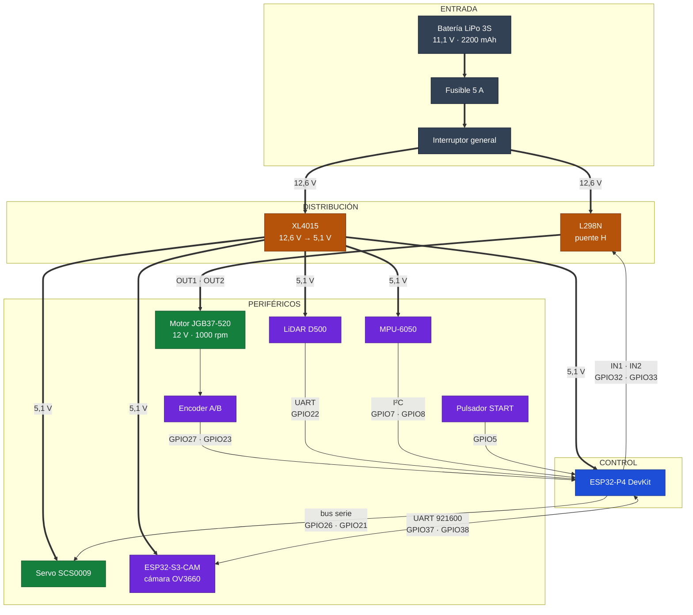
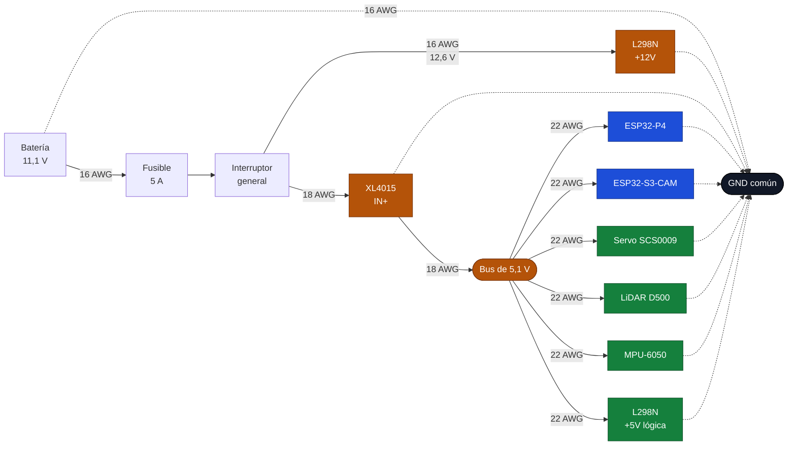
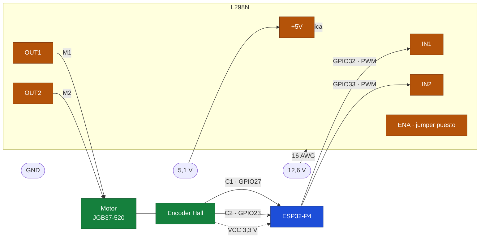
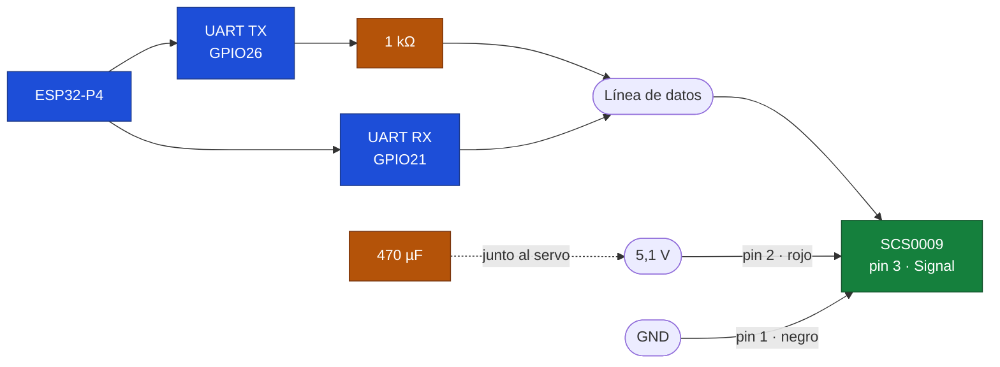
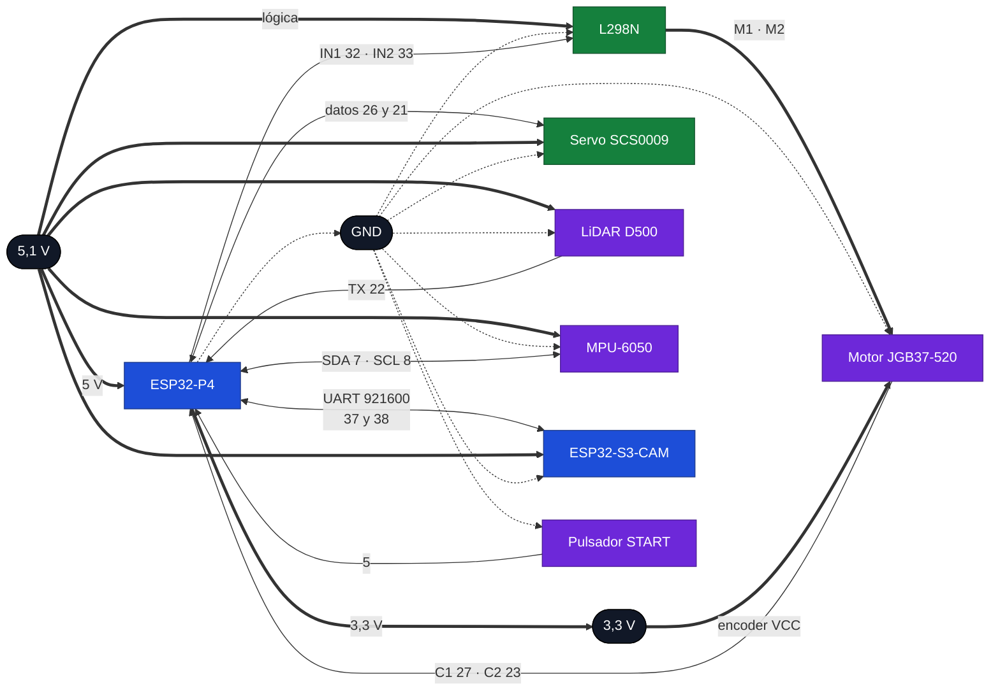

# Electrónica del AutoNex

Esta es la parte eléctrica del coche: qué componentes escogimos, cómo se alimentan y cómo
quedaron conectados entre sí. La idea es simple: que cualquiera del equipo pueda abrir el
coche, ver un cable y saber de dónde viene, para qué sirve y qué pasa si lo desconecta.

Trabajamos en tres pasos. Primero revisamos qué le exige el reglamento al vehículo en
materia eléctrica, que al final es lo que decide entre un componente y otro. Después
elegimos cada pieza comparando datasheets y no descripciones de tienda, porque los
listados de venta mezclan variantes y cambian sin avisar. Y al final armamos el cableado y
lo fuimos probando por partes, dejando por escrito lo que medimos.

---

## Los componentes

**Batería LiPo 3S.** Es la única fuente de energía. Tres celdas en serie, 11,1 V nominales,
12,6 V cargada y 2200 mAh con descarga de 25C. Usamos conectores XT60 porque no se pueden
invertir, y marcamos el positivo con rojo desde el primer día. El corte de seguridad está
en 9,9 V (3,3 V por celda); por debajo de eso la batería se daña.

**Convertidor XL4015.** Baja los 12,6 V de la batería a los 5,1 V que necesitan las placas,
el LiDAR y el servo. Es un reductor no aislado de 5 A, así que la entrada y la salida
comparten tierra. Eso define una regla de todo el montaje: hay un solo GND en el coche.
Lo ajustamos a 5,1 V y no a 5,0 V para compensar la caída en los cables; nunca pasamos de
5,5 V porque ahí ya se pone en riesgo la electrónica.

**L298N.** Es el puente H que mueve el motor. Recibe las órdenes lógicas y conmuta la
tensión de la batería, lo que nos deja avanzar, retroceder y frenar. Aguanta 2 A por canal
con 4 A de pico, y a plena carga se deja unos 2 V en el camino, un detalle que hay que
tener en cuenta al calcular velocidades.

**Motor JGB37-520.** Motorreductor de 12 V y 1000 rpm con encoder Hall de cuadratura
incorporado. La reducción es 10:1 y el encoder entrega 11 pulsos por canal por vuelta del
motor, así que en el eje de salida contamos 440 cuentas por vuelta. Va montado en el eje
trasero, con las dos ruedas unidas físicamente.

**Servo SCS0009.** Mueve la dirección. Es un servo de bus, no de pulso: se le manda la
posición por un protocolo serie y él responde con su estado. Trabaja entre 4 y 7,4 V, con
2,3 kg·cm a 6 V, 300° de recorrido repartidos en 1024 pasos y engranajes metálicos.
Consume 150 mA en vacío y hasta 1 A si se bloquea. Un solo cable de datos lleva la
pregunta y la respuesta, así que el bus es de medio dúplex.

**MPU-6050.** El módulo GY-521 con acelerómetro y giroscopio de seis ejes por I²C. Nos
interesa el giro en el eje Z, que es el que dice cuánto está rotando el coche. Trae
regulador de 3,3 V y resistencias de pull-up en la propia placa, así que se puede alimentar
a 5 V sin riesgo para el bus. Con `AD0` a tierra responde en la dirección 0x68. Los pines
auxiliares `XDA` y `XCL` no los usamos.

**LiDAR D500.** Escáner láser de 360° por tiempo de vuelo. Alcanza 12 m, gira a 10 vueltas
por segundo y entrega unos 5000 puntos por segundo por UART a 230400 baudios. Se alimenta
a 5 V con unos 290 mA y usa un conector ZH1.5 de cuatro pines. Es el sensor que nos da el
mapa del entorno, así que va en la parte alta del coche y sin nada que le tape el barrido.

**ESP32-P4.** La placa que coordina todo. 32 MB de PSRAM, dos núcleos RISC-V y 27 GPIO
útiles repartidos en dos hileras de 20 pines. Se alimenta a 5 V por el header y tiene dos
puertos USB-C: uno para datos y otro, con chip CH343P, que es la consola.

**ESP32-S3-CAM.** La segunda placa, la de la cámara. Es un módulo ESP32-S3-WROOM N16R8 con
8 MB de PSRAM, 16 MB de flash, doble núcleo LX7 y una cámara OV3660 de 2 MP soldada en la
propia placa. La escogimos porque la cámara ya viene montada y la PSRAM alcanza para los
fotogramas, sin tener que añadir otra placa. Eléctricamente nos importan tres cosas: cuelga
del mismo bus de 5,1 V, consume unos 180 mA con la cámara trabajando y hasta 300 mA en el
arranque, y se comunica con el P4 por un UART a 921600 baudios. Su Wi-Fi y su Bluetooth van
apagados durante las rondas, como pide el reglamento, y eso además quita el pico de consumo
del radio.

**Protección.** Un interruptor general, un pulsador de arranque y un fusible. Los tres son
obligatorios, no accesorios: sin interruptor no se puede encender el coche como pide el
reglamento, sin pulsador no hay forma de dar la salida y sin fusible un corto en la LiPo
es un incendio.

---

## El sistema completo

Así queda todo junto. Las flechas gruesas son potencia y las finas son señal.

---

## Cómo se alimenta el coche

Todo cuelga del mismo punto. La batería entra por el XT60, pasa por el fusible y luego por
el interruptor. De ahí salen dos ramas: una directa al L298N para el motor, y otra al
XL4015 para los 5 V.

El fusible va de 5 A y lo elegimos con números, no por costumbre. El motor pide 2,5 A en
el peor caso y la electrónica ronda 1 A, así que el pico total queda en unos 3,5 A: un
fusible de 5 A deja margen para los arranques y corta rápido si hay un cortocircuito.

El consumo en la línea de 5 V queda así:

| Carga | Típico | Pico |
|---|---|---|
| ESP32-P4 | 350 mA | 550 mA |
| ESP32-S3-CAM | 180 mA | 300 mA |
| LiDAR | 290 mA | 320 mA |
| Servo | 150 mA | 1000 mA |
| Lógica del L298N | 25 mA | 30 mA |
| IMU | 4 mA | 4 mA |
| **Total** | **≈ 1,0 A** | **≈ 2,2 A** |

El XL4015 da 5 A, pero sin disipador preferimos no pasar de 2,5 A, así que vamos justos
pero dentro. Sumando el motor, la batería entrega como mucho 3,5 A de pico, muy por debajo
de lo que aguanta una 2200 mAh de 25C.

Hay tres cosas que hay que tener claras en el montaje. La primera: el 5 V que entrega el
propio L298N no sirve para alimentar la placa, porque sale de un regulador pequeño que se
calienta y mete ruido. La segunda: el servo tiene que colgar del convertidor con su propio
cable y su condensador, porque su pico de arranque alcanza para tumbar la placa. La
tercera: todos los negativos van al mismo punto. Un GND flotante entre el motor y la señal
se convierte en datos basura.

---

## Motor y dirección

El motor usa un solo canal del L298N. Las órdenes van por `IN1` e `IN2`, y el jumper de
`ENA` queda puesto para que el canal esté siempre habilitado. El PWM se aplica sobre las
entradas, no sobre la habilitación, y por eso ese jumper no se puede quitar.

| IN1 | IN2 | Qué hace el motor |
|---|---|---|
| PWM | 0 | Avanza, la velocidad sigue al ciclo de trabajo |
| 0 | PWM | Retrocede |
| 0 | 0 | Queda libre |
| 1 | 1 | Frena en seco, no lo usamos para parar |

El jumper de 5 V del módulo lo quitamos y alimentamos la lógica desde el XL4015. Es un
cambio pequeño que evita que el regulador del L298N se caliente y contamine la línea.

### El conector del motor

El motor trae un conector de seis pines en la tapa trasera. El orden está serigrafiado en
la propia placa, y es el que usamos:

| Pin | Serigrafía | Señal | Va a |
|---|---|---|---|
| 1 | `M1` | Motor + | L298N `OUT1` |
| 2 | `GND` | Masa del encoder | GND común |
| 3 | `C1` | Canal A | GPIO27 |
| 4 | `C2` | Canal B | GPIO23 |
| 5 | `VCC` | Alimentación del encoder | 3,3 V |
| 6 | `M2` | Motor − | L298N `OUT2` |

El vendedor adjunta un esquema numerado distinto, que pone `MOTOR+`, `MOTOR−`,
`HALL GND`, `HALL Vcc`, `HALL A` y `HALL B` en ese orden. No coincide con la serigrafía, y
por eso el número del dibujo no sirve. Antes de conectar, se comprueba con el multímetro:
`M1` y `M2` son el único par con resistencia baja, de unos pocos ohmios, porque son el
bobinado del motor; el resto son señales.

Los canales del encoder llevan resistencias de 4,7 kΩ a 3,3 V, porque la salida del sensor
es de colector abierto y sin ellas las cuentas llegan incompletas.

### El servo de dirección

El SCS0009 no se controla con pulsos como un servo normal. Es un servo de bus: recibe
paquetes por un cable y contesta por el mismo cable. Ese cable es el que hay que llevar al
P4, y como el bus es de medio dúplex, la transmisión y la recepción comparten la línea.

| Pin del conector | Color típico | Señal | Va a |
|---|---|---|---|
| 1 | negro | GND | GND común |
| 2 | rojo | VCC | bus de 5,1 V |
| 3 | blanco | Signal / TTL | línea de datos |

La resistencia de 1 kΩ en serie con la salida es lo que permite que los dos hablen por el
mismo hilo: cuando el P4 transmite, la línea la maneja él, y cuando el servo responde, su
salida puede tirar de la línea hacia abajo sin pelearse con el pin del P4. Sin esa
resistencia, los dos se pisan y la comunicación falla de forma intermitente, que es el
peor tipo de falla.

Los valores que hay que respetar: 6 V nominales, aunque el rango va de 4 a 7,4 V, así que
funciona con nuestra línea de 5,1 V, con la salvedad de que el par baja un poco respecto a
los 2,3 kg·cm que anuncia el catálogo a 6 V. Velocidad de 0,1 s por 60° a 6 V y 1024 pasos
para 300°, o sea 0,293° por paso. Viene de fábrica con la dirección 1 y a 1 Mbit/s; si se
cambia la velocidad hay que hacerlo con cuidado, porque si se escribe mal el servo deja de
responder y hay que recuperarlo con la herramienta del fabricante.

Como es un servo de bus, también devuelve la posición real en la que está. Eso permite
saber el ángulo de las ruedas sin depender de haber medido los pulsos a mano, que era el
punto más frágil del servo anterior.

---

## Mapa de conexiones

Este diagrama muestra las dos cosas a la vez: las señales y las dos líneas que pasan por
todos los módulos. Las flechas gruesas son potencia, las finas son señal y las de puntos
son tierra.

### Alimentación y tierra

Cada módulo necesita su positivo y su negativo, y esos no salen en las tablas de señales.
Aquí están todos, incluidos los que van a 3,3 V.

| Módulo | Pin | Va a | Cable |
|---|---|---|---|
| Batería | XT60 `+` | Fusible de 5 A | 16 AWG |
| Batería | XT60 `−` | GND común | 16 AWG |
| XL4015 | `IN+` | Interruptor general, 12,6 V | 18 AWG |
| XL4015 | `IN−` | GND común | 18 AWG |
| XL4015 | `OUT+` | Bus de 5,1 V | 18 AWG |
| XL4015 | `OUT−` | GND común | 18 AWG |
| ESP32-P4 | `5V` | Bus de 5,1 V | 22 AWG |
| ESP32-P4 | `GND` | GND común | 22 AWG |
| ESP32-P4 | `3V3` | `VCC` del encoder y pull-ups | 22 AWG |
| ESP32-S3-CAM | `5V` | Bus de 5,1 V | 22 AWG |
| ESP32-S3-CAM | `GND` | GND común | 22 AWG |
| L298N | `+12V` | Fusible e interruptor | 16 AWG |
| L298N | `GND` | GND común | 16 AWG |
| L298N | `+5V` | Bus de 5,1 V, solo lógica | 22 AWG |
| Motor | `VCC` | `3V3` del P4 | 22 AWG |
| Motor | `GND` | GND común | 22 AWG |
| Servo | pin 2, `VCC` | Bus de 5,1 V | 22 AWG |
| Servo | pin 1, `GND` | GND común | 22 AWG |
| LiDAR | `P5V` | Bus de 5,1 V | 22 AWG |
| LiDAR | `GND` | GND común | 22 AWG |
| IMU | `VCC` | Bus de 5,1 V | 22 AWG |
| IMU | `GND` | GND común | 22 AWG |
| IMU | `AD0` | GND, para dejar la dirección en 0x68 | 22 AWG |
| Botón | Terminal 2 | GND común | 22 AWG |

### Señales

| Módulo | Pin | Va a | Cable |
|---|---|---|---|
| L298N | `IN1` | P4 `GPIO32` | 22 AWG |
| L298N | `IN2` | P4 `GPIO33` | 22 AWG |
| L298N | `OUT1` | Motor `M1` | 16 AWG |
| L298N | `OUT2` | Motor `M2` | 16 AWG |
| L298N | `ENA` | Jumper puesto, sin cable | — |
| Motor | `C1` | P4 `GPIO27` | 22 AWG |
| Motor | `C2` | P4 `GPIO23` | 22 AWG |
| Motor | `C1` y `C2` | Pull-ups de 4,7 kΩ a 3,3 V | 22 AWG |
| Servo | pin 3, `Signal` | 1 kΩ al P4 `GPIO26`, y directo al `GPIO21` | 22 AWG |
| LiDAR | `TX` | P4 `GPIO22` | 22 AWG |
| LiDAR | `PWM` | GND, no al P4 | 22 AWG |
| IMU | `SDA` | P4 `GPIO7` | 22 AWG |
| IMU | `SCL` | P4 `GPIO8` | 22 AWG |
| S3-CAM | `GPIO1`, TX | P4 `GPIO38` | 22 AWG |
| S3-CAM | `GPIO14`, RX | P4 `GPIO37`, solo si se usa el retorno | 22 AWG |
| Botón | Terminal 1 | P4 `GPIO5` | 22 AWG |

### Lo que se queda sin conectar

| Módulo | Pines | Por qué |
|---|---|---|
| L298N | `IN3`, `IN4`, `OUT3`, `OUT4`, `ENB` | El segundo canal no se usa: hay un solo motor |
| IMU | `INT` | Ninguna parte del coche la usa |
| IMU | `XDA`, `XCL` | Son la pasarela I²C auxiliar del módulo y no hacen falta |
| S3-CAM | microSD y LED RGB | No se usan en el coche; la tarjeta ocupa `GPIO38` a `GPIO40` y el LED el `GPIO48` |

### Las tres conexiones que se prestan a confusión

**El LiDAR tiene una sola señal porque solo habla.** El D500 no recibe órdenes: entrega el
barrido y nada más. Su conector de cuatro pines es `P5V`, `GND`, `TX` y `PWM`, y de esos
cuatro solo el `TX` va al P4 (`GPIO22`). El `PWM` no es una señal del micro: se lleva a GND
para que el sensor gire a 10 Hz por su cuenta. Si se deja al aire, el motor interno no gira
y no llega ni un dato. La alimentación va aparte, del bus de 5,1 V, con su par de cables.

**La IMU lleva cuatro cables, no dos.** `VCC` y `GND` para alimentarla, `SDA` y `SCL` para
los datos. El `AD0` se ata a GND para que responda en 0x68; si se deja al aire la dirección
queda indeterminada. La interrupción `INT` no se conecta, y por eso el `GPIO6` del P4 queda
libre.

**En la S3-CAM los pines del enlace están al otro lado del header.** La cámara ocupa
`GPIO4` a `GPIO13` y `GPIO15` a `GPIO18`, y la microSD los `GPIO38` a `GPIO40`, así que el
enlace va por `GPIO1` para transmitir y `GPIO14` para recibir, que son dos de los pocos que
quedan libres. El `GPIO2` también está libre, pero tiene un LED de la placa encima y
preferimos no confundir el parpadeo con actividad del enlace. Del lado del P4 el enlace
entra por `GPIO38` y sale por `GPIO37`, y los dos van trenzados con su GND.

### Los pines del P4 que no se tocan

Hay pines que no se usan aunque parezcan libres, porque en esta placa ya tienen dueño.
`GPIO24` y `GPIO25` son el USB OTG y el JTAG por USB: si los ocupamos perdemos la forma de
flashear y de ver los logs. `GPIO7` y `GPIO8` son el bus I²C de la propia placa, donde
cuelgan el códec de audio y el táctil; los usamos para la IMU porque el MPU-6050 responde
en 0x68 y no choca con el 0x18 del códec ni con el 0x5D del táctil.

La placa también tiene ocupados el audio en `GPIO9` a `GPIO13`, la microSD en `GPIO39` a
`GPIO44`, el Ethernet en `GPIO28` a `GPIO31` y en `GPIO49` a `GPIO52`, el amplificador de
sonido en `GPIO53`, el reset del chip de Wi-Fi en `GPIO54` y el LED indicador en `GPIO45`.

`GPIO0`, `GPIO34`, `GPIO35` y `GPIO36` son de configuración del arranque. `GPIO37` y
`GPIO38` también lo son, y además van al CH343P de la consola, pero los usamos para el
enlace con el S3-CAM: el arranque normal solo mira `GPIO35`, que tiene pull-up propio y no
tocamos, y el USB de consola queda desconectado durante las rondas.

Con todo eso, los que quedan libres son `GPIO2`, `GPIO3`, `GPIO4`, `GPIO6`, `GPIO20`,
`GPIO46`, `GPIO47` y `GPIO48`. Los tres primeros son los pines de JTAG de la placa, que no
usamos porque depuramos por USB, así que quedan como GPIO normal. El `GPIO20` además tiene
ADC, que es lo que hace falta para el divisor que va a vigilar la batería. `GPIO0` y
`GPIO1` no los damos por libres: la placa los comparte con el cristal de 32 kHz y habría
que levantar una resistencia para usarlos limpios.

### Cómo va cada cable

| Desde | Hasta | Calibre |
|---|---|---|
| Batería + | Fusible, interruptor y L298N `+12V` | 16 AWG |
| Batería − | Punto común de GND | 16 AWG |
| L298N `OUT1` y `OUT2` | Motor `M1` y `M2` | 16 AWG |
| XL4015 `OUT+` | Bus de 5,1 V | 18 AWG |
| Bus de 5,1 V | Las dos placas, LiDAR, servo, lógica del L298N | 22 AWG |
| Señales, encoder y servo | Placa | 22 AWG |
| Fuente de 3,3 V | Encoder `VCC` y pull-ups | 22 AWG |
| Enlace UART con el S3-CAM | Placa | 22 AWG, corto y trenzado con GND |

El pin `PWM` del LiDAR va a GND: si se deja al aire, el motor interno no gira y no hay
datos. Los conectores de potencia son XT60 y borneras; los dupont quedan solo para señal.

El enlace entre las dos placas va corto, trenzado con su propio GND y lejos de los cables
del motor. A 921600 baudios el cable se comporta como una línea de transmisión y un lazo
largo con el motor al lado mete errores que después son difíciles de encontrar, porque el
síntoma es una tabla de detecciones que llega a medias.

---

## Puesta en marcha

No conectamos nada sin haber hecho esto antes, y lo repetimos cada vez que cambiamos un
cable.

1. Sin batería, comprobamos con el multímetro que el positivo de 12 V no tiene continuidad
   con GND, y lo mismo con el de 5 V.
2. Alimentamos el XL4015 solo, con una fuente de laboratorio a 12 V, y ajustamos la salida
   a 5,1 V sin carga. Repetimos con una resistencia de 10 Ω conectada y volvemos a ajustar.
3. Conectamos el bus de 5 V y medimos otra vez en el pin de la placa.
4. Encendemos la placa sola y confirmamos que arranca.
5. Conectamos el LiDAR y verificamos que gira y entrega datos.
6. Conectamos la IMU y comprobamos que responde por I²C en la dirección 0x68.
7. Alimentamos el S3-CAM y comprobamos el enlace a 921600: que la tabla llegue completa y
   que no haya tramas cortadas ni errores de trama.
8. Giramos el eje del motor a mano y vemos que el encoder cuenta en los dos sentidos.
9. Movemos el servo con las ruedas en el aire, primero apenas unos grados, y comprobamos
   que responde y que devuelve una posición coherente.
10. Por último el motor, también en el aire y con el PWM al 10 %.

Si algo falla, se desconecta lo último que se puso y se vuelve atrás. Así el error aparece
donde está y no en un cable cualquiera de los veinte que hay dentro del coche.

---

## Decisiones que tomamos

**El driver.** Teníamos dos opciones sobre la mesa: dos módulos IRF520 o un L298N. Nos
quedamos con el L298N porque el IRF520 es un MOSFET de un solo sentido: conecta la carga a
tierra y no puede invertir la polaridad. Dos de ellos no forman un puente H, siguen siendo
dos interruptores hacia GND, y el coche necesita avanzar y retroceder. No era una elección
de gusto.

**El arranque.** El reglamento pide un interruptor para encender y un pulsador para dar la
salida, y prohíbe cualquier comunicación inalámbrica, incluido el Wi-Fi que la placa trae
de fábrica. Por eso descartamos arrancar desde el teléfono y también el botón de la placa,
que además es un pin de configuración y puede dejar el coche en modo descarga si se pulsa
en el momento equivocado. La solución es un pulsador externo entre `GPIO5` y GND, con la
resistencia de pull-up interna.

**El servo.** Pasamos del servo de pulsos al SCS0009 por dos razones. La primera es que sus
engranajes son metálicos y su par es parecido con menos desgaste, algo que importa en un
coche que va a girar miles de veces. La segunda es que devuelve la posición real, así que
no dependemos de haber medido los pulsos a mano para saber dónde están las ruedas. El
precio es que hay que tratarlo como un bus serie y no como una salida PWM, con la
resistencia de 1 kΩ y un protocolo que exige respetar el orden de los bytes.

**La IMU.** El GY-521 con MPU-6050 es el módulo más documentado que existe para esto, viene
en paquetes de tres y su biblioteca está en todas partes. Para medir el giro en Z sobra, y
el hecho de que traiga regulador y pull-ups a bordo simplifica el cableado.

**Las dos placas.** El P4 no trae cámara; el S3-CAM sí, con la lente soldada y PSRAM de
sobra para los fotogramas. Por eso el coche lleva dos: el P4 se queda con los sensores y el
control, y el S3-CAM con la cámara y el enlace serie. Cada una tiene su propio regulador a
3,3 V, así que el ruido de una no se cuela en la otra por la alimentación, y entre las dos
solo va un enlace serie con el GND compartido.

**El LiDAR.** Nos quedamos con el D500. Comparado con las alternativas de la misma gama,
trabaja por tiempo de vuelo y no por triangulación, lo que le permite funcionar con luz
ambiente fuerte y detectar objetos oscuros. La contrapartida es que hay que respetar su
protocolo al pie de la letra, pero el sensor es claramente mejor para una pista con
paredes y pilares de colores.

**Los conectores.** La batería ya venía con XT60 y el resto del coche lo pasamos a ese
mismo tipo. Los dupont quedan solo para las señales, nunca para potencia.

---

## Lo que falta

Nos queda medir la corriente real del motor con el coche completo, porque los 2,5 A de
bloqueo los tomamos del catálogo y no de una medición propia. También hay que probar el
servo de bus a 1 Mbit/s con el cable real y confirmar que la resistencia de 1 kΩ es
suficiente con el largo de cable que terminemos usando, porque el bus es de medio dúplex y
es sensible a la capacidad del hilo.

Con el osciloscopio hay que mirar además a qué nivel alto responde el servo en la línea de
datos. El P4 aguanta 3,3 V en sus GPIO y no es tolerante a 5 V, así que si el servo
contesta por encima de eso hay que poner una resistencia en serie también en la recepción
o un adaptador de nivel. Es la única parte del cableado donde un error se lleva por delante
la placa y no un módulo barato.

Aparte, montar el divisor de tensión en `GPIO20`, que tiene ADC, para vigilar la batería
durante la ronda, y fijar la posición definitiva del interruptor y del pulsador, de modo
que el juez los vea y pueda accionarlos sin desarmar nada.

Del S3-CAM hay que confirmar la cámara al recibir la placa: el texto del proveedor dice
OV3660 y en la foto aparece serigrafiada una OV2640, así que la revisión real se mira en el
módulo y se anota aquí. La alimentación y el enlace no cambian, pero el modelo sí afecta a
lo que hay que configurar en el sensor.

Cuando el coche esté cerrado haremos una prueba de tres minutos seguidos con todo
encendido, que es exactamente lo que dura una ronda, y anotaremos aquí los valores finales
de corriente y temperatura.
