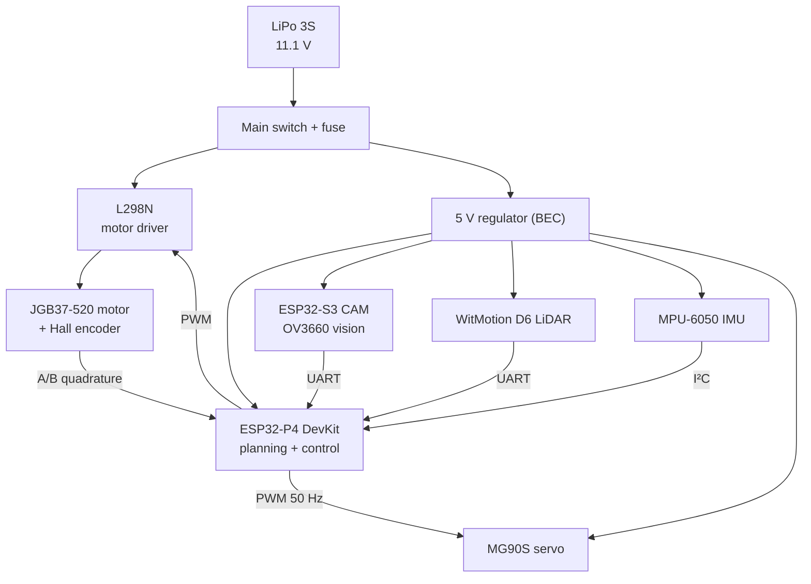

# Electronics

> **Owner:** Yeremmy, Electronics Engineer (collaborator) · back to the [README](../README.md)
>
> [!NOTE]
> This page is pre-filled with what the firmware already assumes about the electronics, so nothing is lost, and has clearly marked blanks for the explanation. Replace every `✍️` block with your own words, photos and the wiring diagram. The power and wiring sections are the ones judges look at first.

## 1. System overview

✍️ *Replace or complete the diagram with your real schematic (KiCad / Fritzing export) and a photo of the wiring.*

## 2. Components and what each one does

| Component | Role | Interface | Notes |
|---|---|---|---|
| ESP32-P4 DevKit (Waveshare) | Main computer: map, planning, control | — | Dual-core RISC-V 400 MHz, **no radio** (not needed: wireless is forbidden during a round) |
| ESP32-S3 CAM + OV3660 | Recognises red / green pillars | UART to the P4 | Colour only; the LiDAR gives distance |
| WitMotion D6 LiDAR | Distance to walls and pillars, 10 scans/s | UART | A scan takes 100 ms, so the firmware compensates the car's motion |
| MPU-6050 IMU | Heading (gyro) | I²C | Bias is measured with the car still before the round |
| JGB37-520 + Hall encoder | Rear drive and distance travelled | PWM + quadrature | 440 counts per wheel turn (11 pulses × 4 edges × 10:1) → 0.047 cm/count |
| L298N | Motor driver | PWM + direction | Limited to ~2 A; drops ~2 V (the motor controller MIC models it) |
| MG90S servo | Steering | PWM 50 Hz | 4.8–6 V; ~1.8–2.2 kg·cm; no published loaded-speed figure, being measured |
| LiPo 3S | Power | — | 11.1 V nominal, 12.6 V full |

## 3. Power

✍️ *Explain how the rails are separated (motor on battery voltage through the driver, logic and servo on the 5 V regulator), which regulator you chose and why, and how you prevent a motor start-up from resetting the computer (decoupling capacitors, separate rails, common ground).*

| Rail | Source | Loads | Peak current | ✍️ Measured |
|---|---|---|---|---|
| 11.1 V | LiPo | L298N / motor | ✍️ | ✍️ |
| 5 V | BEC | P4, S3, LiDAR, IMU, servo | ✍️ | ✍️ |

Items still open (from the project log): battery under-voltage cut-off and cell monitoring; confirming the 5 V regulator current under load; fuse rating.

## 4. Wiring and pin map

The firmware takes the pins from the project configuration (`idf.py menuconfig`, see `LIDAR System/p4_firmware/main/Kconfig.projbuild`). Fill in the real GPIOs once the harness is final and set them there.

| Signal | Kconfig option | GPIO |
|---|---|---|
| LiDAR RX (UART) | `WRO_LIDAR_RX_GPIO` | ✍️ |
| Motor driver IN1 / IN2 | `WRO_MOTOR_IN1_GPIO`, `WRO_MOTOR_IN2_GPIO` | ✍️ |
| Axle encoder A / B | `WRO_AXLE_ENCODER_A_GPIO`, `WRO_AXLE_ENCODER_B_GPIO` | ✍️ |
| Start button | `WRO_START_GPIO` | ✍️ |
| Steering servo | see `hw_steering.c` | ✍️ |

> [!WARNING]
> The drive motor is **locked off by default** until the Ackermann hardware is configured (`WRO_ACKERMANN_HW_CONFIGURED`). In open loop the full duty cycle of the 1000 rpm motor is about 270 cm/s, so use the motor controller (MIC) or recalibrate `WRO_MOTOR_MAX_CM_S` first. Details: [`ACKERMANN.md`](../ACKERMANN.md).

## 5. Motor control (MIC)

Instead of ramps and a PID, [`Motor Control/MIC`](../Motor%20Control/MIC/README.md) uses a physical model of the motor (back-EMF, friction, battery, driver drop), an observer that estimates the load from the encoder, and a planner that knows how hard the motor can accelerate and brake at each speed. The upper layers ask for a speed or an exact distance and MIC chooses the voltage. It has only been tested against a simulated motor; the calibration procedure for the real one is in [`CALIBRACION.md`](../Motor%20Control/MIC/CALIBRACION.md).

✍️ *Add the real motor data once measured (the project notes list 600 rpm in one place and 1000 rpm in another: please read it off the motor label).*

## 6. Bring-up checklist

- [ ] Power on **without** the motor connected; check the 5 V rail and the serial monitor boot log.
- [ ] LiDAR: stable 10 scans per second.
- [ ] IMU: yaw does not drift noticeably when still.
- [ ] Encoder: counts increase when the wheel turns forward (check the direction).
- [ ] Servo: centred at 0°, symmetric travel, no buzzing at the limits.
- [ ] Only then connect the drive motor, with the wheels off the ground.

✍️ *Tick the boxes and add what went wrong and how you fixed it (the engineering log is part of the score).*

## 7. Measurements the software team needs from you

* [ ] Motor **no-load rpm** and **stall current**; battery internal resistance (for `WRO_MIC_*` and the motor model).
* [ ] Real supply voltage under load (for `WRO_BATT_MV`, `WRO_MOTOR_DROP_MV`).
* [ ] Encoder counts per wheel turn with a marked wheel (for `odom.wheel_diameter_cm` and the counts-per-revolution option).
* [ ] Latency of each sensor (LiDAR scan, camera frame) if you can capture it with a logic analyser.
