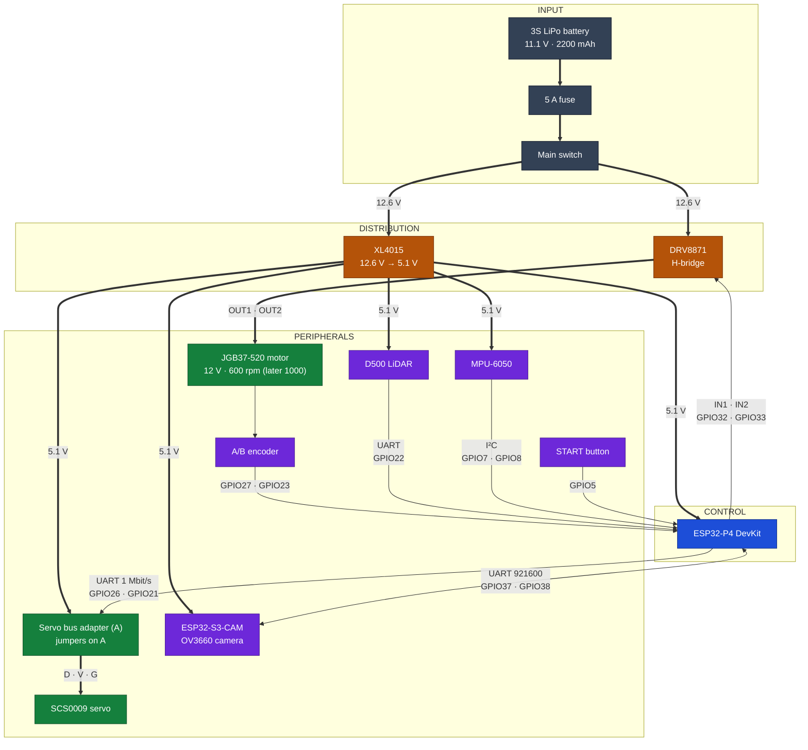
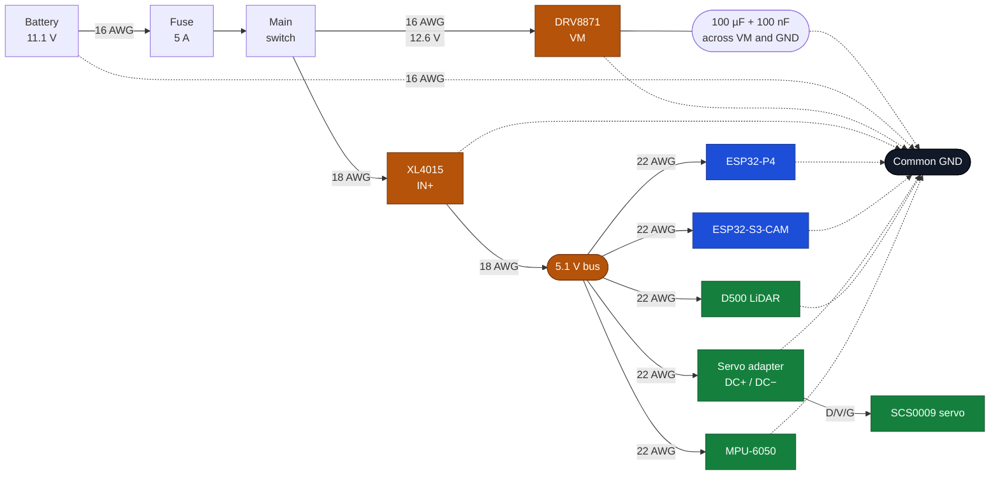
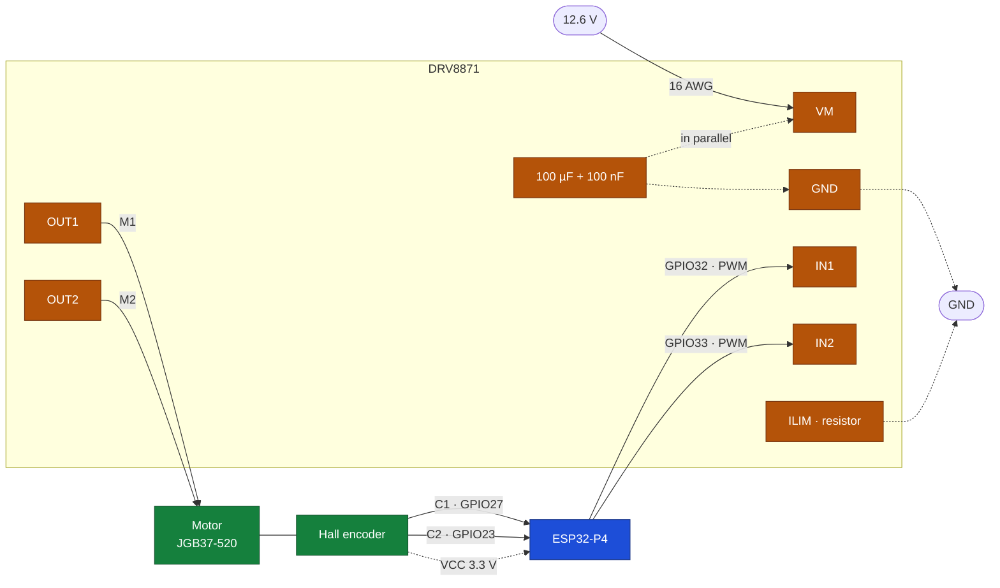
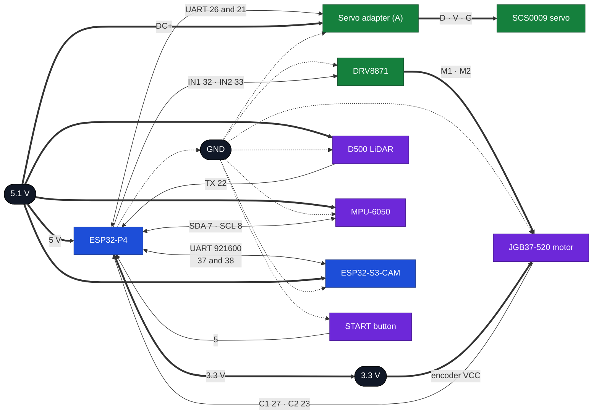

# AutoNex electronics

This document describes the vehicle's electrical installation: the selected components, the
power distribution, the signal wiring and the bring-up procedure. Its purpose is that any
team member can identify a conductor, know what it does and anticipate the consequences of
disconnecting it.

The selection criteria come from datasheets and from the category rulebook, not from sales
listings, which mix variants and change without notice. Each block was tested on its own
before being connected to the next, and the available measurements are stated in the text.
Anything not yet measured appears as an open item in the last section.

---

## Components

**3S LiPo battery.** Single power source. Three cells in series: 11.1 V nominal, 12.6 V fully
charged, 2200 mAh and 50C discharge (24.42 Wh). The installed unit is a HOOVO weighing 174 g
and measuring 104 × 34.5 × 24.5 mm. The battery connector is EC3 and the car uses XT60H; a
short EC3↔XT60H lead joins the two. The positive terminal is identified in red. The safety
cut-off is set at 9.9 V (3.3 V per cell); below that value the battery degrades.

**XL4015 converter.** Steps the 12.6 V battery voltage down to 5.1 V for the boards, the LiDAR
and the servo. It is a non-isolated 5 A buck converter, so input and output share ground;
hence the single GND point rule for the whole build. The output is set to 5.1 V rather than
5.0 V to compensate for conductor drop. It is never taken above 5.5 V, the point at which the
electronics become exposed.

**DRV8871.** Motor H-bridge. It switches battery voltage according to the logic commands and
provides forward, reverse and braking. It is a single-channel MOSFET bridge, rated 6.5 to
45 V, 2 A continuous, 3.6 A peak, with a 0.3 to 0.5 V drop; the L298N used previously left
1.8 to 3 V. The lower drop translates into more torque and speed from the same battery, and
less heat inside the chassis. The Shutao module is used, sold in packs of two: one is
installed and the other kept as a spare. It measures approximately 20 × 15 mm and includes
terminal blocks for `VM`/`GND` and for the motor, a header with `IN1`/`IN2`, a filter
electrolytic and the `ILIM` resistor that sets the current limit.

**JGB37-520 motor.** 12 V geared motor with a built-in quadrature Hall encoder. The installed
unit is 600 rpm; the final one will be 1000 rpm. The gear ratio is 10:1 and the encoder
delivers 11 pulses per channel per motor revolution, giving 440 counts per revolution at the
output shaft. It sits on the rear axle, with both wheels mechanically joined.

**SCS0009 servo.** Steering actuator. It is a bus servo: the position is sent over a serial
protocol and the servo replies with its status. It operates from 4 to 7.4 V, with 2.3 kg·cm
stall torque at 6 V, 300° of travel in 1024 steps and metal gears. It draws 150 mA idle and up
to 1 A with the shaft stalled. A single data wire carries both the command and the reply, so
the bus is half-duplex. It connects through the servo bus adapter, which separates TX and RX,
brings the reply down to 3.3 V and distributes power from the 5.1 V bus.

**Servo bus adapter (253 ST/SC).** Waveshare board between the P4 and the SCS0009. It supports
up to 253 ST/SC servos, has two `D/V/G` ports, a 3.3 V UART header and jumpers to select UART
or USB. It is powered from the 5.1 V bus and the servo plugs directly into one of its ports.

**MPU-6050.** GY-521 module with a six-axis accelerometer and gyroscope over I²C. The quantity
of interest is the angular rate on the Z axis. It includes a 3.3 V regulator and pull-up
resistors, so it can be powered from 5 V without compromising the bus. With `AD0` tied to
ground it responds at address 0x68. The auxiliary `XDA` and `XCL` pins are not used.

**D500 LiDAR.** 360° time-of-flight laser scanner. 12 m range, 10 revolutions per second and
roughly 5000 points per second over UART at 230400 baud. It draws about 290 mA at 5 V and uses
a four-pin ZH1.5 connector. It is the source of the environment map, so it is mounted high on
the vehicle, clear of anything that would interrupt the sweep.

**ESP32-P4.** Control board. 32 MB of PSRAM, two RISC-V cores and 27 usable GPIOs across two
20-pin rows. It is powered at 5 V through the header and has two USB-C ports: one for data and
one for console, with a CH343P chip.

**ESP32-S3-CAM.** Vision board. ESP32-S3-WROOM N16R8 module with 8 MB of PSRAM, 16 MB of flash,
dual LX7 core and a soldered 2 MP OV3660 camera. It was chosen because the camera is
integrated and the PSRAM is sufficient for the frames, with no need for a third board.
Electrically: it hangs off the 5.1 V bus, draws about 180 mA with the camera active and up to
300 mA at start-up, and talks to the P4 over UART at 921600 baud. Wi-Fi and Bluetooth stay off
during the runs, as the rulebook requires, which also removes the radio current spike.

The camera is not mounted on the board. The v2 CAD reserves the nose for the module and leaves
the rear for the electronics, so the two are separated with a **24-pin, 0.5 mm FPC
extension**, male-to-female, about 20 cm long. It must be the same type as the original flex:
24 contacts, 0.5 mm pitch and contacts on the same side. The flex from a Raspberry Pi Zero
Camera is not compatible: it has 22 pins and uses MIPI CSI-2, whereas the S3-CAM works with
eight-bit parallel DVP. The length is kept short because at 20 MHz a long flex acts as an
antenna and shifted pixels appear; if that happens, the camera clock is reduced rather than
extending the cable.

**Protection.** Main switch, start button and fuse. All three are build requirements: the
switch turns the vehicle on, the button gives the start and the fuse limits current in the
event of a battery short.

---

## The complete system

The figure below brings together the power distribution and the vehicle signals. Thick arrows
are power and thin arrows are signal.

---

## How the car is powered

The battery enters through the XT60H (EC3 on the battery, with a lead), passes through the fuse
and continues through the main switch. From there two branches leave: one straight to the
DRV8871 for the motor and one to the XL4015 for the 5 V rail.

The fuse is 5 A. The calculation starts from two figures: the final motor draws 2.5 A in the
worst case according to the catalogue and the electronics sit around 1 A, so the combined peak
lands near 3.5 A. A 5 A fuse leaves margin for start-up and still acts quickly on a short
circuit. The 600 rpm unit is still to be measured, but it does not change the choice.

The expected consumption on the 5 V rail is summarised in the table below:

| Load | Typical | Peak |
|---|---|---|
| ESP32-P4 | 350 mA | 550 mA |
| ESP32-S3-CAM | 180 mA | 300 mA |
| LiDAR | 290 mA | 320 mA |
| Servo | 150 mA | 1000 mA |
| Servo adapter (logic) | 20 mA | 30 mA |
| IMU | 4 mA | 4 mA |
| **Total** | **≈ 1.0 A** | **≈ 2.2 A** |

The XL4015 is rated 5 A, although without a heatsink it is limited to 2.5 A; the calculated
consumption stays below that value. With the motor included, the battery delivers a peak of
about 3.5 A at most, far below the 110 A a 2200 mAh 50C pack can supply.

Three build conditions follow from the above. The DRV8871 delivers no 5 V and has no
regulator, so all the logic is powered from the XL4015 and there is no risk of back-feeding the
boards from the bridge. The servo adapter requires its own pair of conductors and its own
capacitor, because the servo inrush current can cause a dip that resets the board. Finally,
all the returns meet at a single point: a floating ground between the motor and the signals
introduces errors in the data.

---

## Motor and steering

The motor uses the DRV8871's only channel. Commands are applied through `IN1` and `IN2`: PWM
on one input and zero on the other to move forward, and the reverse for backward. There is no
enable pin and no `ENA` jumper; the bridge stays active as long as `VM` is powered. Since the
pins are still `GPIO32` and `GPIO33`, the firmware needs no changes.

On cloned modules the header order may not match the manufacturer's. Before connecting, read
the silkscreen and verify with the multimeter that the power terminal block corresponds to
`VM` and `GND`.

The installed unit is 600 rpm and is used for testing; the final one will be 1000 rpm. The
wiring does not change, because the gearbox and encoder are the same, but the top speed and
odometry do: the 440 counts per revolution are kept and the relationship between duty cycle
and speed changes, and it must be measured again when the motor is replaced. The difference
between the two units is a factor of 1.67.

| IN1 | IN2 | Function |
|---|---|---|
| PWM | 0 | Forward; speed follows the duty cycle |
| 0 | PWM | Reverse |
| 0 | 0 | Motor coasts |
| 1 | 1 | Hard braking; not used to stop the car |

Between `VM` and `GND` a 100 µF electrolytic and a 100 nF ceramic are installed, as close as
possible to the power terminal block. The module already includes an electrolytic, but the
conductors up to the switch are long and the motor's inductive spikes travel along them. The
ceramic filters the fast transients and the electrolytic the slow ones. Without this pair, the
motor spike reaches the 12.6 V rail and gets to the XL4015.

The `ILIM` resistor is soldered on the module. At 30 kΩ the bridge limits current to about 2 A,
below the motor's 2.5 A stall current, which protects both the winding and the bridge. The
limit is inversely proportional to the resistance: if the consumption measurement leaves
margin, it is replaced with 47 kΩ to bring it down to about 1.3 A. The change is made with the
vehicle switched off and the value is recorded in this document.

### The motor connector

The motor has a six-pin connector on the rear cap, with the order silkscreened on the board
itself:

| Pin | Silkscreen | Signal | Goes to |
|---|---|---|---|
| 1 | `M1` | Motor + | DRV8871 `OUT1` |
| 2 | `GND` | Encoder ground | Common GND |
| 3 | `C1` | Channel A | GPIO27 |
| 4 | `C2` | Channel B | GPIO23 |
| 5 | `VCC` | Encoder supply | 3.3 V |
| 6 | `M2` | Motor − | DRV8871 `OUT2` |

The seller provides a differently numbered diagram, with the labels `MOTOR+`, `MOTOR−`,
`HALL GND`, `HALL Vcc`, `HALL A` and `HALL B` in that order. It does not match the silkscreen,
so the drawing's numbering must not be used. Before connecting, it is checked with the
multimeter: `M1` and `M2` are the only pair with low resistance, a few ohms, because they
correspond to the motor winding; the rest are signals.

The encoder channels carry 4.7 kΩ resistors to 3.3 V. The sensor output is open collector and
without the resistors the counts arrive incomplete.

### The steering servo

The SCS0009 is not driven with pulses like a conventional servo. It is a bus servo: it receives
packets over one wire and answers on the same wire, half-duplex. To connect it to the P4, the
Waveshare servo bus adapter (A) is used (SKU 25514), which bridges that single wire and the
microcontroller UART, brings the reply down to 3.3 V on the board side and distributes the
servo power. The servo includes a small TTL board that is not used in the car; it is kept as a
spare for testing the servo on its own with a USB-TTL adapter.

The adapter is a 42 × 33 mm board with two identical servo ports, a three-pin UART header, a
`DC+`/`DC−` terminal block, a DC5521 jack and a USB-C port. Both jumpers go in row `A`, which
connects the bus driver to the UART header; row `B` connects it to the USB CH343P. In position
`A` the adapter needs no PC.

The servo connector has three pins and a key, but it can be forced in backwards. The adapter
port is silkscreened `D V G`; before plugging in, check that black sits on `G`, red on `V` and
white on `D`:

| Servo pin | Colour | Signal | Goes to |
|---|---|---|---|
| 1 | black | GND | adapter port `G` |
| 2 | red | VCC | adapter port `V`, which delivers the 5.1 V bus |
| 3 | white | DATA | adapter port `D` |

The adapter has two identical ports in parallel. One is used and the other is left free to
chain a second servo with another ID. The adapter wiring is as follows:

| Connection | Goes to | Cable |
|---|---|---|
| `DC+` | 5.1 V bus | 22 AWG |
| `DC−` | Common GND | 22 AWG |
| `TX` | P4 `GPIO26`, TX | 22 AWG |
| `RX` | P4 `GPIO21`, RX | 22 AWG |
| UART header `GND` | Common GND | 22 AWG |
| Port `D`, `V`, `G` | servo | servo cable |

On the board the header reads `TX`, `RX`, `GND` from left to right, with `GND` next to the
corner screw.

The adapter's naming must be respected: its `TX` is the input through which the P4 transmits
and its `RX` is the output through which the P4 receives, so they go by the same name and are
not crossed. Waveshare states this explicitly in its documentation: RX to RX and TX to TX. If
they are crossed, the servo does not respond.

The UART header is 3.3 V. Both buffers on the adapter are powered from the board's own
AMS1117-3.3, so the servo reply never reaches 5 V on `GPIO21`. No divider or level shifter is
needed. The P4 `TX` at 3.3 V enters without trouble, because the servo datasheet accepts 2 to
5 V on its input. The header has no power pin: no 3.3 V is taken from the P4 to the adapter.
Its logic comes from `DC+` and the only conductor it shares with the board is GND.

The adapter does not regulate the servo voltage: the port `V` pin delivers the same voltage
that enters through `DC+`. That is why it is powered from the 5.1 V bus, within the SCS0009's
4 to 7.4 V range. The silkscreen reads `DC 9~12.6V` because the board is intended for ST
servos, which run at 12 V; for SC servos the useful range is 5 to 8.4 V and 5.1 V is valid.
The logic is powered separately, from an internal regulator that steps the input down to 5 V
and then to 3.3 V; with 5.1 V at the input the 5 V regulator has no headroom to regulate and
the voltage passes almost unchanged, so during bring-up the 3.3 V are verified before
connecting the servo. If it does not start, the fix is to power only the adapter from a 6 V
branch, not to raise the whole bus.

The input includes a polarity protection MOSFET and a TVS, so a reversed cable does not damage
the board. The terminal block is used rather than the jack, because the terminal block does not
work loose under vibration; the conductors are fitted with ferrules. The 470 µF capacitor is
installed between `DC+` and `DC−`, next to the terminal block, and absorbs the servo inrush
before it reaches the 5.1 V bus.

The adapter does more than adapt the connector. It contains two buffers and a transistor that
detect when the P4 is transmitting: when the TX line is idle, the transmit buffer goes high
impedance and a resistor holds the wire high, so the servo can reply; when the P4 starts
transmitting, the transistor enables the buffer, which pulls the wire low. The receive buffer
is disabled while the line is low so the adapter does not hear itself. This lets the P4 use a
conventional UART, with separate TX and RX, even though the servo talks over a single wire.

The direct wiring tested earlier, with a 1 kΩ resistor on TX and a divider on the receive
side, is ruled out for the final installation: the adapter performs both functions and also
distributes power. The resistor remains useful only for testing the servo on its own with a
supply and a USB-TTL adapter, never inside the car.

The values to be respected are: 4 to 7.4 V supply, 2.3 kg·cm stall torque at 6 V, 0.7 kg·cm
rated torque, 300° in 1024 steps (0.293° per step), 0.1 s per 60° at 6 V, 150 mA idle and 1 A
stall. It ships with address 1 at 1 Mbit/s; if the speed is changed it must be done carefully,
because a wrong write leaves the servo unresponsive and requires recovery with the
manufacturer's tool.

Being a bus servo, it returns its actual position. This makes it possible to know the wheel
angle without relying on a manual pulse count, which was the weakest point of the previous
servo.

---

## Connection map

The diagram below brings together the signals and the two lines that run through every module.
Thick arrows are power, thin arrows are signal and dotted arrows are ground.

### Power and ground

Every module needs its positive and its negative, and these do not appear in the signal
tables. The complete list, including those at 3.3 V, is as follows:

| Module | Pin | Goes to | Cable |
|---|---|---|---|
| Battery | EC3→XT60H `+` | 5 A fuse | 16 AWG |
| Battery | EC3→XT60H `-` | Common GND | 16 AWG |
| XL4015 | `IN+` | Main switch, 12.6 V | 18 AWG |
| XL4015 | `IN−` | Common GND | 18 AWG |
| XL4015 | `OUT+` | 5.1 V bus | 18 AWG |
| XL4015 | `OUT−` | Common GND | 18 AWG |
| ESP32-P4 | `5V` | 5.1 V bus | 22 AWG |
| ESP32-P4 | `GND` | Common GND | 22 AWG |
| ESP32-P4 | `3V3` | Encoder `VCC` and pull-ups | 22 AWG |
| ESP32-S3-CAM | `5V` | 5.1 V bus | 22 AWG |
| ESP32-S3-CAM | `GND` | Common GND | 22 AWG |
| DRV8871 | `VM` | Fuse and switch, 12.6 V | 16 AWG |
| DRV8871 | `GND` | Common GND | 16 AWG |
| DRV8871 | `VM` and `GND` | 100 µF + 100 nF capacitor, in parallel | short |
| Motor | `VCC` | P4 `3V3` | 22 AWG |
| Motor | `GND` | Common GND | 22 AWG |
| Servo adapter | `DC+` | 5.1 V bus | 22 AWG |
| Servo adapter | `DC−` | Common GND | 22 AWG |
| Servo adapter | UART header `GND` | Common GND | 22 AWG |
| Servo | `V`, red | Adapter port `V` | servo cable |
| Servo | `G`, black | Adapter port `G` | servo cable |
| LiDAR | `P5V` | 5.1 V bus | 22 AWG |
| LiDAR | `GND` | Common GND | 22 AWG |
| IMU | `VCC` | 5.1 V bus | 22 AWG |
| IMU | `GND` | Common GND | 22 AWG |
| IMU | `AD0` | GND, to fix the address at 0x68 | 22 AWG |
| Button | Terminal 2 | Common GND | 22 AWG |

### Signals

| Module | Pin | Goes to | Cable |
|---|---|---|---|
| DRV8871 | `IN1` | P4 `GPIO32` | 22 AWG |
| DRV8871 | `IN2` | P4 `GPIO33` | 22 AWG |
| DRV8871 | `OUT1` | Motor `M1` | 16 AWG |
| DRV8871 | `OUT2` | Motor `M2` | 16 AWG |
| DRV8871 | `ILIM` | Resistor to GND, already soldered on the module | — |
| Motor | `C1` | P4 `GPIO27` | 22 AWG |
| Motor | `C2` | P4 `GPIO23` | 22 AWG |
| Motor | `C1` and `C2` | 4.7 kΩ pull-ups to 3.3 V | 22 AWG |
| Servo adapter | `TX` | P4 `GPIO26`, TX | 22 AWG |
| Servo adapter | `RX` | P4 `GPIO21`, RX | 22 AWG |
| Servo | `D`, white | Adapter port `D` | servo cable |
| LiDAR | `TX` | P4 `GPIO22` | 22 AWG |
| LiDAR | `PWM` | GND, not to the P4 | 22 AWG |
| IMU | `SDA` | P4 `GPIO7` | 22 AWG |
| IMU | `SCL` | P4 `GPIO8` | 22 AWG |
| S3-CAM | `GPIO1`, TX | P4 `GPIO38` | 22 AWG |
| S3-CAM | `GPIO14`, RX | P4 `GPIO37`, only if the return link is used | 22 AWG |
| Camera | 24-pin FPC | Camera module in the nose | 24-pin × 0.5 mm FPC extension |
| Button | Terminal 1 | P4 `GPIO5` | 22 AWG |

### Unused pins

| Module | Pins | Reason |
|---|---|---|
| DRV8871 | None | It is single-channel and has no unused pins left |
| IMU | `INT` | No function on the car uses it |
| IMU | `XDA`, `XCL` | They are the module's auxiliary I²C gateway and are not needed |
| S3-CAM | microSD and RGB LED | Not used on the car; the card occupies `GPIO38` to `GPIO40` and the LED `GPIO48` |
| Servo adapter | USB-C and DC5521 jack | USB is for configuring it from a PC and the jack duplicates the terminal block; power enters through the terminal block |
| Servo adapter | Second `D/V/G` port | Left free for a second servo with another ID |

### Connections that need attention

**LiDAR.** The D500 receives no commands: it delivers the sweep and nothing else, so its link
is a single signal. The four-pin connector is `P5V`, `GND`, `TX` and `PWM`, and of those four
only `TX` goes to the P4 (`GPIO22`). `PWM` is not a microcontroller signal: it is taken to GND
so the sensor spins at 10 Hz on its own. If it is left floating, the internal motor does not
turn and no data arrives. Power is separate, from the 5.1 V bus, with its own pair of
conductors.

**IMU.** It carries four conductors, not two: `VCC` and `GND` for power, `SDA` and `SCL` for
data. `AD0` is tied to GND so it responds at 0x68; if left floating, the address is
indeterminate. The `INT` interrupt is not connected, which is why the P4 `GPIO6` is left free.

**P4–S3 link.** On the S3-CAM the link pins are on the other side of the header. The camera
occupies `GPIO4` to `GPIO13` and `GPIO15` to `GPIO18`, and the microSD takes `GPIO38` to
`GPIO40`, so the link uses `GPIO1` to transmit and `GPIO14` to receive, two of the few that
remain free. `GPIO2` is also free, but it has a board LED connected and its blinking could be
mistaken for link activity. On the P4 side the link enters through `GPIO38` and leaves through
`GPIO37`; both run twisted with their GND.

**Servo.** The SCS0009 is not connected directly to the P4. It talks over a single wire and
the P4 has a UART with separate TX and RX; the Waveshare adapter performs that conversion and
brings the reply down to 3.3 V. That is why `GPIO26` goes to the adapter `TX` and `GPIO21` to
`RX`, with the same name and without crossing them. Power does not come from the P4 either: it
enters through `DC+` from the 5.1 V bus and leaves through the `V` pin of the `D/V/G` port.

### Reserved P4 pins

Some pins are not used even though they look free, because on this board they already have an
assigned function. `GPIO24` and `GPIO25` are USB OTG and JTAG over USB: using them prevents
flashing and reading the registers. `GPIO7` and `GPIO8` are the board's own I²C bus, where the
audio codec and the touch controller hang; they are used for the IMU because the MPU-6050
responds at 0x68 and does not collide with the codec's 0x18 or the touch controller's 0x5D.

The board also has audio on `GPIO9` to `GPIO13`, microSD on `GPIO39` to `GPIO44`, Ethernet on
`GPIO28` to `GPIO31` and `GPIO49` to `GPIO52`, the audio amplifier on `GPIO53`, the Wi-Fi chip
reset on `GPIO54` and the indicator LED on `GPIO45`.

`GPIO0`, `GPIO34`, `GPIO35` and `GPIO36` are boot configuration pins. `GPIO37` and `GPIO38` are
too and also go to the console CH343P, but they are used for the link to the S3-CAM: normal
boot only checks `GPIO35`, which has its own pull-up and is left alone, and the console USB is
disconnected during the runs.

With all of the above, the pins left free are `GPIO2`, `GPIO3`, `GPIO4`, `GPIO6`, `GPIO20`,
`GPIO46`, `GPIO47` and `GPIO48`. The first three are the board's JTAG pins, which are not used
because debugging is done over USB, so they remain as normal GPIO. `GPIO20` also has an ADC,
needed for the divider that will monitor the battery. `GPIO0` and `GPIO1` are not considered
free: the board shares them with the 32 kHz crystal and a resistor would have to be removed to
use them without interference.

### How each cable runs

| From | To | Gauge |
|---|---|---|
| Battery + | Fuse, switch and DRV8871 `VM` | 16 AWG |
| Battery − | Common GND point | 16 AWG |
| DRV8871 `OUT1` and `OUT2` | Motor `M1` and `M2` | 16 AWG |
| XL4015 `OUT+` | 5.1 V bus | 18 AWG |
| 5.1 V bus | Both boards and the LiDAR | 22 AWG |
| 5.1 V bus | Servo adapter, with its own pair from the distribution point | 22 AWG |
| Signals and encoder | Board | 22 AWG |
| 3.3 V source | Encoder `VCC` and pull-ups | 22 AWG |
| Servo adapter | Servo | servo cable, short |
| UART link to the S3-CAM | Board | 22 AWG, short and twisted with GND |

The LiDAR `PWM` pin goes to GND: if it is left floating, the internal motor does not turn and
there is no data. The power connectors are XT60H and terminal blocks; Dupont connectors are
kept for signals only.

The link between the two boards runs short, twisted with its own GND and away from the motor
conductors. At 921600 baud the cable behaves as a transmission line, and a long loop next to
the motor introduces hard-to-find errors, because the symptom is a detection table that
arrives incomplete.

---

## Bring-up

No block is connected without completing this sequence, which is repeated every time a cable
is modified.

1. With no battery, check with the multimeter that the 12 V positive has no continuity to GND,
   and the same for the 5 V one.
2. Power the XL4015 alone from a 12 V bench supply and set the output to 5.1 V with no load.
   Repeat with a 10 Ω resistor connected and adjust again.
3. Connect the 5 V bus and measure again at the board pin.
4. Power the board alone and confirm that it boots.
5. Connect the LiDAR and verify that it spins and delivers data.
6. Connect the IMU and check that it responds over I²C at address 0x68.
7. Power the S3-CAM and check the 921600 link: that the table arrives complete and that there
   are no truncated frames or framing errors.
8. Turn the motor shaft by hand and verify that the encoder counts in both directions.
9. Before connecting the servo, check that both adapter jumpers are in row `A`, measure 5.1 V
   between `DC+` and `DC−` and 5.1 V between `V` and `G` on the servo port. The adapter `PWR`
   LED must light, which indicates that the internal regulator is delivering the 3.3 V. Only
   then is the servo connected and moved with the wheels off the ground, first a few degrees,
   checking that it responds and returns a consistent position. If the LED does not light with
   5.1 V at the input, do not continue: move the adapter to a 6 V branch.
10. Before connecting the motor, measure 12.6 V between `VM` and `GND` with the switch closed
    and check that the capacitor is installed with the correct polarity. Then connect the
    motor, also off the ground, and move it at 10 % PWM.

If something fails, the last element added is disconnected and the previous step is repeated.
This way the fault appears where it is and not in any of the car's twenty conductors.

---

## Design decisions

**Driver.** The two IRF520 modules were ruled out from the start: the IRF520 is a single
direction MOSFET, it connects the load to ground and cannot reverse polarity, so two of them do
not form an H-bridge. The L298N did provide forward and reverse, and it was the driver fitted
first. The switch to the DRV8871 is justified by three datasheet figures: the drop falls from
1.8–3 V to 0.3–0.5 V, dissipation is far lower inside a closed chassis and the module takes up
a fifth of the space. Its logic is also 3.3 V, which removes the 5 V supply from the bridge.
The trade-off is that its 2 A continuous are dissipated in a 20 × 15 mm package with no
heatsink, whereas the L298N delivered them with its aluminium block; the DRV8871 temperature
depends on the copper it is mounted on. The motor draws considerably less while running and
the 3.6 A peak covers start-up. The decision remains conditional on the actual current
measurement, which is still pending.

**Start-up.** The rulebook requires a switch to turn on and a button to give the start, and
forbids any wireless communication, including the Wi-Fi the board ships with. That rules out
starting from the phone and also the board button, which is additionally a configuration pin
and can leave the car in download mode if pressed at the wrong moment. The solution is an
external button between `GPIO5` and GND, with the internal pull-up.

**Servo and adapter.** The move from the pulse servo to the SCS0009 has two reasons. Its gears
are metal and its torque is similar with less wear, which matters in a mechanism that turns
thousands of times. It also returns its actual position, so knowing the wheel angle does not
depend on a manual pulse count. The trade-off is that it must be treated as a serial bus and
not as a PWM output. For that the Waveshare adapter was chosen over the included small board:
the adapter contains the half-duplex driver, the 3.3 V levels, the power terminal block with
polarity protection and two servo ports, so the wiring reduces to two power conductors and
three signal ones with nothing soldered in mid-air. The included board is kept as a spare for
testing the servo on its own. The jumpers go in `A` because the P4 uses UART; position `B` is
for configuring the servo from a PC over USB.

**IMU.** The GY-521 with MPU-6050 is the best documented module for this function, it is sold
in packs of three and its library is widely available. It is enough to measure the Z-axis
angular rate, and the on-board regulator and pull-ups simplify the wiring.

**Boards.** The P4 has no camera; the S3-CAM does, with the lens soldered on and enough PSRAM
for the frames. That is why the car carries two: the P4 concentrates the sensors and control,
and the S3-CAM the camera and the serial link. Each has its own 3.3 V regulator, so noise from
one does not pass to the other through the supply, and between them there is only a serial link
with shared GND.

**LiDAR.** The D500 was chosen. Compared with alternatives in the same range, it works by time
of flight rather than triangulation, which lets it operate under bright ambient light and
detect dark objects. The trade-off is that its protocol must be followed to the letter, but
the sensor is clearly better suited to a track with coloured walls and pillars.

**Connectors.** The battery comes with EC3 and the car uses XT60H. A short EC3↔XT60H lead
solves the joint without modifying the LiPo cables. Dupont connectors are kept for signals
only, never for power.

---

## Open items

**Electrical measurements.** The actual motor current with the complete car is still to be
measured. The 2.5 A stall figure comes from the 1000 rpm motor catalogue and not from our own
measurement; the 600 rpm unit may give another value. That measurement determines whether the
DRV8871 `ILIM` limit stays at 2 A or drops to about 1.3 A, and confirms that the bridge does
not overheat.

**Servo.** Test the link at 1 Mbit/s with the adapter and the real cable, and confirm that the
conductor length introduces no errors, because the bus is half-duplex and sensitive to wire
capacitance. The test is done with the servo mounted, not with the short bench cable. With the
oscilloscope, check the adapter `RX`, which is the signal reaching `GPIO21`: it must stay
between 0 and 3.3 V. The buffers are powered from the internal 3.3 V, so the signal should be
in that range; if a 5 V peak appears, do not connect `GPIO21` and inspect the board before
continuing. Torque at 5.1 V with the steering assembled also remains to be measured. If it is
not enough to turn the wheels with the car stopped, only the adapter supply is moved to a 6 V
branch, keeping the rest at 5.1 V. It must also be confirmed that the internal regulator starts
with 5.1 V at the input, which the `PWR` LED indicates.

**Battery and build.** Install the voltage divider on `GPIO20`, which has an ADC, to monitor the
battery during the run. Fix the final position of the switch and the button so the judge can
operate them without taking the vehicle apart.

**Motor change.** Replace the 600 rpm unit with the 1000 rpm one and measure speed, current and
odometry again. The encoder and the wiring do not change, but the relationship between duty
cycle and speed does, and it must be characterised again.

**Camera.** Confirm the model when the board arrives: the supplier states OV3660 and the photo
shows an OV2640 silkscreened on it. The actual revision is checked on the module and recorded
in this document. Power and link do not change, but the model determines the sensor
configuration.

**Final test.** With the car closed, a three-minute continuous test will be run with everything
powered, which is the length of a run, recording the final current and temperature values.
